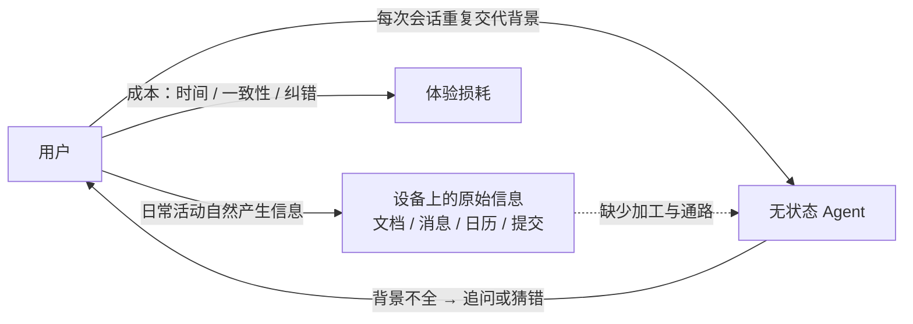
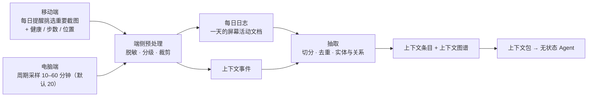
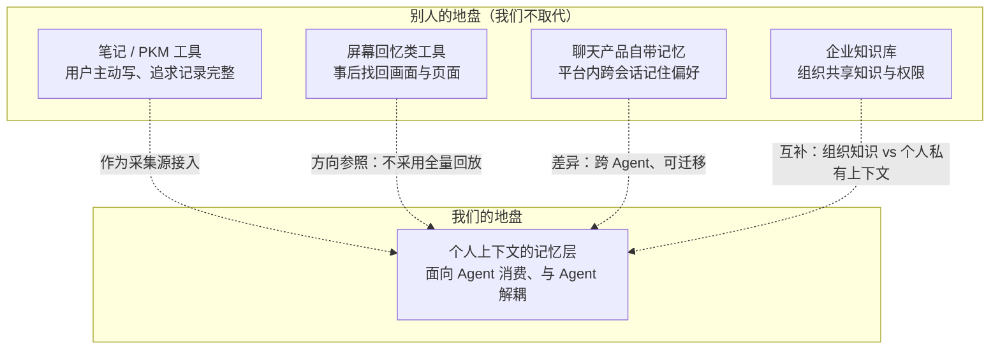

# 00 · 愿景与问题定义

> 状态：设想稿 v0.1 · 最后更新：2026-11-03

一句话摘要：为「无状态 Agent」补上一层个人上下文的记忆层，让它在用户没有专门提示的情况下也能取到任务相关的背景；采集路径以「屏幕截图 + 每日日志」为主假设，待验证。

本文只回答"要解决什么问题、给谁用、什么算成功、哪些边界我们不碰"，不回答实现方式；实现见 [01-architecture.md](01-architecture.md)，采集与检索细节见 [02-capture-clients.md](02-capture-clients.md) 与 [04-storage-retrieval.md](04-storage-retrieval.md)。

---

## 1. 背景与问题

### 1.1 问题现象

今天的 Agent（无论是通用助手还是编码/办公类 Agent）大多是**无状态**的：每次会话开始时，它对"用户是谁、正在做什么项目、昨天决定了什么、和谁在协作"一无所知。用户于是被迫反复做同一件事——**把背景重新交代一遍**：

- 「这是一个内部工具，用任务号做索引，别问我要不要加测试。」
- 「上周我们讨论过这个方案，选的是本地优先，理由写在某个文档里。」
- 「这个同事是合作方，邮件语气要正式一点。」
- 「我下午三点有个会，帮我看下要准备什么。」

这些背景在用户的电脑和手机里其实**已经存在**（文档、聊天、日历、浏览器标签、提交记录、剪贴板），但没有任何一层把它整理成 Agent 可以直接消费的形态。结果是：

| 成本 | 表现 |
|---|---|
| 重复叙述成本 | 每开一个新会话、每换一个 Agent，背景要从头讲一遍 |
| 一致性成本 | 同一背景在不同会话里说法不同，Agent 结论随之漂移 |
| 纠错成本 | 用户说漏了关键约束，Agent 做出看似合理但错误的动作 |
| 迁移成本 | 换一个 Agent 产品，之前积累的"它对我的了解"全部清零 |

### 1.2 为什么现在值得做

三点变化让"个人上下文记忆层"从想法变成可做的工程问题：

1. **采集面已经铺开**：桌面与移动端都有系统级的活动、日历、剪贴板、文件接口可用；屏幕截图更是"不依赖各应用单独适配"的通用入口（代价是隐私风险最高，见第 4.1 节）。无感知采集不再需要自建硬件。
2. **Agent 侧出现了标准接入点**：MCP / Skill 这类接入方式让"一次建设、多 Agent 复用"成为可能，记忆层不必绑定某一个 Agent 产品。具体协议能力以公开资料为准（**待核实**）。
3. **模型侧具备了"上下文装配"能力**：抽取实体、判断相关性、按预算裁剪，都可以由模型承担一部分，人工规则不必覆盖全部情况。

### 1.3 现有替代方案的缺口

- 手动写笔记/系统提示词：**可维护性差**，靠用户自觉，且不随现实变化。
- 依赖聊天产品自带记忆：**被单一平台锁定**，跨 Agent 不可用。
- 依赖企业知识库：**解决的是组织知识**，不是个人私有上下文，也无法覆盖生活场景。

结论：缺的不是"再做一个记录工具"，而是**面向 Agent 消费而设计的个人上下文记忆层**——一个把**上下文事件**加工成**上下文条目**与**上下文图谱**、并能被任意**无状态 Agent** 消费的独立层。

### 1.4 问题是怎么产生的

图中的虚线就是本平台要补上的那一段：把设备上已存在的信息，加工成 Agent 能直接消费的形态。**这条通路具体"从哪采"目前有一个主假设（屏幕截图 + 每日日志），见第 4.1 节。**

---

## 2. 目标 / 非目标

### 2.1 目标

| 编号 | 目标 | 说明 |
|---|---|---|
| G1 | 无感知采集 | 电脑客户端与移动 App 在用户不额外操作的前提下采集上下文事件 |
| G2 | 可检索的记忆层 | 把原始事件加工为可检索、可引用、带来源与时间的**上下文条目** |
| G3 | 免提示注入 | 让任意**无状态 Agent** 在用户未专门提示的情况下拿到任务相关的**上下文包** |
| G4 | 标准接入 | Agent 侧只需配置 MCP 或 Skill 即可接入，不改 Agent 内部实现 |
| G5 | 用户可控 | 用户能看见、纠正、暂停、导出、删除自己的数据；授权可撤销 |
| G6 | 跨设备一致 | 桌面与移动采集的数据在云端汇合，任意设备上的 Agent 拿到同一份记忆 |

### 2.2 非目标

| 编号 | 非目标 | 原因 |
|---|---|---|
| N1 | 不做生产级代码与部署 | 本目录产出设想与方案；按 `AGENTS.md`，模块结构需方案确认后单独走初始化流程 |
| N2 | 不做笔记 / PKM 编辑器 | 不追求用户主动撰写与整理的体验，见第 5 节边界 |
| N3 | 不做屏幕录制与全量回放 | 成本与隐私代价过高；只保留可检索的最小必要信息（**备选**，见第 5 节） |
| N3.1 | 不做"全量录屏 + 原图长期上云" | 屏幕是主假设的采集入口，但**不采用**把原始画面长期留在云端的做法：画面只在端侧用于解析，原图按敏感度分级与有限保留期处理（见 [02-capture-clients.md](02-capture-clients.md)） |
| N4 | 不训练模型 / 不做模型选型 | 不讨论用哪家模型，只定义接口与契约 |
| N5 | 不做企业级多租户知识管理 | 组织知识共享由企业知识库承担，不在本项目范围 |
| N6 | 不做商业化与定价 | 见 `creativity/README.md`「不在本目录范围」 |
| N7 | 不给 Agent 自主授权 | 记忆写回与跨域访问必须有用户确认或预置授权，见第 7 节 |

---

## 3. 目标用户画像与切入顺序假设

**切入顺序是假设，不是结论**，需要用 MVP 的事实验证（见第 6 节）。

| 阶段 | 画像 | 特征 | 为什么先/后做 |
|---|---|---|---|
| 阶段一（切入） | **重度 Agent 使用者（知识工作者）** | 每天多个 Agent 会话，涉及多个项目与协作方；桌面端为主；对隐私敏感但愿意用可控方案换效率 | 痛点最强、反馈最快；桌面采集接口最成熟，能先跑通"采集 → 上下文包 → Agent 消费"闭环 |
| 阶段二 | **移动办公与外出场景用户** | 大量信息发生在手机（消息、日历、位置、拍照）；希望在手机上直接得到带背景的答复 | 移动采集权限与后台限制更复杂（**待核实**），需等闭环在桌面验证后再投入 |
| 阶段三 | **多设备 / 多 Agent 切换者** | 同时使用多个 Agent 产品与多台设备，最在意"记忆不被单一平台锁定" | 强依赖 G6 跨设备一致与 G4 标准接入，属于闭环成熟后的自然扩展 |
| 阶段四（远期） | **小团队共享上下文** | 希望在授权下共享部分项目上下文 | 涉及组织边界与合规，需单独方案，不在本阶段 |

**明确不优先的画像**：把本平台当作日记/记录工具的用户。这类需求会诱导方案走向"记录完整度"，与第 7 节的原则 1 冲突。

---

## 4. 核心场景（一句话版）

每个场景都以"用户没有专门提示"为前提；端到端走查与失败案例见 [07-scenarios.md](07-scenarios.md)。

1. **会前准备**：日历事件即将开始，Agent 自动带上该会议的参与者、上次会议结论与相关文档，无需用户说"帮我准备一下三点钟的会"。
2. **写作与汇报**：用户要写周报，Agent 自动汇总本周的提交、文档改动与关键对话，而不是让用户回忆"这周干了啥"。
3. **代码任务续接**：用户打开某个仓库，Agent 自动带上该项目的技术约定、未决问题与最近的决策记录。
4. **跨设备续接**：手机上看到的文章，回到电脑后 Agent 已知道用户关注它，可以直接展开讨论。
5. **沟通语气匹配**：Agent 依据对象与历史往来，自动选择合适的正式程度与语言（跨语言沟通时尤其明显）。
6. **行程与生活安排**：Agent 结合行程、位置与家庭日程给出建议，而不是每次都问"你几点有空、家里有什么安排"。
7. **偏好与约束不再重复**：饮食、作息、工具偏好、输出格式偏好等长期约束一次确认后长期生效。
8. **决策考古**：面对旧项目时，Agent 能给出"当时为什么这么选、谁提的、否决了什么"，而不是让用户翻聊天记录。
9. **睡前两分钟回顾**：手机 App 每晚提醒用户从当天截图中挑几张重要的，系统据此生成当天的**每日日志**；第二天 Agent 讨论相关话题时已经知道这些事发生过。

---

### 4.1 产品形态主假设：截图 + 每日日志

> **这是待验证的主假设，不是已定结论。** 发起人补充的采集路径假设是：**移动 App 每日提醒用户挑选重要手机截图（并接入健康 / 步数 / 位置数据）+ 电脑客户端每 10–30 分钟静默截屏（已细化为周期采样 10–60 分钟、默认 20 分钟）→ 端侧脱敏 → 解析成「每日日志」→ 从中抽取上下文。**
>
> 采集端已按此假设把口径写细：周期采样**间隔 10 / 20 / 30 / 60 分钟（默认 20 分钟，另有"仅手动"）**、桌面端**默认关**需单独开启、移动端**每日提醒默认开**、**原图默认不出设备**（本地加密暂存 + 到期删除，云端只收脱敏文本与条目）。口径细节以 [02-capture-clients.md](02-capture-clients.md) 第 9 节为准。仍待发起人确认：**默认留存天数**、**是否提供单张上传通道**、间隔下限与随机抖动是否进入 MVP。

#### 4.1.1 完整链路

（链路中的**采集器**与**摄取管道**职责划分见 [02-capture-clients.md](02-capture-clients.md) 与 [03-context-model.md](03-context-model.md)；本文只定义它作为产品形态假设的取舍。）

#### 4.1.2 为什么它被当作主假设

| 优势 | 说明 |
|---|---|
| 覆盖面高 | 屏幕是"用户此刻在做什么"的最直接载体，能覆盖没有 API 可读的应用与场景 |
| 采集成本低 | 截屏是系统级能力，不依赖各应用单独适配；端侧解析一次可复用给多个 Agent |
| 有自然的人工把关点 | 移动端"每日挑选"把用户判断引入采集环节，比全自动全量采集更容易获得信任 |
| 与 LLM 能力契合 | 画面理解（OCR / 视觉模型）已可用，解析质量不再完全依赖人工规则（**待核实**具体成本与准确率） |

#### 4.1.3 代价（必须同时承认）

| 代价 | 说明 | 缓解方向（**建议**） |
|---|---|---|
| 隐私风险最高 | 屏幕会包含密码、私信、证件、他人信息，误采一次就很严重 | 端侧脱敏与敏感度分级前置；敏感窗口端侧丢弃；L3 不出设备；原图有限保留期 |
| 解析成本高 | 截图数量 × 解析单价，是成本模型里最敏感的一项 | 采样前先做变化检测，跳过无变化帧；端侧先做廉价筛选，再对少量关键帧做重解析；超预算时优先降级解析档位（如只开 OCR）而不是关掉整条链路 |
| 用户负担 | 移动端每日挑选仍是**用户主动操作**，与"无感知"存在张力 | 把它设计成 1–2 分钟的低负担仪式（默认已预选候选，用户只做取舍）；并明确这不等于"完全无感知" |
| 可靠性风险 | 解析错误会被当成事实进入记忆 | 条目带置信度与来源引用；低置信度默认不注入；用户可一键纠正 |
| 与既有取舍的关系（已对齐） | [02-capture-clients.md](02-capture-clients.md) 已并入同一主假设：把"周期采样"与"连续录屏"明确区分，后者始终**不采用**；桌面端默认关、移动端"用户挑选"默认开 | 无需再裁决；剩余待确认项是默认留存天数与单张上传通道（见第 9 节待定问题 8） |

#### 4.1.4 什么算验证通过

主假设要被接受，至少需要下面三类证据（**待定**：阈值未定）：

1. **召回增益**：加入截图链路后，任务相关上下文命中率相对提升幅度的下限。
2. **隐私代价可控**：端侧脱敏的漏检率，以及用户"这条不该采"的投诉/关闭率。
3. **成本可承受**：单用户每日截图解析成本，与"用户手动交代背景"的时间成本对比。

---

## 5. 与相邻形态的边界

| 相邻形态 | 它主要解决什么 | 与本平台的关系 | 边界判断 |
|---|---|---|---|
| 笔记 / PKM 工具 | 用户**主动**记录并整理知识，强调回顾与写作体验 | 数据可作为一种**采集源**接入；但不是竞争对手 | 我们不要求用户写；成功看「任务相关召回率」而非「记录完整度」 |
| 屏幕回忆类工具（Recall / 时间线回放类） | 事后**找回**"我见过什么"，以原屏检索为主 | 方向参照：验证了无感知采集的用户价值 | 不采用全量录屏与像素级回放；我们输出结构化**上下文条目**与**上下文包**，而不是播放画面 |
| 聊天产品自带的记忆 | 在**单一平台内**跨会话记住用户偏好 | 可能在单一平台内体验更好，但不跨 Agent | 我们的价值恰恰是**与 Agent 解耦**：换 Agent 记忆不丢（G4、G6） |
| 企业知识库 | 组织级**共享**知识与权限治理 | 互补：组织知识解决"大家该知道什么" | 我们不解决组织知识共享；个人**隐私域**与组织可见范围必须分开治理 |
| 操作系统级数字助手 | 系统内深度集成与全局入口 | 可能是未来的宿主或通道 | 不依赖系统集成即可工作，保证跨平台可移植 |

一句话边界：**我们不是记录工具，而是 Agent 的记忆层；不与记录工具争用户时间，只与"重复交代背景"这件事争效率。**

### 5.1 边界定位图

图中四条虚线都是"接入 / 参照 / 互补"关系，**没有一条是替代关系**：我们不与它们竞争用户时间，只补上它们都没有的那层"可被任意 Agent 消费的个人上下文"。

### 5.2 与"屏幕回忆类工具"的具体差异

主假设（见第 4.1 节、第 7.1 节）与这类工具都用屏幕作为数据入口，差异必须说清楚，否则会被当成同类产品：

| 差异点 | 屏幕回忆类工具的常见做法 | 本平台的**建议**做法 |
|---|---|---|
| 数据形态 | 保留可回放的画面（截图/视频），靠原屏检索 | 画面**只在端侧**用于解析，产物是**上下文条目**与**每日日志**；原图默认不长期保留 |
| 检索方式 | 用户主动回想并搜索"我见过的那一屏" | **任务锚点**驱动，用户不需要想起任何东西（注入形态 ①） |
| 消费方 | 用户本人 | **无状态 Agent**，返回**上下文包** |
| 隐私边界 | 全量留存，事后可查 | **端侧预处理**先脱敏分级；L3 内容不出设备（见 [06-privacy-security.md](06-privacy-security.md)） |

**结论**：屏幕截图只是**采集手段**，不是产品形态；我们**不采用**"全量录屏 + 像素级回放"这条路线（详见 [02-capture-clients.md](02-capture-clients.md) 的采集源取舍）。

### 5.3 本平台"有"而相邻形态"没有"的三样东西

这三样是本平台的存在理由，也是判断某个功能该不该进范围的标准：

1. **聚合与加工**：把多个采集器的**上下文事件**汇成**上下文条目**与**上下文图谱**，这是任何单一记录工具都不负责的一层。
2. **检索编排（Retrieval Orchestrator）**：不靠用户写 query，而是由**任务锚点**驱动召回、重排与裁剪，最后组装成**上下文包**。
3. **上下文网关（Context Gateway）**：一个与具体 Agent 产品解耦的统一入口，负责认证、**用途绑定**校验与审计，让"任意无状态 Agent 都能接"成立。

缺少其中任何一样，产品就退化成"又一个记录工具"或"又一个平台绑定记忆"。

---

## 6. 成功指标与度量方法

北星指标：**任务相关上下文命中率**。其余为护栏与成本指标。

**下表中的数值均为待验证的目标假设**，不是实测数据；请在 MVP 后用真实数据校准，在此之前不要对外引用。

| 指标 | 定义 | 度量方法 | 目标（假设值，待核实） | 护栏 |
|---|---|---|---|---|
| 任务相关上下文命中率 | 一次任务中，**上下文包**至少包含 1 条被判定为相关条目的比例 | ①无状态 Agent 任务抽样 + 人工/模型标注；②Agent 侧反馈：注入的上下文是否被实际引用；③用户纠正行为反推 | MVP ≥ 60%，成熟期 ≥ 80% | 不得通过"塞更多条目"提升该指标 |
| 注入噪音率 | 上下文包中与任务无关条目的占比 | 同上标注 + 用户反馈（明确"这跟当前任务无关"） | ≤ 25%，成熟期 ≤ 10% | 与命中率同时看，避免只优化一侧 |
| 注入延迟 | 从任务锚点确立到上下文包可用的时间 | 端到端埋点：网关收到请求 → 返回包；区分本地热缓存命中与云端检索 | 热路径 P50 ≤ 800ms、P95 ≤ 3s；冷路径 P95 ≤ 8s（均为假设值，待核实） | 超时必须有降级：返回部分结果而非阻塞任务 |
| Token 成本 | 单次注入的上下文包 token 数与单位任务成本 | 按包统计 token，按日/任务聚合；对比"无记忆时用户手动交代"的 token 量 | 单包设预算上限并自动裁剪；目标：总成本不高于用户手动交代的背景量 | 预算超限时按优先级裁剪并标注被裁内容 |
| 用户纠错率 | 用户对上下文条目执行纠正/删除/标记错误的频率 | 记忆面板中的纠正操作次数 ÷ 暴露条目数 | 稳定期 < 10% 且逐月下降 | 纠错率上升时必须先查采集与抽取质量 |
| 截图链路解析准确率 | **每日日志**中抽取的条目被判定正确的比例（主假设专属） | 对日志抽样人工标注 + 用户纠正反推 | 待定；低于阈值时该链路不应默认开启（**待核实**） | 低置信度条目默认不注入，不得用"多抽取"凑召回 |
| 隐私事故 | 未授权访问、越域泄露、意外上报敏感数据的事件数 | 审计日志 + 越权检测 + 上报前敏感度拦截 | **必须为 0**（硬性红线，非目标值） | 任何一次即视为发布阻塞 |

补充的过程指标（用于早期学习，不作为对外承诺）：

- **采集覆盖率**：活跃时段内产生上下文事件的比例（判断"无感知"是否真的成立）。
- **闭环完成率**：从采集到被上下文包引用的端到端转化率（判断是否有数据白采）。
- **写回采纳率**：**记忆写回**的建议被用户接受的比例。
- **首次可用时间**：新用户从安装到第一次命中"有用的自动注入"所需天数（衡量冷启动难度）。
- **截图链路专属**：①每日挑选的完成率（用户是否愿意每天花那 1–2 分钟）；②单用户每日解析成本；③原图保留期内的实际占用；④端侧脱敏漏检率。这四项直接决定主假设（第 4.1 节）能否成立。

度量纪律：所有指标必须能按**隐私域**分域统计，且统计本身不得上送超出必要范围的原始内容。

---

## 7. 设计原则（展开七条核心主张）

七条主张来自 `creativity/README.md`，此处展开为可判定的设计原则：每条给出「含义 → 设计推论 → 被否决的备选」。下表是本目录的用词对照，便于其他文档保持同一套术语：

| 主张 | 落到哪个概念上 | 在哪篇文档继续展开 |
|---|---|---|
| 1 记忆层而非笔记应用 | 上下文条目 · 上下文事件 | [03-context-model.md](03-context-model.md)、[04-storage-retrieval.md](04-storage-retrieval.md) |
| 2 三种注入形态 | 上下文包 · 无状态 Agent | [05-agent-access.md](05-agent-access.md) |
| 3 任务锚点是召回入口 | 任务锚点 · 情境 · 每日日志 | [03-context-model.md](03-context-model.md) |
| 4 返回上下文包 | 上下文包 · 置信度与来源 | [03-context-model.md](03-context-model.md) |
| 5 隐私域 + 用途绑定 | 隐私域 · 用途绑定 · 敏感度分级 | [06-privacy-security.md](06-privacy-security.md) |
| 6 混合部署 | 端侧预处理 · 本地热缓存 | [01-architecture.md](01-architecture.md)、[02-capture-clients.md](02-capture-clients.md) |
| 7 双向记忆 | 记忆写回 | [04-storage-retrieval.md](04-storage-retrieval.md) |

### 原则 1 · 它不是笔记应用，而是个人上下文的记忆层

- **含义**：用户不主动写给谁看，系统不追求记录完整。
- **推论**：以"任务相关召回率"为准，而非"记录完整度"；宁可少存，不可存而不可用；任何采集行为都要能回答"它服务哪类任务"。
- ****不采用**：把产品做成"记录 + 回顾"的时间线应用——会诱导团队优化错误的指标。

### 原则 2 · "不用专门提示"必须用三种注入形态覆盖

- **含义**：①会话开始时按**任务锚点**自动预热；②Agent 主动调用工具按需检索；③后台订阅在上下文变化时提醒。
- **推论**：**只有形态 ① 才真正满足"用户没提也能拿到"**，①是必须做对的；②是覆盖率兜底；③最容易被滥用，必须默认关闭、逐条订阅。
- ****备选**：只提供查询接口（②），实现简单但直接违背需求。

### 原则 3 · 任务锚点是召回的入口

- **含义**：当前前台应用、正在看的文档/页面、日历事件、最近消息、剪贴板意图共同构成**情境**指纹。
- **推论**：检索由锚点驱动，而不是等用户写 query；锚点识别失败时要有降级路径（回退到时间邻近 + 主动询问一次）。
- ****不采用**：以关键词搜索为唯一入口——无状态 Agent 恰恰不知道该搜什么。

### 原则 4 · 返回物是"上下文包"而不是条目列表

- **含义**：包内含时间线、实体、来源引用、置信度与 token 预算裁剪结果。
- **推论**：包必须**自解释**：拿到即可用、可引用、可自查；不确定内容必须显式标注置信度，不能伪装成事实；裁剪要有记录，让 Agent 知道"可能还有更多"。
- ****备选**：返回原始条目列表——把拼装与判断成本转嫁给 Agent，稳定性差。

### 原则 5 · 访问控制从 ACL 升级为"隐私域 + 用途绑定"

- **含义**：只判断"这个 Agent 能不能读"不够，还要判断"这次任务用途是否匹配该**隐私域**的授权用途"。
- **推论**：授权是二维的（域 × 用途）；Agent 接入时必须声明用途；越域访问默认拒绝并可审计；**敏感度分级** L0–L3 决定处理与存储位置。
- ****不采用**：仅按 Agent 身份做 ACL——一次授权即永久全量可读，隐私风险不可接受。

### 原则 6 · 推荐混合部署：端侧脱敏 + 本地热缓存 + 云端加密冷存与索引

- **含义**：纯云隐私风险高，纯本地跨设备与跨 Agent 能力弱。
- **推论**：**端侧预处理**必须先于出设备；本地服务低延迟热路径；云端只保存加密后的必要内容与索引；L3 数据默认不出设备。三种形态的详细对比见 [01-architecture.md](01-architecture.md)。
- ****备选**：纯本地部署（隐私最好，但跨设备/跨 Agent 弱）；纯云部署（体验最一致，但隐私代价高）。

### 原则 7 · 记忆是双向的：Agent 的任务结果要能写回

- **含义**：只读的记忆层每次都要重新推导用户偏好。
- **推论**：**记忆写回**必须在授权与用户确认下进行；写回要带来源（哪个 Agent、哪次任务）；写回内容可被用户一键**遗忘**；写回不得成为绕过隐私域的后门。
- ****不采用**：允许 Agent 静默写回任意内容——污染记忆且难以追责。

### 7.1 主假设与这些原则的关系

第 4.1 节的截图链路是**主假设**，它必须服从原则，而不是反过来改写原则：

| 原则 | 截图链路对它的影响 | 判定 |
|---|---|---|
| 原则 1 · 记忆层而非笔记应用 | **每日日志**容易被做成"记录完整"的产品形态（时间线回顾），与原则 1 直接冲突 | **建议**：每日日志只作为**文档级来源引用**与抽取原料，不作为检索单元，也不作为产品主界面；是否检索单元由 [03-context-model.md](03-context-model.md) 决定 |
| 原则 3 · 任务锚点是召回入口 | 截图提供大量"行为信号"，可用于锚点识别，是正贡献 | **建议**：截图只作为锚点的输入之一，不改变"锚点驱动召回"这一前提 |
| 原则 4 · 返回上下文包 | 解析错误会污染包 | **建议**：截图派生的条目置信度单独标注，低置信度默认不进包 |
| 原则 5 · 隐私域 + 用途绑定 | 屏幕上同时出现工作与生活内容，**域归属必须在端侧判定**，否则无法隔离 | **必须**：端侧按窗口/应用判定域与敏感度，判定不确定时按更严一档处理 |
| 原则 6 · 混合部署 | 截图是"数据不出设备就最安全"的典型场景 | **建议**：解析优先端侧；确需云端重解析时先脱敏且限 L0/L1 |
| 原则 2 · 三种注入形态 | 移动端"每日挑选"是**用户主动操作**，与"不用专门提示"存在张力 | **必须承认**：它降低了采集端的无感知程度，但注入端仍可以做到免提示；两者不是同一件事，不能混为一谈 |

一句话：**截图链路改变的是"数据从哪来"，没有改变"给谁用、怎么给、谁能看"。**

---

## 8. 主要风险与伦理问题

### 8.1 风险清单

| 风险 | 说明 | 缓解方向（建议） |
|---|---|---|
| 监控感与信任崩塌 | 无感知采集容易被理解为"被监视"，一次越界即失去用户 | 采集范围可视、可逐项关闭、默认最小集；出设备前脱敏；审计可查（详见 [06-privacy-security.md](06-privacy-security.md)） |
| 屏幕误采（主假设专属） | 屏幕会同时包含密码、验证码、私信、证件与他人信息；一次误采可能直接酿成事故 | 端侧敏感内容识别与丢弃；敏感窗口整段跳过；原图有限保留期；提供"这一屏别用"的即时撤回 |
| 静默截屏的心理成本 | "每 10–20 分钟自动截屏"即使不误采，也可能让用户感到不适 | 常驻可见的采集指示灯；明确告知频率与范围；一键暂停而非藏在多层设置里 |
| 工作与生活边界混淆 | 工作 Agent 读到家庭/健康等私密内容 | **隐私域**隔离 + **用途绑定**；跨域访问显式确认 |
| 错误记忆误导 Agent | 过期或错误的条目被当成事实，导致错误动作 | 条目带时间与置信度；冲突时以更新者为准并标注；提供"这条不对"的一键纠正 |
| 过度依赖与能力退化 | 用户不再主动整理，系统一旦失效体验骤降 | 保留导出与本地副本；关键结论显式标注来源，让用户可核对 |
| 授权滥用与钓鱼接入 | 恶意 Agent 声明用途后获取数据 | 接入需用户可见的授权与来源标识；异常访问告警与自动熔断；定期复授权 |
| 第三方处理链泄露 | 依赖外部模型/云服务处理个人数据 | 分级决定处理位置；L3 不出设备；第三方处理需明示（**待核实**各家条款） |
| 合规与保留期限 | 各地对个人数据保留、导出、删除要求不同 | 最小保留期 + 到期自动清理 + 一键导出/删除；合规结论需专业意见（**待核实**） |

### 8.2 伦理红线

1. **知情**：采集什么、存多久、谁能读，必须让用户能看懂，不用术语糊弄。
2. **可控**：暂停、导出、删除、撤回授权必须同样简单；不做"关闭入口难找"的暗黑模式。
3. **最小化**：不采集与任务无关的内容；不做全量录屏；不把"以后可能有用"当作采集理由。
4. **不替用户决策**：记忆层只提供上下文，不代替用户对外发送、承诺或授权。
5. **可遗忘**：用户要求删除时，条目、索引与派生关系都应被清理，并在审计中留痕。
6. **不伤害第三方**：采集到的他人信息（对话对象、家人）同样受隐私域保护，不可因"不是用户本人"而降低保护。

---

## 9. 待定问题

1. **切入画像是否需要调整**：阶段一假设"重度 Agent 使用者"，是否应先从单一强场景（如编码或会议）切入以降低冷启动难度？
2. **无感知与知情同意的边界**：移动端权限弹窗必然打断"无感知"，哪些采集可以在首次授权后长期静默运行？需要法务意见（**待核实**）。
3. **"不用专门提示"的验收定义**：如何用可重复的评测集证明形态 ① 真的生效，而不是运气好？评测集如何构建？
4. **成功指标的目标值**：第 6 节全部为假设值，需要 MVP 数据才能校准；首个可校准的时间点尚未确定。
5. **隐私责任边界**：用户把记忆层接到第三方 Agent 后发生泄露，责任如何划分？
6. **相邻形态是否应合并**：屏幕回忆类工具若已具备结构化检索能力，本平台是否只需做"接入与治理层"？
7. **是否服务多人共享场景**：阶段四远期画像是否值得保留在愿景中，还是明确划出？
8. **主假设的最终确认（唯一待发起人拍板项）**：采集端口径已由 [02-capture-clients.md](02-capture-clients.md) 第 9 节收敛（周期采样 10/20/30/60 分钟、默认 20 分钟、桌面默认关、移动默认开、原图不出设备），**不再存在"02 建议不做截图"的冲突**。仍需确认：**默认留存天数**（示例 7 天，需法律意见）、**是否提供单张上传通道**、间隔下限与随机抖动是否进入 MVP。
9. **截屏触发策略**：固定周期采样（现口径）vs 事件触发（窗口切换 / 内容变化 / 空闲检测），哪种在召回增益与成本之间更优，尚无数据。
10. **每日日志定位**：每日日志是"给用户看的回顾"还是"纯中间产物"？若给用户看，会与原则 1（不做笔记应用）冲突，需要明确它是否属于产品界面。
11. **移动端每日挑选的可持续性**：用户能连续多少天坚持挑选？一旦完成率下滑，是否有退化为"自动预选 + 事后确认"的备选路径？
12. **原图保留策略**：脱敏后的原图保留多久、存在哪里、能否被用户单独导出或彻底删除，需与 [06-privacy-security.md](06-privacy-security.md) 对齐。
13. **健康 / 步数 / 位置数据的必要性**：这三类数据在"无感采集"之外还带来合规与信任成本（均属高风险默认关），需要单独证明它们对召回的实际贡献。

## 10. 相关文档

- [creativity/README.md](README.md) — 目录地图、七条核心主张与统一术语表
- [01-architecture.md](01-architecture.md) — 分层架构、端到端数据流、部署形态对比
- [02-capture-clients.md](02-capture-clients.md) — 电脑与移动端的无感知采集
- [03-context-model.md](03-context-model.md) — 上下文事件、条目、图谱与任务锚点
- [04-storage-retrieval.md](04-storage-retrieval.md) — 存储、索引与混合检索
- [05-agent-access.md](05-agent-access.md) — MCP / Skill 接入与无状态会话协议
- [06-privacy-security.md](06-privacy-security.md) — 隐私域、用途绑定、加密与审计
- [07-scenarios.md](07-scenarios.md) — 端到端场景走查
- [08-options-and-roadmap.md](08-options-and-roadmap.md) — 选型、MVP 切分与路线
