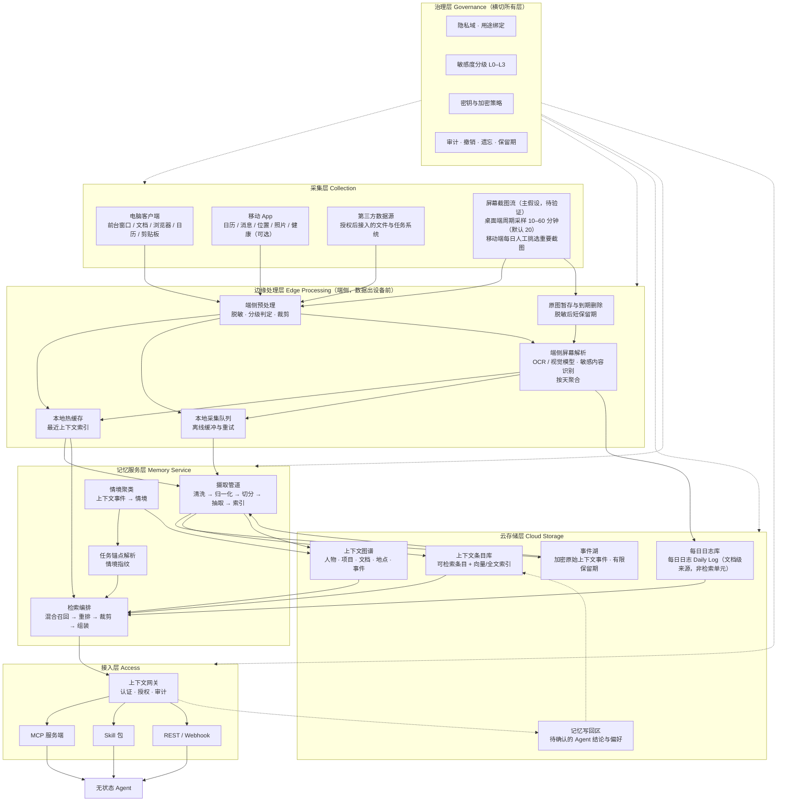
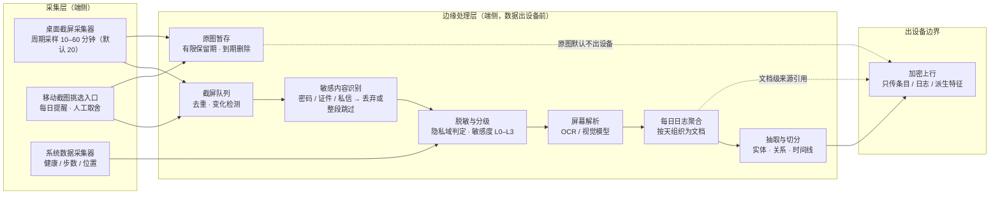
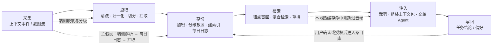

# 01 · 总体架构

> 状态：设想稿 v0.1 · 最后更新：2026-11-03

一句话摘要：用「采集层 → 边缘处理层 → 云存储层 → 记忆服务层 → 接入层」五段流水线加一层横切的治理层，把无感知采集的原始事件加工成无状态 Agent 可直接消费的上下文包；其中「屏幕截图流 → 端侧解析 / 脱敏 → 每日日志 → 抽取入库」是待验证的主假设链路。

本文只给结构与边界，不给目录与实现；问题定义与原则见 [00-vision.md](00-vision.md)，术语以 [creativity/README.md](README.md) 术语表为准。

---

## 1. 分层架构



### 1.1 每层职责

| 层 | 负责什么 | 不负责什么 | 关键约束 |
|---|---|---|---|
| 采集层 | 以**采集器**为单位采集**上下文事件**；管理采集开关与优先级；屏幕截图流的截屏触发与移动端挑选入口 | 不做内容语义理解；不决定存哪里；不做 OCR/识别 | 采集范围默认最小集，逐项可关闭；采集本身不产生对外网络请求；截图流默认受"可暂停 + 指示灯可见"约束 |
| 边缘处理层 | **端侧预处理**：脱敏、敏感度分级、裁剪、去重；本地热缓存与离线队列；**屏幕解析**（OCR / 视觉模型）与**每日日志**聚合；原图暂存与到期删除 | 不做全局检索与重排；不长期保存原始数据；不把原图直接上行 | 数据出设备前必须完成脱敏与分级；L3 默认不出设备；解析失败或存疑时按更严一档处理 |
| 云存储层 | 加密存储**上下文条目**、图谱、索引、**每日日志**与**记忆写回**待确认区 | 不做召回决策；不做授权判定 | 原始**上下文事件**与原图有限保留期；删除需覆盖条目、索引与派生关系 |
| 记忆服务层 | 摄取管道、情境聚类、**任务锚点**解析、检索编排与**上下文包**组装 | 不直接面向 Agent 暴露；不做认证 | 组装必须按 token 预算裁剪，并记录裁剪与置信度 |
| 接入层 | **上下文网关**统一认证、授权、审计；暴露 MCP / Skill / REST | 不持有记忆数据；不做业务判断 | 网关是唯一的对外入口，所有访问留审计 |
| 治理层 | **隐私域**、**用途绑定**、敏感度分级、密钥、审计、撤销、遗忘、保留期 | 不替代业务层实现具体功能 | 横切所有层；任何绕过治理层的通路都是缺陷 |

**建议**：治理层以"策略即配置 + 强制检查点"实现，每个层的出入口各设一个检查点，避免治理逻辑散落在各模块。
**备选**：把治理能力做成独立微服务，由各层远程调用——集中但引入延迟与单点，热路径不适用。
**不采用**：把授权判断放在接入层一处——无法阻止内部链路越域。

### 1.2 主假设链路：屏幕截图流 → 端侧解析 / 脱敏 → 每日日志 → 抽取入库

> **这是待验证的主假设**（发起人补充的采集路径假设），不是已定结论；愿景与代价见 [00-vision.md](00-vision.md) 第 4.1 节。本节只把它落到**采集层与边缘处理层**的职责上。



**链路各段职责**

| 段 | 输入 | 输出 | 职责边界 | 关键约束 |
|---|---|---|---|---|
| 桌面截屏采集器 | 屏幕画面 | 截图流 | 只负责按策略触发与落本地队列；**不做**解析、不上传 | 频率与触发条件用户可调、可暂停；指示灯可见 |
| 移动截图挑选入口 | 系统相册 / 分享 | 用户选中的截图 | 只做候选预选与用户取舍；**不做**自动全量上传 | 用户不选即不采集；默认已预选候选以降低负担 |
| 截屏队列与变化检测 | 截图流 | 待处理帧 | 去重、跳过无变化帧；**不做**语义判断 | 去重必须在端侧完成，避免无谓解析成本 |
| 敏感内容识别 | 待处理帧 | 丢弃或放行的帧 | 识别密码、验证码、证件、私信等；**不确定时按更严一档处理** | 漏检即事故，宁可多丢 |
| 脱敏与分级 | 放行的帧 | 带**隐私域**与**敏感度分级**的帧 | 判定域归属与级别；**不做**抽取 | L3 默认不出设备，只在端侧参与解析 |
| 屏幕解析 | 脱敏后的帧 | 帧级文本与结构化信息 | OCR / 视觉模型调用；**建议**端侧执行，云端重解析为**备选**且需用户显式同意 | 云端重解析不作为默认路径；确认采用时须在解析后立即删除云端原图，并仅限 L0/L1 |
| 每日日志聚合 | 帧级解析结果 | **每日日志** | 按天组织为文档，保留时间与来源；形态为可按本地日期分片的文本，可导出、可由 Agent 读取 | 日志是**文档级来源引用**，不是检索单元（与 [03-context-model.md](03-context-model.md) 一致）；云端只收脱敏后的日志文本 + 条目索引 |
| 抽取与切分 | 每日日志 + 系统数据 | **上下文条目** / 图谱边 | 实体、关系、时间线抽取；**不做**召回 | 每条带置信度与来源；低置信度默认不注入 |
| 原图暂存 | 原始截图 | 到期自动删除 | 只在端侧短保留；供用户预览、撤回与重解析 | 默认不出设备；用户可单独删除 |

**与分层架构的对应关系**

- 上表前两段属于**采集层**；其余段属于**边缘处理层**，其中"抽取与切分"与云端**摄取管道**职责重叠时，**建议**端侧只做轻量切分，重抽取由云端管道完成（成本与隐私的权衡见第 7 节待定问题 12）。
- **每日日志**入库后属于**云存储层**（C5），对**记忆服务层**只作来源引用；检索仍由**任务锚点**驱动。
- 任何一段都不得绕过**治理层**：敏感度判定、域归属、保留期三项由治理层策略下发，端侧执行。
- 采集口径以 [02-capture-clients.md](02-capture-clients.md) 第 9 节为准（间隔档位、默认状态、跳过规则、原图配额），本文不重复定义，避免两处说法漂移。

**与 02 的口径关系（已对齐，但仍有待确认项）**：[02-capture-clients.md](02-capture-clients.md) 已并入同一主假设（其第 9 节），并把采集口径收敛为：**周期采样**（间隔 10 / 20 / 30 / 60 分钟，默认 20 分钟，另有"仅手动"）而非连续录屏；桌面端"建议但默认关"、首次单独开启；移动端"每日提醒 + 用户挑选"默认开；**原图默认不出设备**（本地加密暂存 + 到期删除），云端只收脱敏文本与条目。这与本文的链路划分一致，**早先"02 建议不做全局截图"的表述已由 02 自行修订，不再构成冲突**。仍需发起人确认的是：**默认留存天数**与**是否提供单张上传通道**（该口径已由 [06-privacy-security.md](06-privacy-security.md) 给出建议，见 [02-capture-clients.md](02-capture-clients.md) 待定问题 13）。

---

## 2. 端到端数据流



主假设把"采集 → 摄取"这一段拆得更细（截图在端侧先变**每日日志**再入库），但六个阶段的语义不变；细粒度链路见第 1.2 节。

### 2.1 六阶段说明

| 阶段 | 输入 | 输出 | 主要风险 | 缓解（建议） |
|---|---|---|---|---|
| 采集 | 用户设备上的活动（含主假设的屏幕截图流） | **上下文事件** / 截图帧 | 采集过度、漏采 | 采集分级 + 覆盖率监控；默认最小集；截图流可暂停 |
| 摄取 | 原始事件 / 截图解析结果 | **上下文条目** + 图谱边 + **每日日志** | 抽取错误被当事实 | 条目带来源、时间与置信度；低置信度默认不注入 |
| 存储 | 条目、图谱与每日日志 | 加密存储 + 索引 | 越权、超期保留 | 按敏感度分级放置；保留期到期自动清理；原图默认不出设备 |
| 检索 | **任务锚点** | 候选条目集 | 召回偏差、噪音 | 混合召回 + 重排；锚点失败时降级到时间邻近并询问一次 |
| 注入 | 候选条目 | **上下文包** | 噪音、超预算、延迟 | token 预算裁剪 + 置信度标注 + 超时降级返回部分结果 |
| 写回 | Agent 任务结论 | 待确认写回项 | 记忆污染、越权写入 | 默认需用户确认；写回项带来源任务与可追溯标记，可一键遗忘 |

**建议**：写回默认走"待确认"而非直接入库，仅在用户显式开启自动写回且用途匹配时才直通。
**备选**：写回直接生效、事后可撤销——体验顺滑但污染风险高。
**不采用**：写回无条件直通所有**隐私域**。

---

## 3. 部署形态对比

| 维度 | 云优先 | 本地优先 | 混合（推荐） |
|---|---|---|---|
| 数据放置 | 原始事件与条目主要在云 | 主要在用户设备 | 端侧脱敏 + 本地热缓存 + 云端加密冷存与索引 |
| 跨设备 / 跨 Agent | 最好 | 弱，需要复杂点对点同步 | 好（经云端同步加密产物） |
| 延迟 | 取决于网络，冷启动即可用 | 热路径最快，冷启动需本地积累 | 热路径本地最快，冷路径走云 |
| 隐私风险 | 高（全量出设备） | 最低 | 中（出设备前已脱敏，L3 不出设备） |
| 移动端可行性 | 好（算力在云） | 差（移动端算力/电量/后台限制，**待核实**） | 中（移动端只做轻量预处理） |
| 离线可用性 | 差 | 好 | 中（本地缓存范围内可用） |
| 工程复杂度 | 低 | 高 | 最高 |
| 成本结构 | 云存储与推理成本随数据量上升 | 端侧资源占用，云成本低 | 云成本可控（冷存 + 分层），端侧有额外开销 |
| 截图解析放在哪（主假设专属） | 云端解析，效果好但原图必须出设备（**不采用**为默认路径） | 端侧解析，隐私最好但端侧算力与准确率受限 | **建议**端侧解析为主；云端重解析为**备选**，需用户显式同意且解析后立即删除云端原图 |
| 截图原图留存 | 云端留存，回放体验最好、风险最高 | 只在端侧短保留，风险最低 | 端侧加密暂存 + 按天滚动到期删除，原图默认不出设备（口径见 [02-capture-clients.md](02-capture-clients.md) §9.4） |

### 3.1 为什么推荐混合

1. **隐私与体验不必二选一**：原则 6 要求数据出设备前完成脱敏与分级，这让"云端存索引与冷数据"在隐私上可接受；同时本地热缓存解决"无状态 Agent 需要低延迟注入"的硬需求。
2. **跨设备与跨 Agent 是本项目的核心价值**：纯本地做不到 G6；纯云则放弃 L3 数据的合规空间。
3. **成本可控**：冷数据可压缩与分层存储，热数据只留窗口期，成本随真实使用量而非采集量增长。
4. **主假设只在混合形态下成立**：屏幕截图流只有在"端侧脱敏 + 原图不出设备"的前提下才敢开；纯云会让截图成为最大的隐私敞口，纯本地则无法把**每日日志**与条目同步给其他设备上的 Agent。

### 3.2 混合形态的代价（必须诚实列出）

- **工程量最大**：需要同时维护端侧预处理、本地缓存一致性、云端同步与冲突解决三套机制。
- **一致性复杂**：本地与云端可能短暂不一致，扫描结果需要标注"截至时间"，否则 Agent 会基于旧状态行动。
- **调试困难**：问题可能出在端侧、同步层或云端，需要端到端追踪 ID 贯穿全链路（**建议**：所有层级携带同一 trace id）。
- **移动端约束**：后台采集与预处理受系统限制，可能无法达到桌面端同等覆盖率（**待核实**各家系统策略）。
- **端侧资源占用**：脱敏与分级消耗电量与算力，需要节流策略与用户可见的资源开关；若截图解析也放端侧，占用会进一步上升（**待定**，见第 7 节待定问题 11）。

**备选**：MVP 阶段先做"云优先 + 强制端侧脱敏"的简化混合，把本地热缓存推迟到第二阶段；风险是早期注入延迟不达标。
**不采用**：纯本地优先作为首发形态——与跨设备、跨 Agent 的目标直接冲突。

---

## 4. 组件职责与模块边界（建议）

> **重要**：以下只是**建议**，不是实际目录结构，也不代表仓库里已经存在这些文件夹。按 `AGENTS.md`，模块划分需要在方案确认后由用户拍板，并单独走「初始化项目结构」流程；在那之前不要创建任何模块目录。

划分依据是 `AGENTS.md` 的"按能力分包"：**总被同一需求一起改的代码放一起**。

| 建议组件 | 职责（负责 / 不负责） | 依赖 | 对应层 | 大致对应文档 |
|---|---|---|---|---|
| `capture-desktop` | 负责桌面端**采集器**与采集调度（含截屏触发策略）；不负责语义理解与云端通信细节 | 端侧预处理公开接口 | 采集层 | [02-capture-clients.md](02-capture-clients.md) |
| `capture-mobile` | 负责移动端**采集器**、权限管理与每日截图挑选入口；不负责重计算 | 端侧预处理公开接口 | 采集层 | [02-capture-clients.md](02-capture-clients.md) |
| `edge-preprocess` | 负责**端侧预处理**：脱敏、分级、裁剪、去重；不负责采集与存储 | 敏感度分级策略 | 边缘处理层 | [06-privacy-security.md](06-privacy-security.md) |
| `edge-screen-parse`（主假设，待验证） | 负责**屏幕解析**：敏感内容识别、OCR / 视觉模型调用、**每日日志**聚合与原图到期删除；不负责召回，不做云端全量回放 | `edge-preprocess`、治理层策略 | 边缘处理层 | [02-capture-clients.md](02-capture-clients.md)、[03-context-model.md](03-context-model.md) |
| `edge-cache` | 负责本地热缓存与本地时间邻近检索；不负责云端索引 | 上下文条目契约 | 边缘处理层 | [04-storage-retrieval.md](04-storage-retrieval.md) |
| `context-model` | 定义**上下文事件 / 条目 / 情境 / 任务锚点 / 上下文包**契约；不负责实现存储与检索 | 无（最底层契约） | 记忆服务层 | [03-context-model.md](03-context-model.md) |
| `ingest-pipeline` | 负责清洗 → 归一化 → 切分 → 抽取 → 索引；不负责召回 | `context-model` | 记忆服务层 | [03-context-model.md](03-context-model.md) |
| `memory-store` | 负责加密存储、索引、图谱、**每日日志**与保留期；不负责授权判定 | `context-model` | 云存储层 | [04-storage-retrieval.md](04-storage-retrieval.md) |
| `retrieval-orchestrator` | 负责**检索编排**：召回、重排、裁剪、组装**上下文包** | `memory-store`、`context-model` | 记忆服务层 | [04-storage-retrieval.md](04-storage-retrieval.md) |
| `context-gateway` | 负责认证、授权、审计与协议适配（MCP / Skill / REST）；不持有记忆数据 | 治理层策略、`retrieval-orchestrator` | 接入层 | [05-agent-access.md](05-agent-access.md) |
| `governance` | 负责**隐私域**、**用途绑定**、分级、密钥、审计、撤销、遗忘 | 无 | 治理层（横切） | [06-privacy-security.md](06-privacy-security.md) |
| `shared/`（如需要） | 仅放被 ≥2 个组件真正复用的内容；不预先创建 | — | — | `AGENTS.md` |

**边界规则（建议）**：

- 跨组件只调用对方 README 里列出的公开接口，不引用内部文件。
- `context-model` 是唯一的契约来源：条目与包的字段改动必须只发生在这里，其他组件通过链接引用（遵循"单一事实来源"）。
- 治理检查点是强制依赖：任何组件都不能自行决定"这次可以放行"。

---

## 5. 内部服务与对外接口（高层草案）

> 以下均为**高层草案**，不是最终接口定义，字段与语义需要在 [03-context-model.md](03-context-model.md)、[04-storage-retrieval.md](04-storage-retrieval.md)、[05-agent-access.md](05-agent-access.md) 中收敛。

### 5.1 内部服务边界

| 服务 | 输入 | 输出 | 是否热路径 |
|---|---|---|---|
| 采集调度 | 采集器注册、用户开关、截屏触发策略 | **上下文事件**流 / 截图帧 | 端侧，非云端热路径 |
| 屏幕解析与日志聚合（主假设，待验证） | 脱敏后的截图帧、系统数据 | **每日日志** + 帧级抽取结果 | 端侧，非云端热路径 |
| 摄取管道 | 原始事件（加密）、每日日志 | **上下文条目**、图谱边、索引 | 否（异步） |
| 情境聚类 | 条目时间线 | **情境**与**任务锚点**候选 | 近实时 |
| 检索编排 | **任务锚点** + token 预算 + 用途声明 | **上下文包** | 是 |
| 网关 | 外部 Agent 请求 | 上下文包 / 写回结果 | 是 |
| 写回通道 | Agent 任务结论 | 待确认写回项 → 条目 | 否（默认人工确认） |

### 5.2 对外接口草案

MCP 工具（**备选**：同时提供 Skill 包，二者能力等价）。**命名说明**：下表是架构层的功能划分草案，具体工具名、参数与返回契约以 [05-agent-access.md](05-agent-access.md) 的 `context.*` 工具清单为单一事实来源；实现时按下表语义映射到 05 的名字。

| 工具 | 作用 | 关键入参 | 关键出参 | 备注 |
|---|---|---|---|---|
| `get_context` | 按**任务锚点**取**上下文包** | 锚点描述、用途声明、token 预算、域过滤 | 上下文包 | 核心接口，对应注入形态 ② |
| `prewarm_context` | 会话开始时预热并缓存 | 锚点描述、用途声明、TTL | 包引用或包本体 | 对应注入形态 ①，是"免提示"的关键 |
| `resolve_source` | 由条目溯源到原始来源（含**每日日志**文档级引用） | 条目 ID | 来源类型、位置引用、时间、日志引用 | 让 Agent 的结论可被用户核对 |
| `write_memory` | **记忆写回** | 结论/偏好、来源任务、目标域 | 待确认项 ID | 默认需用户确认 |
| `manage_privacy` | 查看/纠正/暂停/撤销 | 域、条目、授权句柄 | 操作结果 | 建议在客户端 UI 完成，工具只做查询 |

REST（**建议**给非 MCP 客户端用）：`POST /context:query`（取包）、`POST /context:prewarm`、`POST /memory:writeback`、`POST /privacy:grant|revoke`。所有接口语义与 MCP 工具一一对应，避免两套逻辑。

统一请求/响应骨架（草案，字段待定）：

```json
{
  "anchor": { "kind": "task_anchor", "hint": "当前前台应用/文档/日历事件描述" },
  "purpose": { "declared": "任务用途声明", "domain": "隐私域标识" },
  "budget": { "max_tokens": 0, "max_items": 0 },
  "trace_id": "端到端追踪 ID",
  "response": { "bundle": "上下文包", "truncated": true, "as_of": "数据截至时间", "sources": ["每日日志引用（可选）"] }
}
```

**约定（建议）**：

- 所有响应必须带 `as_of`（数据截至时间）与 `truncated`（是否被裁剪），让 Agent 知道自己看到的是不是全集。
- 授权失败与"没有相关上下文"必须返回不同错误码，避免 Agent 误判为"用户确实没有相关背景"。
- 网关不缓存**上下文包**内容，只缓存索引与锚点→条目映射。

---

## 6. 可扩展性与成本模型要点

### 6.1 扩展性

| 维度 | 压力来源 | 应对（建议） |
|---|---|---|
| 采集量 | 采集器数量 × 设备数 × 活跃时长 | 端侧队列与批量上报；采集分级（高频源只留摘要，原始不入云） |
| 截图解析吞吐（主假设专属） | 截屏频率 × 设备数，是最容易失控的一项 | 变化检测去重后再解析；端侧廉价筛选 + 关键帧重解析；解析排队可限流、可降级为"只存日志不抽取" |
| 原图存储 | 截图原图的短期占用 | 端侧暂存 + 到期自动删除；原图默认不出设备，不进入云端存储扩容路径 |
| 写入吞吐 | 摄取管道的异步处理 | 分区按用户分片；摄取与检索读写分离 |
| 检索并发 | Agent 会话数与预热请求 | 本地热缓存优先；包级缓存按锚点指纹复用（短 TTL） |
| 图谱增长 | 实体与关系随时间的膨胀 | 定期合并同义实体、按活跃度降冷 |
| 多设备 | 同一用户的并发编辑与同步 | 单一写入序 + 冲突解决策略（**待定**，见待定问题） |
| 水平扩展 | 用户量增长 | 网关与检索编排无状态、可按用户分片扩展 |

### 6.2 成本模型要点

成本 ≈ **采集与传输** + **存储（热/冷/索引）** + **摄取与抽取算力** + **检索与注入算力** + **审计与合规开销**。

- **存储分层**：原始**上下文事件**保留短窗口（合规与回溯用），长期只留**上下文条目**与图谱，显著压低单位用户成本。
- **向量索引成本**：向量维度与条目数共同决定成本，建议对低价值条目不做向量索引，只用全文与结构化索引（**备选**：全部做向量，效果可能更好但成本更高）。
- **注入算力**：主要成本在重排与组装，与 token 预算正相关；预算是成本控制的主要旋钮。
- **端侧 vs 云端分工**：把脱敏、分级、去重放端侧，直接用端侧算力换云成本，同时改善隐私。
- **屏幕解析成本（主假设专属，最敏感的一项）**：成本 ≈ 截图帧数 × 单帧解析单价。截屏频率是**成本的第一旋钮**，因此**建议**不按固定频率机械截屏，而是事件触发（窗口切换 / 内容变化）+ 端侧廉价筛选。若单用户日成本超护栏，按序降级：只保留**每日日志**不做抽取 → 降低截屏频率 → 仅保留移动端人工挑选的截图。
- **冷启动成本**：新用户早期数据少、命中率低但成本已发生，需要按"闭环完成率"判断是否值得继续采集该用户的数据源。
- **成本护栏**：单用户日成本上限与单包 token 上限都要有硬限，超限降级（返回更少的包）而不是静默失败。

**待核实**：以上为结构性判断，缺少真实单价与数据量，具体成本数字必须在 MVP 埋点后测算；在此之前不要对外给成本承诺。

---

## 7. 待定问题

1. **本地热缓存的职责边界**：端侧缓存是否也承担部分召回？若承担，端侧与云端两套排序如何保证一致？
2. **多设备写入冲突**：同一**上下文条目**在多设备上被并发修改时的合并策略未定（最后写入胜出 / 字段级合并 / 人工确认）。
3. **移动端可行性**：后台采集与端侧预处理的系统限制能支撑到什么程度，需要真机验证（**待核实**）。
4. **摄取管道放在哪一侧**：重抽取放云端还是端侧，直接影响隐私与成本，尚未权衡出结论。
5. **网关的无状态程度**：是否需要会话级缓存以支持预热（形态 ①），与"网关不持有数据"的约束如何调和。
6. **图谱与条目是否分库**：图谱若独立存储，跨库一致性成本如何控制。
7. **模块划分何时定稿**：第 4 节只是建议，实际初始化需要用户确认后按 `AGENTS.md` 流程执行，时间点未定。
8. **第三方数据源接入的信任模型**：授权第三方源（文件、任务系统）时，如何界定其数据回到哪个**隐私域**。
9. **主假设的最终口径确认**：采集端口径已由 [02-capture-clients.md](02-capture-clients.md) 第 9 节收敛（周期采样 10/20/30/60 分钟、默认 20 分钟、桌面默认关、移动默认开、原图不出设备）。仍需发起人确认：**默认留存天数**、**是否提供单张上传通道**、**间距下限与随机抖动是否进入 MVP**。
10. **截屏触发策略**：固定周期采样 vs 事件触发（窗口切换 / 内容变化 / 空闲检测），哪种在召回增益与成本之间更优，尚无数据；02 当前选周期采样 + 抖动，需实测验证。
11. **端侧解析的算力上限**：OCR / 视觉模型能否在桌面与移动端稳定跑在端侧，是否需要云端兜底，以及兜底时的脱敏强度（**待核实**端侧模型能力与耗电）。
12. **每日日志的存储与生命周期**：日志按天生成后保留多久、是否加密上云、是否允许用户逐天删除，需与 [04-storage-retrieval.md](04-storage-retrieval.md)、[06-privacy-security.md](06-privacy-security.md) 对齐。
13. **原图暂存的边界**：端侧暂存容量、到期删除的强制程度、以及"用户撤回某张截图"后派生条目如何清理。
14. **每日日志是否进入检索路径**：[03-context-model.md](03-context-model.md) 把日志定位为文档级来源引用，但若 Agent 需要"按天回顾"，是否需要一个受限的日志检索入口，尚未决定。

## 8. 相关文档

- [creativity/README.md](README.md) — 目录地图、七条核心主张与统一术语表
- [00-vision.md](00-vision.md) — 问题定义、目标与非目标、设计原则
- [02-capture-clients.md](02-capture-clients.md) — 桌面与移动采集架构、采集分级
- [03-context-model.md](03-context-model.md) — 事件、条目、图谱、任务锚点与包契约
- [04-storage-retrieval.md](04-storage-retrieval.md) — 分层存储、索引与混合检索
- [05-agent-access.md](05-agent-access.md) — MCP 工具清单、Skill 设计与接入时序
- [06-privacy-security.md](06-privacy-security.md) — 隐私域、用途绑定、加密、审计与撤销
- [07-scenarios.md](07-scenarios.md) — 端到端场景走查与失败案例
- [08-options-and-roadmap.md](08-options-and-roadmap.md) — 形态对比、MVP 切分与里程碑
