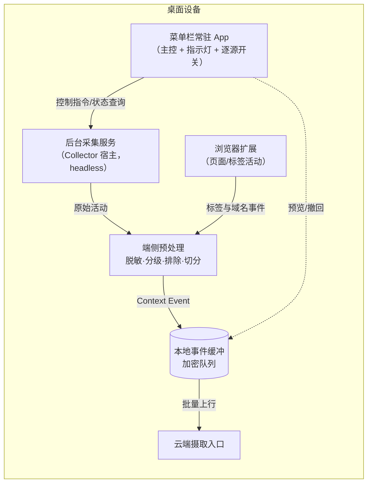
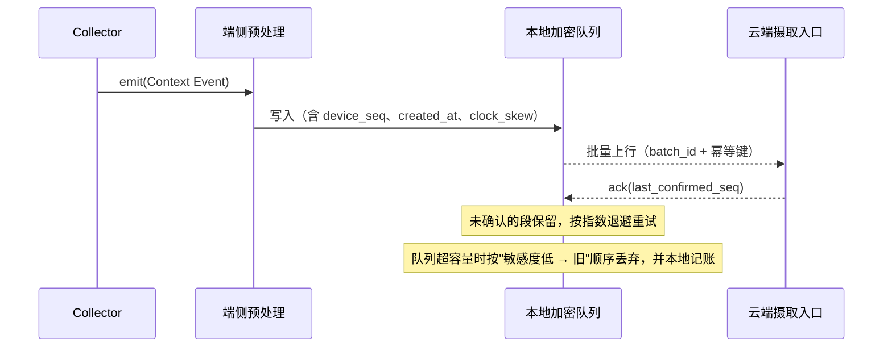
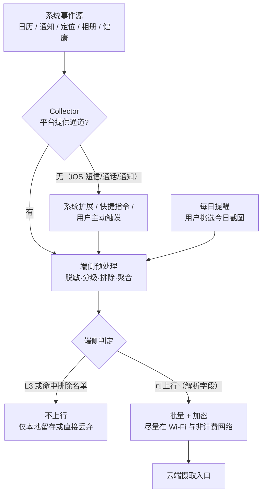
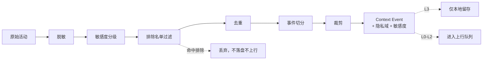
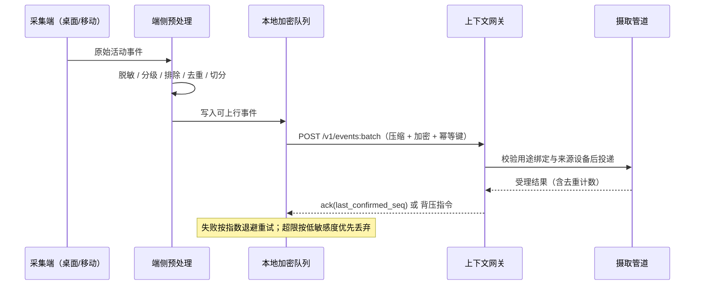
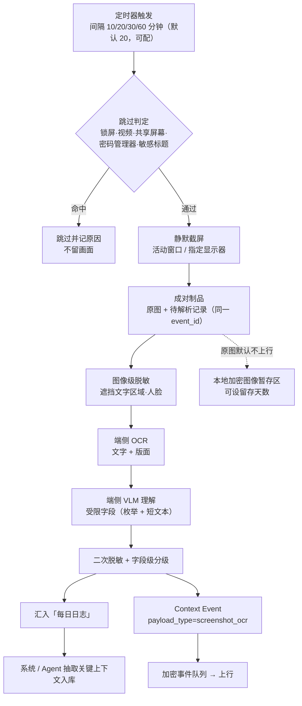

# 02 · 采集端：电脑客户端与移动 App

> 状态：设想稿 v0.1 · 最后更新：2026-11-03
> 一句话摘要：采集端的目标不是"记录得最全"，而是在用户几乎不介入的前提下，把电脑与手机上的活动**在端侧**变成带隐私域与敏感度标注的**上下文事件 Context Event**，只把任务真正需要的那部分送上云。

术语以 [README.md](README.md) 的「术语表」为准；本文只用「上下文事件 Context Event」「隐私域」「敏感度分级 L0–L3」「端侧预处理」「采集器 Collector」等统一说法。方案标签统一使用 **建议 / 备选 / 不采用**。

本文同时并入两条补充设想：**桌面端可配间隔的定时屏幕截图**与**移动端每日人工挑选截图**，两条链路都按"截图 → 端侧 OCR/VLM 解析 → 脱敏 → 每日日志 → 抽取入库"组织，集中写在第 9 节。

---

## 1. 采集目标与底线

### 1.1 三个目标

| 目标 | 含义 | 可检验的判据（设想） |
|---|---|---|
| 无感知 | 用户不需要为采集做任何操作：不写笔记、不打标签、不"投喂" | 安装后 72 小时内用户主动交互次数 ≈ 0（除首次授权与排除名单设置） |
| 低打扰 | 采集过程不抢焦点、不弹窗、不拖慢正在用的应用 | 桌面端常驻 CPU 均值 < 1%、内存 < 150 MB；不产生用户可见窗口切换 |
| 可解释 | 任何一条上传的数据，用户都能回答"哪来的、为什么在这、给了谁" | 每条 Context Event 都可回溯到「采集器 + 设备 + 时间 + 触发原因」，且可在端上看到原文 |

### 1.2 底线：无感知 ≠ 无告知

**建议**把这条写成产品红线，而不是文案技巧：

1. **首次安装必须有一次完整的采集范围告知**，逐源列出、逐源默认值可见，不能折叠成一句"我们可能收集您的信息"。
2. **常驻期间必须有持续可见的状态指示**（见第 7 节：采集指示灯），用户一眼能看出"现在正在采"。
3. **暂停开关必须是一等公民**：一键暂停全部采集，且暂停状态在指示灯上无歧义。
4. **不上行"用户以为没被采"的数据**：任何"顺手多拿一点"的采集都等于欺诈，直接按 **不采用** 处理。
5. **端侧保留预览与撤回**：采集到的原始事件在端上可见、可删，撤回要能阻止它继续参与云端检索。

一句话：**对用户无感知，对知情权零妥协。** 采集的"无感"指交互成本，不是指用户不知道。

### 1.3 采集端不负责什么

- 不做语义理解与任务锚点抽取——那是摄取管道与检索编排的事，见 [03-context-model.md](03-context-model.md)、[04-storage-retrieval.md](04-storage-retrieval.md)。
- 不做授权决策——采集端只打「隐私域 + 敏感度分级 L0–L3」标签，是否可给某 Agent 读由云端用途绑定裁决，见 [06-privacy-security.md](06-privacy-security.md)。
- 不做跨设备时间线合并——采集端只保证时间戳可信与幂等，合并逻辑在云端。

---

## 2. 采集源清单

### 2.1 分级口径

| 级别 | 含义 | 默认状态建议 |
|---|---|---|
| **可行** | 平台提供公开、可审核的 API，或只需常规用户授权 | 低敏感项默认开；中高敏感项默认开但可逐源关 |
| **需高风险权限** | 需要辅助功能 / 完全磁盘访问 / 通知读取 / 屏幕使用时间 / 全天定位等强权限 | **默认关**，逐项显式开启，开启时单独解释风险 |
| **建议不做** | 收益低、风险高，或只能靠键盘记录 / 截图等侵入手段实现 | **不做**，仅记录为"若要实现需要什么"，不进入 MVP |

「敏感度初判」是采集瞬间的**初始标注**，不是最终裁决；端侧可下调也可上调（例如检测到身份证号直接升到 L3）。

**采集分级 `capture_level`（端侧字段，供 03/04/06 引用）**：除了逐条的敏感度分级，采集端还要声明"这次采集到底采到了哪一层"，因为"只采到元数据"和"采到了正文"的风险完全不同：

| `capture_level` | 含义 | 典型来源 | 上行边界 |
|---|---|---|---|
| `metadata_only` | 只有应用/域名/时间/时长等元数据 | 前台窗口、浏览器 URL 与标题 | 可上行 |
| `metadata_plus_text` | 元数据 + 脱敏后的文本片段 | 页面正文（白名单）、文档标题、剪贴板摘要 | 脱敏后可上行 |
| `metadata_plus_parsed_image` | 元数据 + 屏幕图像的解析字段（原图不上行） | 定时屏幕截图、用户挑选截图 | 仅解析字段可上行，原图默认留在端上 |
| `full_artifact` | 含原始制品（原图、音频、原始样本） | 需用户显式授权才可能出现的形态 | 默认不上行；例外仅限用户对单条的显式动作 |

- 采集器必须在权限声明里给出自己的 `capture_level`，用户据此判断"开了它到底会采到多深"。
- `capture_level` 是 [03-context-model.md](03-context-model.md) 事件 schema 的字段之一；事件级 schema 的权威定义在那份文档，本节只定义取值口径。


### 2.2 桌面端

| 来源 | 端 | 可得信息 | 权限要求 | 采集方式 | 默认状态 | 敏感度初判 |
|---|---|---|---|---|---|---|
| 前台窗口与标题 | macOS / Windows | 前台应用名、窗口标题、切换时刻与停留时长 | macOS：辅助功能（待核实是否仅辅助功能即可）或屏幕录制；Windows：常规进程查询 | 事件驱动轮询（窗口切换时触发），非定时截图 | **可行** · 开 | L1，标题含「密码/私钥/工资」等词时自动升 L3 |
| 文档与应用活动 | macOS / Windows | 当前打开的文档路径与类型、编辑/保存事件、应用内停留 | 同上 + 文件路径可读 | 由前台窗口事件派生 + 应用内保存事件监听 | **可行** · 开 | L2（文档名常含客户名/项目名） |
| 浏览器历史与页面正文 | 桌面（浏览器扩展） | 访问 URL、域名、页面标题、停留时长；正文按需 | 扩展自身权限 + 用户显式授权；正文抽取需用户逐站允许 | **建议**用浏览器扩展，而不是读取历史数据库；不采集登录态与表单内容 | **可行** · 开（仅 URL/标题/时长）；正文抽取默认关 | L2；正文默认 L3 且需逐站白名单 |
| 剪贴板 | macOS / Windows | 文本摘要、来源应用、复制时刻 | 常规剪贴板读取权限（macOS 系统会提示） | **建议**只在用户粘贴/复制动作发生时采样，且不长期保留历史 | **可行** · 开但强约束 | L2；检测到疑似凭据时**端侧丢弃、不上行** |
| 日历 | macOS / Windows | 事件标题、时间、参与人、地点、会议链接 | 系统日历访问授权 | 系统日历 API 读取 | **可行** · 开 | L2 |
| 本地文件与 git 活动 | macOS / Windows | 文件增删改路径与时间、git 仓库的 commit/branch/diff 统计 | 完全磁盘访问（macOS，待核实是否可以缩小到用户选定目录） | 文件系统事件监听（FSEvents/ReadDirectoryChangesW）+ 只读 git 命令 | **需高风险权限** · 默认关，用户选定仓库/目录后开 | L2；`diff` 正文默认不上行，只上文件路径与统计 |
| 会议 | macOS / Windows | 会议起止、参会人、平台（会议链接）、是否共享屏幕 | 各会议平台 API 各自授权（能力差异大，**待核实**） | 优先用日历 + 会议平台公开 API 的元数据；**不做**自动录音 | **需高风险权限**（逐平台开）；实时转写为**建议不做** | 元数据 L2；转写文本 L3 且必须"会中告知" |
| 系统通知 | macOS / Windows | 通知来源应用、标题、正文摘要 | macOS：通知读取受系统限制（**待核实**）；Windows：需 UI Automation 类权限 | 仅在平台明确提供可审核 API 时实现 | **建议不做**（MVP 不做，待平台能力明确后复议） | 若做：L3 |
| 定时屏幕截图 | macOS / Windows | 周期采样的屏幕画面，经端侧 OCR/VLM 解析为结构化字段并汇入「每日日志」 | 屏幕录制权限（macOS 逐应用授权、系统会提示；Windows 受桌面复制 API 与安全软件影响）；**待核实**各版本授权与撤销细节 | 用户配置间隔的**周期采样**（10 / 20 / 30 / 60 分钟或更长，默认 20 分钟，可关闭），非连续录屏；原始图像默认只在本地加密暂存 | **建议但默认关**：首次使用需单独开启并逐项说明风险 | 原始图像 L3；解析后按字段降为 L1–L2；详见第 9 节 |
| 键盘输入 / 连续录屏 | 全平台 | 按键内容、不间断屏幕录像 | 键盘记录 / 常驻录屏 | 无合规实现路径 | **建议不做** | — |

### 2.3 移动端

| 来源 | 端 | 可得信息 | 权限要求 | 采集方式 | 默认状态 | 敏感度初判 |
|---|---|---|---|---|---|---|
| 日历 | iOS / Android | 事件标题、时间、参与人、地点 | 日历读取权限 | 系统日历 API | **可行** · 开 | L2 |
| 通知 | Android | 通知来源应用、标题、正文摘要、时刻 | 通知读取权限（NotificationListenerService） | 常驻监听服务 | **需高风险权限** · 默认关 | L3（含验证码、聊天摘要） |
| 通知 | iOS | 无第三方公开读取通道（**待核实**） | — | 只能靠系统扩展 / 快捷指令 / 用户主动触发补齐 | **建议不做**（系统限制） | — |
| 短信 / IM 摘要 | Android | 短信收发方与正文摘要、IM 通知摘要 | 短信读取权限；IM 仍走通知读取 | 短信 API + 通知读取；**只取摘要不取全文** | **需高风险权限** · 默认关 | L3 |
| 短信 / IM 摘要 | iOS | 短信无公开读取 API（**待核实**）；IM 无通知读取通道 | — | 只能靠分享扩展 / 快捷指令由用户主动提交 | **建议不做** | — |
| 位置轨迹 | iOS / Android | 停留点、地点语义、通勤段 | "始终允许"定位 + 后台定位能力 | 系统定位 API 聚合为停留点后上报，**不上行原始 GPS 点序列** | **需高风险权限** · 默认关 | L2；医疗机构/宗教场所/家等敏感地点端侧降精度或丢弃 |
| 相册元数据 | iOS / Android | 拍摄时间、地点、数量、可选场景标签 | 相册受限访问（iOS 可只授权部分照片） | 相册 API 读元数据；**默认不上行图片像素** | **可行** · 开（仅元数据） | L2；人像与证件类照片端侧跳过 |
| 健康 | iOS（HealthKit）/ Android（Health Connect） | 步数、睡眠时长、运动记录、心率区间等派生特征 | 健康数据读授权（逐类型） | 平台健康 API，**只取聚合特征，不取原始样本** | **需高风险权限** · 默认关 | L3 |
| 通话 | Android | 通话时间、时长、号码/联系人 | 通话记录读取权限 | 系统通话记录 API | **需高风险权限** · 默认关 | L3 |
| 通话 | iOS | 无公开通话记录读取 API（**待核实**） | — | 只能靠用户主动触发（如快捷指令）补齐 | **建议不做** | — |
| 常用 App 前台时长 | Android | 各应用前台使用时长与切换 | 使用情况访问权限（UsageStats） | 系统使用统计 API | **需高风险权限** · 默认关 | L2 |
| 常用 App 前台时长 | iOS | 需「屏幕使用时间」类框架与系统扩展（**待核实**具体可达粒度） | 系统扩展 + 用户授权 | 系统扩展上报聚合时长 | **需高风险权限** · 默认关 | L2 |
| 用户挑选的截图 | iOS / Android | 用户当天手动选中的截图，经端侧解析为结构化字段并汇入「每日日志」 | 相册受限访问（用户逐次挑选，不申请全库） | 每天固定时间的本地提醒 → 系统截图选择器 → **用户选中后才解析** | **可行** · 开（提醒可关；解析范围仅限用户选中项） | 原始图像 L3；解析后按字段降为 L1–L2；详见第 9 节 |
| 麦克风环境音 / 相册全量上传 / 后台自动截屏 | 全平台 | 环境语音、原始照片、后台自动截取的全部屏幕 | 常驻麦克风、全量相册、后台录屏 | 无低打扰合规实现 | **建议不做** | — |

### 2.4 清单层面的三条取舍

- **建议**：默认值遵循"**低风险默认开、高风险默认关、敏感默认只上派生特征**"。默认关的项即使开启，也必须在指示灯上体现为"增强采集中"。
- **备选**：全部默认关，靠首次向导引导用户逐个开启。隐私上更稳，但会导致"开箱即空"，与"无需用户专门提示"冲突，故不设为默认路线。
- **不采用**：以"提升召回率"为由默认开启通知读取、健康、位置轨迹之一。这三类是撤回成本最高、误伤面最大的数据。
- **对屏幕类采集额外收紧**：定时屏幕截图不属于"低风险默认开"的范围，走"默认关 + 首次单独开启 + 逐项说明 + 可设间隔"的独立通道（详见第 9 节）；原图像素默认不上行。

---

## 3. 桌面采集客户端架构

### 3.1 进程形态

**建议**：菜单栏/托盘常驻进程（主控）+ 按需拉起的后台辅助进程 + 浏览器扩展，三者分工**不重叠**。



| 形态 | 职责 | 不做什么 |
|---|---|---|
| 菜单栏/托盘常驻 App | 状态指示灯、逐源开关、暂停、预览与撤回、首次授权向导 | 不直接采集数据 |
| 后台采集服务 | 承载所有 Collector、执行节流、维护本地缓冲 | 不做 UI，不弹窗 |
| 浏览器扩展 | 标签激活/关闭、URL 与标题、停留时长、按用户白名单抓正文 | 不读历史数据库、不读登录态、不注入修改页面 |

- **备选**：单一进程同时做 UI 与采集。实现简单，但主进程卡顿会直接影响用户正在用的应用，且权限面被撑大，**不作为建议**。
- **不采用**：纯后台守护进程、没有常驻可见 UI。违反第 1.2 节"持续可见"的底线。

### 3.2 采集器 Collector 插件化模型

**建议**：每个采集源是一个独立 Collector，统一生命周期（`预备 → 启动 → 采样 → 停止 → 卸载`），由宿主统一负责权限检查、节流与缓冲写入。接口草案（伪代码，非生产实现）：

```
Collector（草案，接口形状示意）
  name           : string        // 唯一名，如 "macos.foreground_window"、"macos.silent_screenshot"
  version        : string
  platforms      : [macos | windows | android | ios]
  permissions    : Permission[]  // 每个权限声明：用途说明 + 是否高风险 + 拒绝时的降级行为
  sensitivity    : L0..L3        // 默认敏感度，可被端侧预处理上调
  privacyDomain  : 默认隐私域     // 个人 / 工作 / 家庭，可由用户按源覆盖
  samplePolicy   : {
     mode        : event | poll | window
     intervalMs? : number        // poll 模式的采样间隔
     debounceMs? : number        // 事件去抖动
     idlePause   : boolean       // 用户空闲/锁屏时是否暂停
  }
  resourceBudget : { cpuPctMax, memMbMax, wakeupsPerMinMax }
  start(ctx) / stop() / health() -> CollectorHealth   // health 用于指示灯与故障提示
  emit(event: ContextEvent)                            // 只允许吐 Context Event，不直接触网
  emitPair(artifact, event)                            // 视觉类 Collector：一次采样产出一对
                                                       // （原图制品 + 解析后的 Context Event）
```

三条硬约束：

1. **Collector 不得自行联网**，只能 `emit`，由宿主统一走端侧预处理与上行队列——这样才能保证"排除名单"无法被单个采集器绕过。
2. **声明式权限**：新增采集器必须声明权限与用途，宿主在启用前把这份声明展示给用户。
3. **可降级**：权限被拒时，Collector 必须给出"可用到什么程度"的降级路径（如无辅助功能时只采应用名、不采窗口标题），而不是直接崩溃或静默失效。

视觉类 Collector（定时屏幕截图那一类，见第 9 节）另加两条：

4. **必须成对产出**：一次采样同时给出"原图制品 + 解析后的 Context Event"，两者用同一 `event_id` 关联；不允许只留图不留解析，也不允许只留解析却说不清图在哪。
5. **必须自报帧预算**：声明采样间隔、单帧大小上限、本地图像配额与留存天数，由宿主统一裁决；超出配额时宿主有权暂停该 Collector，而不是无限占用磁盘。

### 3.3 资源占用与节流

**建议**默认策略（具体数值是设想目标，需实测校准）：

| 策略 | 规则 | 理由 |
|---|---|---|
| 事件优先于轮询 | 窗口切换、文件系统、浏览器事件驱动；仅无事件源时用轮询 | 空闲时接近零唤醒 |
| 前台感知节流 | 用户正在全屏视频/游戏/共享屏幕时降到最低采样 | 不能影响正在进行的活动 |
| 空闲与锁屏暂停 | 无输入超过 N 分钟或锁屏后，暂停绝大多数 Collector | 省电且减少无意义事件 |
| 电池模式 | 笔记本电池供电且低于阈值时，暂停"需高风险权限"类采集 | 采集不该以续航为代价 |
| 批量写入 | 事件先内存聚合（如 ≤ 2s 或 ≤ 50 条）再落盘 | 减少磁盘与电量开销 |
| 全局限速 | 单设备事件上行速率上限，超限时丢弃最低敏感度的冗余事件而非堆积 | 防止故障时雪崩 |

- **备选**：按"任务锚点出现时"才临时提高采样率（例如检测到会议应用启动）。召回更好、实现更复杂，可作为二期。
- **不采用**：常驻高频轮询（如 1 秒级全量窗口枚举或秒级连续截屏）——周期采样与连续录屏是两件事，前者是本文建议，后者不做。
- **屏幕类采集的额外节流**：定时屏幕截图受独立预算约束（见第 9.1 节）——间隔可配且下限保守、跳过锁屏/视频/共享屏幕/密码管理器、解析任务限并发、超预算即降级为"只采元数据不采图"。

### 3.4 离线缓冲与断点续传

**建议**：本地加密队列 + 每设备单调递增序号 + 服务端确认位点。



- 队列有明确容量上限（条数 + 字节），达到上限**先丢低敏感度旧事件**，绝不因为缓冲失败而阻塞采集线程或占用用户磁盘。
- 服务端确认后才物理删除；重传依赖幂等键去重，不能产生重复条目。
- 队列必须加密落盘（见 [06-privacy-security.md](06-privacy-security.md)）；退出登录/卸载时要提供"清除本地缓冲"入口。
- **原图制品不走事件队列**：屏幕截图的原始图像与 Context Event 分开处理——事件走本节的加密队列，原图进独立的"图像暂存区"（独立配额、独立留存天数、按天滚动删除），确保"事件都同步完了，却留下一堆没人管的截图"不会发生。

---

## 4. 移动端采集架构

### 4.1 为什么移动端不能照搬桌面端

桌面端可以常驻后台进程，移动端不行：后台执行被系统强约束，多数采集只能在**系统允许的时机**（后台任务窗口、显著位置变化、推送唤醒、用户主动触发）发生。因此移动端的设计原则是：

1. **能靠系统事件驱动的，不做常驻轮询**；
2. **系统不给的通道，明确承认拿不到**，不做越权或灰色方案；
3. 用**系统扩展 / 快捷指令 / 用户主动触发**补齐剩下的缺口，并在 UI 上说清"这部分只有你主动操作时才有数据"。

### 4.2 iOS / Android 能力差异对照

| 能力维度 | iOS | Android | 对采集方案的后果 |
|---|---|---|---|
| 后台执行 | 后台任务窗口短、调度由系统决定，不能长期常驻 | 前台服务可较长时间驻留，但受厂商省电策略影响 | 移动端一律按"机会式采集"设计（**待核实**具体后台时长与配额上限） |
| 通知读取 | 无第三方公开读取通道（**待核实**） | NotificationListenerService 可读通知 | 仅 Android 可做通知类采集，且默认关 |
| 定位 | 提供"使用期间/始终允许"，后台定位有系统提示与频率限制 | 提供前台/后台定位，后台需单独声明，部分厂商更严格 | 两端都可做停留点聚合；"始终允许"必须逐次说清用途 |
| 相册 | 支持"受限访问"（用户只授权部分照片）与"仅添加" | 需读媒体权限（分版本细分，**待核实**最新版本粒度） | iOS 体验更细；两端都只取元数据 |
| 健康 | HealthKit，类型多、授权可逐类 | Health Connect（可用性随系统版本与设备，**待核实**） | 只取聚合特征；机型/版本差异要写进降级路径 |
| App 使用时长 | 需「屏幕使用时间」类框架 + 系统扩展，第三方粒度受限（**待核实**） | UsageStats 在获得使用情况访问权限后可取 | 桌面级"逐 App 时长"在 iOS 上不可保证，需说明缺口 |
| 短信 | 无公开读取 API（**待核实**） | 可读短信（需权限，商店审核严格） | 短信类采集只承诺 Android |
| 通话记录 | 无公开读取 API（**待核实**） | 可读通话记录（需权限） | 同上 |
| 日历 | 系统日历 API 可读 | 系统日历 API 可读 | 两端都可行 |
| 截屏采集 | 无第三方公开的后台截屏能力（**待核实**；「快捷指令」类自动化是否可由系统代为截屏同样待核实） | 截屏需 MediaProjection 类运行时授权，每次会话由系统提示且无法隐藏系统指示 | **移动端不做后台自动截屏**；改为"每日提醒 + 用户挑选截图"（见第 9.2 节） |
| 截图解析 | 端侧 OCR/VLM 可用，但受前台时长与算力限制 | 端侧 OCR/VLM 可用，受机型算力与电量策略限制 | 解析只在用户挑选后触发，且尽量等到充电/非计费网络 |

> 表中标注「待核实」的条目属于"公开资料不足以确认当前系统版本的确切行为"，落地前必须用目标 OS 版本实测；不得据传闻当结论。

### 4.3 可用的补齐手段

| 手段 | 适用缺口 | 说明 | 标签 |
|---|---|---|---|
| 系统扩展（共享/分享扩展、屏幕使用时间类扩展、Widget） | iOS 拿不到前台 App、拿不到全文的场景 | 用户在分享或系统扩展被唤醒时，由扩展产出 Context Event | **建议** |
| 快捷指令 / 自动化（iOS「快捷指令」、Android 同类工具） | 用户主动上报（"记录一下""把这封邮件纳入上下文"） | 由用户配置触发点，采集端只负责接收与预处理 | **建议** |
| 用户主动触发 | 短信、通话、健康原始样本等系统不开放的通道 | UI 上提供"补录/导入"入口，导入即视为用户明确同意 | **建议** |
| 无障碍服务抓取界面 | Android 通知/界面内容 | 权限面过宽、易被滥用且商店审核风险高 | **不采用**（除非某源确实无替代且用户显式逐次开启，作为远期备选） |
| 越狱 / Root 提升采集能力 | 全部缺口 | 破坏设备安全基线，用户基数极小 | **不采用** |

### 4.4 移动端侧处理与上行

**建议**：移动端不维护完整事件流，只做"**聚合 + 摘要 + 立即上行**"（移动端本地缓冲更易受系统清理影响）：



- 移动端事件量小但连续，**建议**以"聚合窗口 + 触发上行"为主：聚合窗口到来、网络可用、或充电/待机时批量发送。
- 位置与健康只上行**派生特征**（停留点、时长、区间统计），原始样本留在端上。
- **备选**：移动端完全不做本地缓冲，事件即产即发。实现简单，但断网会直接丢数据；离线队列仍是建议。
- **屏幕类采集在移动端只走"用户挑选"路径**（见第 9.2 节）：不做后台自动截屏，解析任务排到充电或非计费网络时执行，避免把手机的续航和流量当成采集的代价。

---

## 5. 端侧预处理

### 5.1 通用处理步骤

| 处理 | 做什么 | 例子（示意，不含真实数据） |
|---|---|---|
| 脱敏 | 抹掉/哈希可识别信息 | 手机号、邮箱、身份证号、银行卡号、URL 中的 token 与查询串、对话中的密钥样式串；屏幕内容另做图像级遮盖（见第 9.3 节） |
| 敏感度分级 | 给每条 Context Event 标 L0–L3 | 窗口标题命中排除关键词 → L3；纯应用名 → L1 |
| 排除名单 | 用户可按应用/网站/时间段/关键词排除 | 排除某银行 App、某域名、22:00–08:00、含"薪资"的标题 |
| 图像/屏幕解析 | 对截图与屏幕画面做文字提取与内容理解，产出结构化字段 | 屏幕 → OCR 文本 → VLM 输出"应用 / 文档类型 / 主题 / 实体 / 任务线索"字段（详见第 9.3 节） |
| 去重 | 同一活动重复上报合并 | 同一窗口连续停留合并为一条并累积时长 |
| 事件切分 | 把连续活动切成有意义的一段 | 以应用/文档切换、空闲超时、日历事件起止为切分边界 |
| 裁剪 | 只保留 Agent 用得上的字段 | 正文只保留首段摘要；git 只保留路径与统计 |



### 5.2 分级与丢弃规则（建议）

- **L0 公开**：可上行，可参与云端索引。
- **L1 一般**：可上行，正常索引。
- **L2 私密**：可上行，但需标记隐私域并在检索侧受用途绑定限制。
- **L3 极敏感**：**默认不上行**，只在本地留存供用户预览；若用户为该源显式开启"允许上行"，才进入加密上传路径，并在审计中单独记账。

**明确不上行的清单**（端侧处理完就结束，不离开设备）：

1. 命中排除名单的应用/网站/时段/关键词所产生的事件；
2. 疑似凭据、密钥、验证码、完整银行卡号、身份证号（脱敏失败即整条丢弃）；
3. 剪贴板的完整原文（只上行类型与摘要，且用户可关）；
4. 位置原始点序列、健康原始样本（只上行派生特征）；
5. 相册图片像素、会议音频与实时转写；
6. **屏幕与截图的原始图像像素**（默认不上行；只上行解析后的文本与派生特征。原图口径已在 [06-privacy-security.md](06-privacy-security.md) 收敛为"本地加密暂存 + TTL 到期删除"，本文采纳，见第 9.4 节）；
7. 被判为 L3 且用户未显式允许上行的任何事件；
8. 桌面本地文件的**内容**（只上行路径、类型、时间与统计）。

- **备选**：端侧只做最小脱敏，把分级与过滤放到云端。云端模型/规则更强、更新更快，但意味着敏感原文已经离开设备，与"端侧预处理"的核心主张冲突，**不作为建议**。
- **不采用**：端侧"只上报元数据、内容全部后补"的懒加载方案，除非用户对具体条目逐次确认。

> 关于第 6 条：这不是"截图不采"，而是"图不上行"。屏幕内容会自然包含密码框、银行页面、他人聊天记录与病历——这些内容用户自己也不希望被上传，所以默认只让**解析结果**离开设备，原图留在本地可选短留存。屏幕采集的完整处理链见第 9 节。

### 5.3 可解释性的端侧实现

每条 Context Event 都带 `trigger` 字段（哪个采集器、因为什么规则产生），使"为什么这条在这里"在端上可回答，也在云端审计中可追溯。规则版本号随事件上报，便于回溯某次规则变更导致的误采。

---

## 6. 上行协议草案

### 6.1 设计要点

| 要点 | 建议做法 |
|---|---|
| 批量 | 一个批次 50–500 条或 ≤ 1 MB，先到先发；批次内按 `seq` 有序 |
| 加密 | 传输走 TLS；事件载荷按隐私域分密钥做端到端加密（细节见 [06-privacy-security.md](06-privacy-security.md)） |
| 压缩 | 批次级压缩（如 zstd/gzip），压缩前先做字段裁剪以减小体积 |
| 幂等 | 每条事件有全局唯一 `event_id`；重传同 `batch_id` 或同 `event_id` 由服务端去重 |
| 时钟 | 每条带 `occurred_at`（设备时钟）+ `monotonic_seq`（设备内单调递增）；同时上报 `clock_skew_hint`，云端做校正，不盲信设备时间 |
| 离线队列 | 有界队列 + 指数退避 + 服务端 `ack(last_confirmed_seq)`，未确认不删除 |
| 背压 | 服务端可返回"降低频率/只收 L0–L1"指令，端侧据此降采样 |
| 撤回 | 撤回以 `event_id` 列表或 `time_range + source` 表达，走独立接口并可被检索侧立即排除 |

**备选**：长连接推送实时流。延迟更低，但移动端保活成本高、耗电明显，仅适合桌面端的实时订阅场景。
**不采用**：为了省事把整条本地缓冲明文上传后由云端删除。加密与最小化必须发生在离开设备之前。

**图像制品的上行**（与普通事件不同，需要单独口径）：批量与幂等规则同上，但原图默认**不进入** `/v1/events:batch`；若用户对某一张显式允许上传，走独立通道（独立配额 + 独立留存策略 + 可单独撤回），不复用事件批次的"上传即可检索"语义。默认口径与例外档位见第 9.4 节与 [06-privacy-security.md](06-privacy-security.md)。

### 6.2 一条 Context Event 示例

**示例一：应用焦点事件（设备侧上行样例，`payload_type = "window"`）**

```json
{
  "event_id": "01J8ZC9K3M2Q7V0E5T4B6N8P1R",
  "schema_version": "1.0.0",
  "collector_id": "macos.foreground_window",
  "collector_version": "0.1.0",
  "device_id": "dev-laptop-01",
  "platform": "macos",
  "client_version": "0.1.0",
  "occurred_at": "2026-11-03T10:12:31.482+08:00",
  "timezone": "Asia/Shanghai",
  "monotonic_seq": 1048573,
  "clock_skew_hint_ms": 120,
  "payload_type": "window",
  "capture_mode": null,
  "capture_level": "metadata_plus_text",
  "privacy_domain": "work",
  "sensitivity": "L2",
  "payload_ref": "local://queue/01J8ZC9K3M2Q7V0E5T4B6N8P1R",
  "payload_digest": "sha256:REDACTED_HASH",
  "idempotency_key": "dev-laptop-01:1048573",
  "payload": {
    "app_id": "com.example.doceditor",
    "app_name": "文档编辑器",
    "window_title_redacted": "季度方案 v3 —— <客户名已脱敏>",
    "document_ext": "docx",
    "document_path_hash": "sha256:REDACTED_HASH",
    "foreground_seconds": 612,
    "idle": false
  },
  "derived": {
    "project_guess": null,
    "entities": [],
    "dedup_key": "app_focus:com.example.doceditor:<doc_hash>:2026-11-03T10:12"
  },
  "trigger": {
    "rule": "window_switch",
    "rule_version": "0.1",
    "excluded_hit": null
  },
  "handling": {
    "processed_on_device": ["redact", "classify", "dedup", "segment", "trim"],
    "uploaded": true,
    "retention_hint": "cloud_index"
  }
}
```

约定如下：

- **schema 权威在 03**：事件级字段的完整定义以 [03-context-model.md](03-context-model.md) 的「上下文事件 schema」为准，本节示例只取采集端需要说明的部分（示例字段名与那份文档保持一致：`collector_id`、`device_id`、`payload_type`、`payload_ref`、`payload_digest`、`capture_mode`、`capture_level`、`idempotency_key`）。
- **本文两个示例都是「设备侧上行样例」**：除 03 schema 的字段外，还带一组**设备侧信封字段**（`collector_version`、`platform`、`client_version`、`monotonic_seq`、`clock_skew_hint_ms`、`payload`、`derived`、`trigger`、`handling`）。它们用于传输、时钟校正与端侧预处理留痕，**不进入云端事件表**：设备侧不含 `ingested_at`（云端接收时补写），`handling` 的端侧处理结果在云端映射为 03 的可选字段 `redaction` / `preprocess`。
- **`payload_ref` 的取值规则**：本文示例处于上行前状态，`local://queue/…` 指设备本地队列引用；上行后按 03 必须改写为对象存储的不可变（WORM）引用；**原始负载不随事件上行时取 `null`**（例如原图默认不出设备的场景，见第 9.5 节示例），此时以 `payload_digest` / `frame_digest` 承担去重与「原图已删」核对。
- `payload` 内不出现真实姓名、账号、路径原文或任何密钥；`window_title_redacted` 表示标题已经过端侧脱敏；`document_path_hash` 用哈希而非明文路径（用户可在端上反查自己看得懂的原名）。
- 屏幕采集的对应示例见第 9.5 节——它是同一 schema 下 `payload_type = screenshot_ocr` 的实例，差异集中在 `payload` 与"成对制品"字段。

### 6.3 上行时序



> 接口名与路径 `/v1/events:batch` 等是**本文草案**：这条是**设备侧上行契约**（采集端 → 云端摄取入口），与 [05-agent-access.md](05-agent-access.md) 定义的 **Agent 侧契约**（`context.search` / `context.bundle` 等 MCP/REST 工具）**不是同一条链路**，不要互相套用。存储侧的落地由 [04-storage-retrieval.md](04-storage-retrieval.md) 承接；截至本文修订，04 尚未给出对应的写入入口命名，两处命名需在下一步统一（见"待定问题"第 20 条）。

---

## 7. 用户可见性

**建议**：可见性不是设置页里的一个 Tab，而是常驻在用户日常路径上的四个东西。

| 机制 | 形态 | 必须做到 |
|---|---|---|
| 采集指示灯 | 菜单栏/托盘常驻图标 + 移动端状态栏/常驻通知 | 三态无歧义：**正在采集 / 已暂停 / 异常**；增强采集（高风险源开启）有独立视觉差异 |
| 屏幕采集指示灯 | 桌面端在常驻图标上叠加"屏幕采集中"的独立状态；每次采样时短暂变化 | 状态可查（上一次采样时刻、当前间隔、是否跳过中）；**不弹通知、不抢焦点**——"静默"指不打扰操作，不指不可见 |
| 暂停开关 | 一键暂停全部采集，含定时暂停（如"暂停 1 小时""22:00–08:00 不采集"） | 暂停即刻生效，指示灯同步；恢复需用户动作，不自动静默恢复 |
| 逐源开关 | 按采集源列出：名称、能拿到什么、用什么权限、当前是否开启、默认值 | 高风险源开启时单独二次确认并解释风险；拒绝权限时有可见的降级说明 |
| 采集预览与撤回 | 时间线视图，可看每条 Context Event 的端侧留存原文与脱敏结果 | 支持单条删除、按源/时段批量撤回、清空本地缓冲；撤回要能同步阻止云端继续用于检索 |

屏幕类采集在这些通用机制之外还需要三项专属可见性（建议）：

- **间隔与范围可见可改**：当前间隔（10 / 20 / 30 / 60 分钟等，默认 20 分钟，另有"仅手动"）、采集范围（全屏 / 当前活动窗口 / 指定显示器）、当前生效的跳过名单，都在同一处可查可改。
- **每次采样可感知但不打扰**：指示灯短暂变化 + "上一次采样"时间戳，让用户不必怀疑"它到底有没有在拍我"。
- **原图留存可调**：原图留存天数可设（含"解析后立即删除"），并提供"一键清空所有截图"与"清空图像暂存区"入口；解析结果与原图分开管理。

- **建议**增加"**本周采集了什么**"的摘要视图（来源分布、条数、被排除命中的次数），让"无感知"不至于变成"无感知地失控"。
- **备选**：把可见性放在独立的"隐私中心"页面。更整洁，但日常不可见，**不作为唯一形态**。
- **不采用**：只在首次安装时告知、之后不再提示的"一次同意，永久采集"模式。

---

## 8. 失败与边界

| 场景 | 表现 | 建议处理 | 用户可见反馈 |
|---|---|---|---|
| 权限被拒 | 某 Collector 起不来或只能降级 | 逐源降级（如无辅助功能只采应用名），其余源不受影响；不反复弹窗骚扰 | 指示灯"部分降级"，逐源页显示缺什么权限、影响哪类信息 |
| 权限被事后收回 | 系统设置里被关掉 | 采集端检测到失效即停止该源、清理该源未上行的缓冲 | 异常态提示 + 一键重新授权入口 |
| 系统更新导致采集失效 | 升级后某个 API 行为变化或需重新授权 | 采集器做能力探测（启动时自检 + 定期 `health()`）；失效即降级而非静默 | 明确的"系统更新后 X 源暂不可用"说明，不伪造数据 |
| 采集器崩溃 | 单源异常 | 单源隔离重启、限次退避；连续失败则禁用该源并上报 | 异常态 + 报错摘要（不含原始数据） |
| 电量受限 | 低电量/省电模式 | 暂停高风险源与批量上行，保留日历等低频源 | 指示灯提示"省电模式已降低采集" |
| 网络受限 | 无网/计费网络/弱网 | 有界队列缓冲；非 Wi-Fi 时只发低敏感度小批次或等待；队列满时按低敏感度优先丢弃并记账 | 显示未上行条数与原因，恢复网络后自动补传 |
| 磁盘/存储吃紧 | 本地队列与预览缓存增长 | 队列与预览缓存都有硬上限，超限先淘汰预览缓存与低敏感度旧事件 | 提供"本地占用"查看与清理 |
| 屏幕录制权限被拒或未授予 | 定时截屏采集器无法工作 | 明确降级为"只采应用/窗口元数据、不采图"；重复提示采样失败会退避，直到用户处理 | 逐源页置顶提示"需要屏幕录制权限 + 如何开启 + iOS/Windows 差异"，并显示该源当前处于降级态 |
| 系统更新或企业策略导致截屏失效 | 升级后权限被重置（macOS 常见）或被 MDM/安全软件禁止 | 启动自检 + 定期 `health()` 探测；失效即停该源、清理未处理的原图暂存，不伪造数据 | "系统更新后屏幕采集暂不可用，需要重新授权"的可操作说明 |
| 采到敏感画面 | 定时采样恰好命中登录页、支付页、私密聊天或他人信息 | 采样前按前台应用/窗口标题判定跳过；命中密码管理器/银行/会议共享屏幕时不采；解析阶段再做字段级拦截 | 预览中标"已跳过（含敏感内容）"，用户可查看跳过原因，但不展示被跳过的画面 |
| 屏幕采集的跳过失灵 | 应用改名导致跳过名单未命中 | 跳过名单按"应用标识 + 窗口标题规则"双轨匹配；规则不命中时把该帧降级为"只留解析字段、不留原图" | 指示灯异常态 + 在逐源页提示"最近的跳过规则可能已失效，建议复查名单" |
| 移动端提醒未响应 | 用户未在提醒时挑选截图，或当天无截图 | 顺延一次提醒（可配置），当天无数据即跳过，不补采、不追溯扫描相册 | "今天没有挑选截图"的中性提示，不制造压力也不假装有数据 |
| 多设备时间线冲突 | 同一时段两台设备事件相互矛盾（如笔记本与手机同时有位置/日历记录） | 云端按"设备可信度 + 时间偏移校正 + 事件类型优先级"合并，保留冲突标记而非静默覆盖；采集端只保证 `device_id`、`monotonic_seq`、`clock_skew_hint` 可靠 | 预览中显示"同一时段存在另一设备记录"，允许用户指定以哪台为准 |
| 用户在多设备同时暂停 | 暂停状态不一致 | 暂停状态以账号级下发，设备在下次联网时同步；本地立即生效优先 | 显示"其他设备仍在采集"的提示，避免误以为已全局暂停 |
| 时钟被手动修改/时区切换 | 事件顺序错乱 | 依赖 `monotonic_seq` 排序，`occurred_at` 只作展示与校正，云端记录偏移 | 一般不可见；严重偏移时在预览里标注"时间可能不准" |

**不采用**：任何"采集失败就重复弹窗直到用户授权"的强推策略；任何"权限缺失时用近似手段推断"（例如没有定位就用 IP 粗定位冒充位置事件）的做法——这会污染上下文，破坏可解释性。

---

## 9. 屏幕截图采集与图像解析

本节对应发起人补充的两条设想：**桌面端定时静默截屏 → 端侧脱敏 → 解析成「每日日志」→ 供系统或 Agent 抽取关键上下文**，以及**移动端每天定时提醒用户挑选"今天重要的手机截图" → 解析抽取**；移动 App 同时接入健康、步数、地理位置等系统数据源并抽取（见第 9.2 节后半）。

**总原则（建议）**：

1. **两条摄入路径，风险等级不同**——桌面端是"周期采样（用户配置间隔）"，移动端是"每日人工挑选"。前者是系统主动采，后者是用户主动交；后者的同意强度更高，因此移动端的门槛可以更低（默认开提醒），而桌面端必须默认关、单独开启。
2. **采样不是录屏**——两者在采样率、留存与法定告知要求上都不同；秒级连续录屏在本目录中始终是 **不采用**（见 9.4）。
3. **静默 ≠ 无痕**——"静默"指不弹窗、不抢焦点、不打断用户操作；系统权限提示、常驻指示灯与"上次采样时间"必须保留，不允许隐藏。
4. **成对产出、可分别撤回**——每次采样产出一对：原图制品 + 解析后的 Context Event（同一 `event_id` 关联）。原图默认不上行，留存口径见第 9.4 节。

### 9.1 桌面端：定时屏幕截图

**建议**：默认关闭；开启后由 `macos.silent_screenshot` / `windows.silent_screenshot` 采集器按用户配置的间隔采样，产出"原图 + 解析结果"一对。

**频率与帧预算**

| 参数 | 建议取值 | 说明 |
|---|---|---|
| 采样间隔 | 10 / 20 / 30 / 60 分钟，**默认 20 分钟**；另有"仅手动" | 间隔由用户配置；不提供秒级或分钟级以下档位 |
| 采样点抖动 | 在间隔内随机偏移 | 避免整点整齐采样形成可预测的行为画像 |
| 采集范围 | 全部显示器 / **当前活动窗口** / 指定显示器或窗口 | 默认**只采活动窗口**——全屏多显示器会产生大量重复帧 |
| 单帧大小 | 长边缩放到 2K 以内再压缩，单帧目标 ≤ 300 KB | 解析用不到原始分辨率；大图只增加成本与泄露面 |
| 原图暂存配额 | 例如 ≤ 2 GB 或 ≤ 7 天（先到为准） | 超出时**暂停截图采集**，而不是淘汰事件队列 |
| 解析并发 | 1（串行） | 避免 OCR/VLM 抢占用户正在用的算力 |

**必须跳过的时机**

| 类型 | 触发 | 理由 |
|---|---|---|
| 锁屏 / 息屏 / 用户离开 | 系统空闲或锁屏状态 | 没有上下文价值；且此时画面多为锁屏或他人使用 |
| 视频播放 / 游戏 / 演示模式 | 前台应用为媒体或全屏娱乐类 | 低打扰；且这类画面信息密度低 |
| 屏幕共享 / 正在录屏 / 视频会议中 | 检测到共享或录制状态 | **双向风险**：可能把会议内容与"他人信息"一起采集；此场景一律硬跳过 |
| 密码管理器、银行与支付、私密聊天、医疗健康等应用在前台 | 前台应用标识命中名单 | 默认名单 + 用户可增删；**宁严勿宽** |
| 窗口标题命中敏感词 | 如"密码/登录/验证码/支付/订单/身份"等规则 | 规则版本化，命中即跳过并记一次"跳过事件"（只记原因，不留画面） |
| 用户自定义排除时段 | 如 22:00–08:00、周末 | 与第 5 节的排除名单共用一套规则 |

- **建议**：跳过名单按"应用标识 + 窗口标题规则"双轨匹配——应用改名或换版本时，标题规则仍能挡住一部分。
- **建议**：用户可指定"只在白名单应用里采样"（例如只采编辑器与浏览器），代价是漏采，但可解释性最好，适合高敏感用户。
- **备选**：按"任务锚点出现时才采样"（如检测到在写文档时提高采样率）。召回更好，但会让采样时机难以向用户解释清楚，列为二期。
- **不采用**：把采样间隔降到分钟以下以求"完整"；在共享屏幕状态下采样；对密码管理器类应用做"仅脱敏不跳过"的折中。

**处理链路**



### 9.2 移动端：每日人工挑选截图 + 系统数据源

**（a）每天定时提醒，用户挑选"今天重要的截图"**

- **建议形态**：每日固定时间（用户可选，默认晚间）本地通知提醒一次；通知里不展示截图内容（避免锁屏泄露）；用户点击后进入"今日截图挑选"页，只列出**用户自己截的图**（采集器 `ios.photo_pick` / `android.photo_pick`，与 [03-context-model.md](03-context-model.md) 命名一致）。
- **为什么是"挑选"而不是"自动"**：用户点选本身就是**强同意信号**——哪一张进上下文由用户当场决定，系统不做全库扫描。这也顺手解决了 iOS 拿不到后台截屏能力的限制。
- **同意信号要留痕**：记录"用户主动选择"的 `consent` 与选择时刻；这一步是后续审计与撤回的基础。
- **选取方式**：用户多选 / 逐张确认 / "今天没有重要的"一键跳过（跳过也应该是一次有效交互，避免用户被反复打扰）。
- **系统数据源**：健康、运动步数、地理位置等通过平台 API（iOS HealthKit / Android Health Connect / 系统定位）接入，**只取聚合特征**（步数、睡眠时长、运动类型、停留点与通勤段），与截图解析结果合并进同一份「每日日志」；原始样本不上行（与第 2.3 节一致）。
- **降级**：某项健康授权被拒时，只缺该维度，不阻塞截图路径；缺什么在逐源页明说。
- **解析时机**：用户挑选后不要求立刻解析完，可排队到充电或非计费网络时执行；失败则延后重试，不反复打扰。

**（b）与桌面端的差异**

| 维度 | 桌面端定时屏幕截图 | 移动端用户挑选截图 |
|---|---|---|
| 触发 | 定时器（用户配置间隔） | 每日提醒 + 用户手动选择 |
| 同意强度 | 一次性授权 + 可随时关 | 每次挑选都是新的明确同意 |
| 默认状态 | **默认关**，需单独开启 | **默认开**（提醒可关） |
| 覆盖范围 | 屏幕全局（受跳过规则约束） | 仅用户选中的那几张 |
| 主要风险 | 采到密码、银行、他人信息、共享屏幕 | 截图本身可能含验证码、支付码、票据与聊天记录 |
| 风险缓解 | 跳过规则 + 图像级脱敏 + 原图不上行 | 逐张挑选 + 端侧拦截验证码/支付码类内容 + 原图不上行 |

> **待核实**：iOS 是否允许 App 通过系统选择器只读取"今天新增的截图"而不授予相册全库访问；Android 各版本能否把媒体权限限定到截图目录。若不能，挑选流程必须走系统选择器逐张授权。

- **备选**：Android 上申请相册读取权限后自动列出"今日截图"候选，再让用户一键确认。步骤更少，但仍需用户确认才解析。
- **不采用**：后台自动截屏、自动读取全部截图、把"用户点过提醒"默认等同于同意解析全部今日截图。

### 9.3 端侧解析与脱敏

**顺序是硬要求**：先脱敏、再理解，**绝不能反过来**——否则敏感内容会先经过模型，等于把最敏感的东西喂给了可能出错的黑盒。

| 步骤 | 做什么 | 硬要求 |
|---|---|---|
| 1. 图像级脱敏 | 文字检测后对敏感区域做遮盖/模糊，人脸与人像区域打码；只保留解析所需的下采样图 | 遮盖要在送模型之前完成 |
| 2. OCR | 端侧识别文字与版面（标题区、列表区、输入框、按钮） | 纯本地执行；不上传图片 |
| 3. VLM 理解 | 输入"已脱敏文本 + 降采样图"，输出**受限结构化字段**：应用/场景枚举、文档或页面类型、主题短句、实体名称（人名/项目名/地名）、任务线索、时间感 | 只允许"枚举 + 短文本"，禁止自由长文转写，禁止输出完整对话记录 |
| 4. 二次脱敏 | 对模型输出再过一遍规则：手机号、邮箱、身份证、银行卡、地址、URL 查询串、验证码样式数字串 | 输出里出现疑似凭据即整条丢弃，不只做遮盖 |
| 5. 字段级分级 | 每个字段单独打 L0–L3 | 例如"应用=编辑器"是 L1，"文档标题含客户名"是 L2，"页面显示身份信息"是 L3 |
| 6. 失败即降级 | OCR 或 VLM 任一失败，则该帧只保留元数据（应用、窗口、时间、是否命中排除）；连续失败降频并提示 | 不允许把未脱敏文本透传到下一步 |

**绝对不入模清单**（既不入 VLM，也不上行）：

1. 密码框、验证码、支付码/银行卡完整数字、身份证完整号码；
2. 登录页、支付页、银行与证券类页面的任何文字；
3. 私密聊天窗口、他人个人资料页；
4. 医疗、法务等敏感文档正文；
5. 任何"看起来像密钥"的字符串。命中即整帧跳过（只记原因），不做"局部遮盖后继续"的折中。

- **建议**：VLM 能力可分级启用——只开 OCR（字段少但最稳）或开启 VLM 理解；移动端默认先只开 OCR。
- **备选**：低端设备上把解析推到充电 + Wi-Fi 时执行、或只解析用户挑中的少数图；不采用"把图片上传到云端解析"作为默认路径（若要作为备选，必须用户显式同意并在解析后立即删除原图）。
- **待核实**：端侧 OCR/VLM 在目标机型上的时延、内存与能耗（直接决定"解析一步能不能留在端上"）。

### 9.4 成对产物、每日日志与限制

**成对产物**

每次采样（桌面定时或移动挑选）产出两份互相关联的产物：

| 产物 | 内容 | 默认去向 |
|---|---|---|
| 原图制品 | 加密的截图图像 + 采集元数据（时间、显示器/窗口、跳过的规则版本） | 仅在本地加密暂存区，按天滚动删除；默认不上行 |
| 解析事件 | 一次 Context Event（`payload_type = screenshot_ocr`，对应采集器 `macos.silent_screenshot` 或 `ios.photo_pick` / `android.photo_pick`），含结构化字段、字段级敏感度与隐私域 | 进入加密事件队列上行 |

- 用户删除其中任一侧，另一侧同步删除（或至少标记为"无对应原图"，不允许出现"图删了但解析还在被检索"的静默状态）。
- 与 [03-context-model.md](03-context-model.md) 的衔接点：**多模态条目如何建模**——原图是不上行的本地制品，上行的是"图像派生条目"，字段级分级与来源引用需在该文档中定义。
- 与 [06-privacy-security.md](06-privacy-security.md) 的衔接点：**截图隐私治理**与**原图留存/加密口径**。

**「每日日志」的形态与切分**

- **形态**：按本地日期分片的 Markdown 文档（用户能直接看、能整体导出、能请 Agent 读），默认存于用户私有隐私域；云端保存"脱敏后的日志文本 + 条目索引"，原图不随日志上行。日志标识沿用 [04-storage-retrieval.md](04-storage-retrieval.md) 的 `log:{date}:{device_id}`，本文示例里的 `daily_log_doc` 只是它的可读路径形态。
- **切分**：以"半天 + 应用/主题"为二级切分；同一应用连续活动合并为一条带时间区间的记录，避免流水账。
- **条目结构**：时间区间、来源采集器（如 `macos.silent_screenshot` / `ios.photo_pick`）、摘要短句、结构化字段（应用/文档类型/实体/任务线索）、来源引用（指向 `event_id` 与本地原图，若原图已删则标注为不可复现）、字段级敏感度。
- **同名文档替换旧内容**（原文）→ **变更**为：新增内容一律**追加**，同日重算时保留旧版本（或明确标注"重算覆盖"），避免"昨天的日志被今天的重算悄悄改写"。用户对日志的编辑**优先于**系统重算。
- **自由文本的边界**：因为字段级分级与检索依赖结构化字段，日志主体建议以结构化字段为准，自由文本只作摘要；这样"日志可读"与"索引可用"不会互相牺牲。

**"静默截屏"的真实平台限制**

| 平台 | 限制 | 对方案的后果 |
|---|---|---|
| macOS | 屏幕录制权限按应用授予，系统会弹窗提示；系统更新后可能需要重新授权；多显示器与全屏应用空间需分别处理（**待核实**最新版本的行为细节） | 所谓"静默"只能做到"不弹自家 UI"，**无法绕过系统提示**；要在引导里讲清楚 |
| Windows | 无统一的"屏幕录制权限"概念（**待核实**），但桌面复制类 API 会受安全软件、DRM 保护内容与游戏反作弊影响；多用户会话不支持 | 采集失败要有明确的失败态与降级，不能静默丢帧 |
| iOS | 无第三方公开的后台截屏能力；「快捷指令」/自动化能否代为截屏同样**待核实**；屏幕录制需用户显式开始且有系统指示 | 移动端只能走"每日提醒 + 用户挑选"路径，不做后台自动截屏 |
| Android | 截屏需 MediaProjection 类运行时授权，每次会话由系统提示；前台服务必须带常驻通知 | Android 上的自动截屏**不可能"静默"**，只会更显眼；因此同样不做自动截屏 |
| 企业/受管设备 | MDM、合规策略或投标要求可能完全禁止屏幕采集 | 采集器需检测到策略限制时禁用该源并明确说明，不做规避 |

**风险、限制与缓解（不构成否决理由）**

| 风险 | 说明 | 缓解 |
|---|---|---|
| 屏幕会包含密码、银行、医疗等信息 | 用户自己也不希望这些内容被上传，且第三方（银行、医院）并未同意 | 采样前跳过 + 图像级遮盖 + 绝对不入模清单 + 原图默认不上行 |
| 共享屏幕 / 会议场景含他人信息 | 采集会同时涉及参会者与屏幕内容，属于"双向隐私风险" | 检测到共享或录制即硬跳过，宁可漏采 |
| 定时采样形成行为画像 | 固定间隔的截屏本身就是一份细粒度行为记录，比窗口标题更敏感 | 采样抖动、短留存、字段级分级、按隐私域加密、逐源可关 |
| 用户可能忘记自己开着屏幕采集 | 屏幕采集比"窗口标题"更难被用户直觉感知 | 指示灯独立状态 + 上次采样时间 + 每日/每周摘要里列出截图条数 |
| 功耗与算力 | OCR/VLM 是端上最重的任务之一，移动端尤其明显 | 桌面串行解析；移动端排队到充电/非计费网络；超预算降级为只采元数据 |
| 企业合规 | 受管设备或客户合同可能禁止屏幕采集 | 检测策略限制即禁用并说明；企业场景默认不启用该源 |

**本节的 不采用**

1. **绕过或伪装系统权限提示**（例如试图隐藏系统指示器）——任何"静默"都不等于可以欺骗用户与操作系统。
2. **秒级或连续录屏**——与低打扰、最小化都冲突。
3. **移动端后台自动截屏**——平台不允许，且同意强度不足。
4. **长期保留全部原始截图**——违反最小化；保留应以"解析所需"为限，并给用户可设的短留存。
5. **把整帧未脱敏内容上传云端解析**——与端侧预处理的核心主张冲突。

### 9.5 屏幕采集的 Context Event 示例

**示例二：定时屏幕截图解析事件（`payload_type = screenshot_ocr`）**——注意原图**未随事件上行**：

```json
{
  "event_id": "01J8ZD2W7Q4N6B1H9K3S5V0XY2",
  "schema_version": "1.0.0",
  "collector_id": "macos.silent_screenshot",
  "collector_version": "0.1.0",
  "device_id": "dev-laptop-01",
  "platform": "macos",
  "client_version": "0.1.0",
  "occurred_at": "2026-11-03T10:20:03.117+08:00",
  "timezone": "Asia/Shanghai",
  "monotonic_seq": 1051020,
  "clock_skew_hint_ms": 120,
  "payload_type": "screenshot_ocr",
  "capture_mode": "silent_interval",
  "capture_level": "metadata_plus_parsed_image",
  "privacy_domain": "work",
  "sensitivity": "L1",
  "payload_ref": null,
  "payload_digest": "sha256:REDACTED_HASH",
  "idempotency_key": "dev-laptop-01:1051020",
  "payload": {
    "capture_scope": "active_window",
    "interval_config_minutes": 20,
    "display_count": 2,
    "skipped": false,
    "skip_reasons": [],
    "parsed": {
      "app_id": "com.example.doceditor",
      "app_name": "文档编辑器",
      "scene": "editing_document",
      "doc_type": "docx",
      "title_redacted": "季度方案 v3 —— <客户名已脱敏>",
      "summary_short": "正在编辑一份季度方案的第三版，围绕排期与预算章节",
      "entities": ["季度方案", "<项目代号>"],
      "task_hints": ["修订排期", "核对预算"],
      "text_blocks_count": 12
    },
    "artifact": {
      "stored_locally": true,
      "uploaded": false,
      "artifact_hash": "sha256:REDACTED_HASH",
      "local_retention_days": 7,
      "note": "原图仅本地加密暂存，未上行"
    },
    "redaction": {
      "applied": ["mask_credential_fields", "blur_faces", "strip_url_query"],
      "findings": ["疑似订单号已移除 2 处", "已丢弃 1 处疑似验证码"],
      "post_check": "passed"
    },
    "parser": { "ocr": "on_device", "vlm": "on_device_small", "parser_version": "0.1.0" }
  },
  "derived": {
    "project_guess": "<项目代号>",
    "entities": ["季度方案"],
    "dedup_key": "screen_snapshot:com.example.doceditor:<frame_digest>:2026-11-03T10:20"
  },
  "trigger": {
    "rule": "interval_timer",
    "rule_version": "0.1",
    "excluded_hit": null
  },
  "handling": {
    "processed_on_device": ["skip_check", "capture", "image_redact", "ocr", "vlm", "redact", "classify", "pair"],
    "uploaded": true,
    "retention_hint": "cloud_index_fields_only",
    "daily_log_doc": "daily/2026-11-03/dev-laptop-01.md"
  }
}
```

约定：

- `artifact.uploaded=false` 表示原图未上行；`title_redacted` 与 `summary_short` 均为端侧脱敏后的产物；`daily_log_doc` 只指向日志文档的相对路径，不暴露本地绝对路径。
- **`payload_ref: null` 是"本地专用制品"的正式表达**（03 中 `payload_ref` 指向云端不可变引用；原图未被授权上传时就是 null）。云端因此无法直接取到原图，取图只能通过"用户显式授权的单张动作"回到设备侧——这正是我们要的默认姿态。
- **`payload_digest` 复用原图指纹**（端侧计算，随事件上行），使云端能在**没有原图**的前提下做重复帧检测与"图已删除"的完整性核对。

> 说明：示例二是同一 schema 下 `payload_type = screenshot_ocr` 的实例（与示例一共用 `schema_version: 1.0.0`），差异仅在 `payload` 与 `handling.daily_log_doc`——这样摄取管道不需要为屏幕采集另设入口。事件级 schema 的权威定义以 [03-context-model.md](03-context-model.md) 为准；采集器命名（`macos.silent_screenshot`、`ios.photo_pick` / `android.photo_pick`）也沿用该文档。

---

## 待定问题

1. **前端窗口权限的精确边界**：macOS 上"前台窗口标题"是否必须辅助功能权限，能否用更小的权限集合实现？（**待核实**，需实测）Windows 侧对应 API 的权限与稳定性同样待核实。
2. **iOS 通知与短信是否真的完全无通道**：当前判断为"无第三方公开读取通道"，是否需要随系统版本变化重新评估？（**待核实**）
3. **iOS「屏幕使用时间」类框架第三方可达粒度**：能否拿到逐 App 前台时长，还是只有聚合分类？（**待核实**）这决定移动端"常用 App 前台时长"是否可承诺。
4. **Android 健康数据可用性**：Health Connect 在不同厂商/系统版本上的覆盖差异，是否需要为旧机型准备降级方案？（**待核实**）
5. **会议元数据与转写**：各会议平台 API 的能力与授权门槛差异很大，走"平台 API 元数据"还是"日历 + 用户主动导入转写"？（**待核实**后定）
6. **浏览器正文采集的合规边界**：只对用户白名单站点抽取正文是否足够，还是必须逐次点击确认？
7. **端侧敏感度分级的规则来源**：纯本地规则、可下发规则包，还是本地小模型？规则包下发会带来"云端知道我有什么规则"的新泄露面。
8. **L3 是否允许上行**：默认不上行已定；是否提供"用户显式允许后加密上行"的路径，还是永久只留本地（会削弱跨设备召回）？
9. **离线队列容量与丢弃顺序**：容量上限与"低敏感度优先丢弃"的顺序是否符合用户直觉，是否需要让用户选择"宁可丢也不上传"？
10. **节流数值的验收口径**：CPU/内存/电量目标（如 CPU 均值 < 1%）需要在真实设备上定义测量方法，否则无法验收。
11. **多设备时间线冲突的裁决权**：默认自动合并 + 保留冲突标记，还是遇到冲突一律交用户裁决？
12. **采集端与摄取管道的切分点**：事件切分放在端侧（省流量、隐私好）还是云端（规则更新快）？本文倾向端侧，需与 [03-context-model.md](03-context-model.md) 对齐。
13. **原图的处置口径（已收敛，待发起人确认）**：截至本文修订，[06-privacy-security.md](06-privacy-security.md) 已给出建议口径——默认"原图不出设备、本地加密暂存 + TTL 到期删除、云端只收脱敏文本"，并保留"最严格：解析后立即删除原图"与"用户对单张显式授权后加密上传"两档。本文采纳该口径（见 §9.4），仍需发起人确认两点：**默认留存天数**（示例 7 天，需法律确认）与**是否提供单张上传通道**。
14. **端侧 VLM 的性能与替代路径**：目标机型上端侧 OCR/VLM 的时延、内存与能耗能否支撑 10–20 分钟一帧的桌面采样与每日移动端解析？（**待核实**）若不能，是否接受"降级为纯 OCR 字段"或"仅对用户挑选的少量图启用 VLM"？该问题与 [03-context-model.md](03-context-model.md) 第 15 条、[04-storage-retrieval.md](04-storage-retrieval.md) 第 16 条是同一交叉项，三份文档需取同一结论。
15. **跳过名单的覆盖策略**：默认跳过名单应该"宁严勿宽"（漏采多、隐私稳）还是"覆盖主流敏感应用即可"（漏采少、但要持续维护）？名单由客户端内置版本更新，还是允许云端下发（会带来"云端知道用户排除了什么"的新泄露面）？
16. **多显示器与跨设备重复帧**：同一时刻多屏、或手机与电脑拍摄同一内容时，如何在采集端去重、还是统一留给云端？（与 [04-storage-retrieval.md](04-storage-retrieval.md) 的摄取去重策略需一致）
17. **移动端每日截图的功耗与流量预算**：每天挑选若干张图做端侧解析的额外耗电与流量，是否需要给"仅 Wi-Fi、仅充电时解析"设默认值？以及是否需要在低电量模式下自动降级。
18. **「每日日志」的归属与检索路径**：日志是"云端文档类型上下文条目"（单一事实来源）还是"端侧导出的日报"？以及用户在日志里手动编辑与系统重算的冲突如何裁决（本文建议追加不覆盖 + 用户编辑优先）。
19. **屏幕采集的企业与共享设备场景**：受管设备、公用电脑上的屏幕采集是否需要直接禁用（而非仅提示）？这条会影响"是否把屏幕采集放进 MVP"。
20. **设备侧上行契约的命名归属**：本文 §6.3 的 `/v1/events:batch` 是采集端 → 云端摄取入口的**设备侧**草案命名，与 [05-agent-access.md](05-agent-access.md) 的 Agent 侧工具（`context.search` / `context.bundle`）是两条链路；[04-storage-retrieval.md](04-storage-retrieval.md) 负责存储侧落地，但截至本文修订尚未给出对应的写入入口命名。两处命名需在下一步统一（否则容易出现"用 Agent 工具名去指设备上行"的误引用）。

---

## 相关文档

- [creativity/README.md](README.md)：术语表与文档约定（本文术语一律引用此表）。
- [00-vision.md](00-vision.md)：问题定义、目标/非目标、成功指标。
- [01-architecture.md](01-architecture.md)：整体分层架构与数据流，采集端在其中的位置。
- [03-context-model.md](03-context-model.md)：Context Event 如何被清洗、切分、抽取为上下文条目（本文 §6.2 与 §9.5 的 schema 需与其对齐）。**衔接点：多模态条目建模**——屏幕派生的图像条目、字段级分级与来源引用（含"原图已删"的不可复现态）需在该文档定义。
- [04-storage-retrieval.md](04-storage-retrieval.md)：云端存储、索引与检索编排。**衔接点：截图存储与留存**——原图不入云、解析字段入库、每日日志文档的存放与索引口径，以及跨设备重复帧的去重策略。
- [05-agent-access.md](05-agent-access.md)：Agent 侧契约（MCP 工具与 REST，如 `context.search` / `context.bundle`）与上下文网关的对外接入。**注意：它不定义设备侧上行契约**——本文 §6.3 的 `/v1/events:batch` 是采集端 → 云端摄取入口的**设备侧**草案命名，与 05 的 Agent 侧工具是不同链路。
- [06-privacy-security.md](06-privacy-security.md)：敏感度分级、隐私域、用途绑定、加密与审计、撤回的实现口径。**衔接点：截图隐私治理**——原图加密与留存期、图像制品上传通道、跳过名单是否可下发、以及日志与解析字段的审计与撤回。
- [07-scenarios.md](07-scenarios.md)：端到端场景走查（采集端在这些场景中的实际表现）。
- [08-options-and-roadmap.md](08-options-and-roadmap.md)：采集端 MVP 切分与里程碑。
- [`../requirements.md`](../requirements.md)：本目录需求来源。
- [`../AGENTS.md`](../AGENTS.md)：仓库协作规范。
