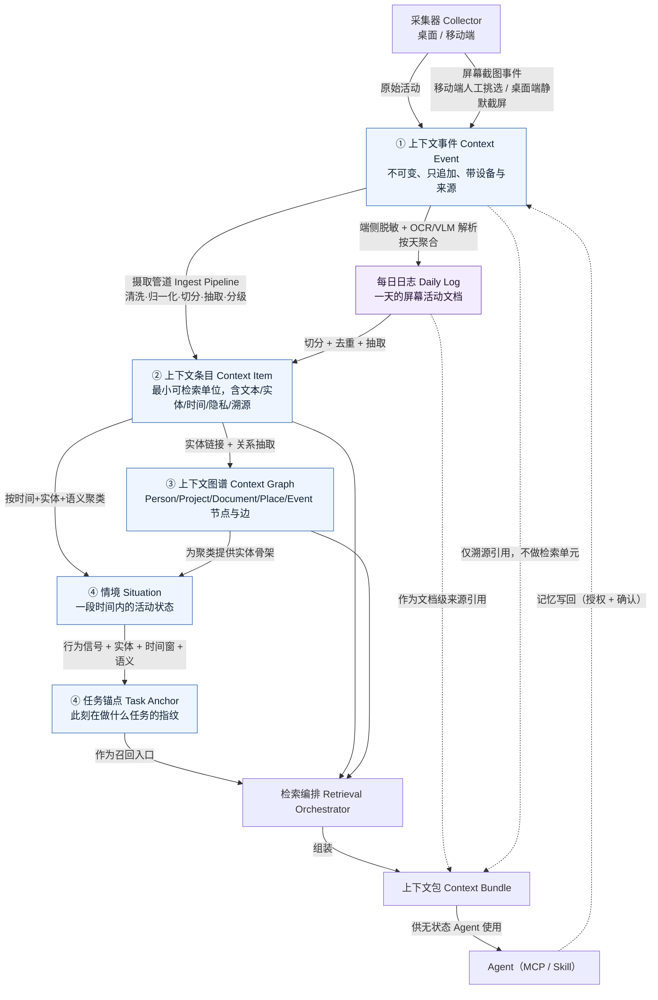
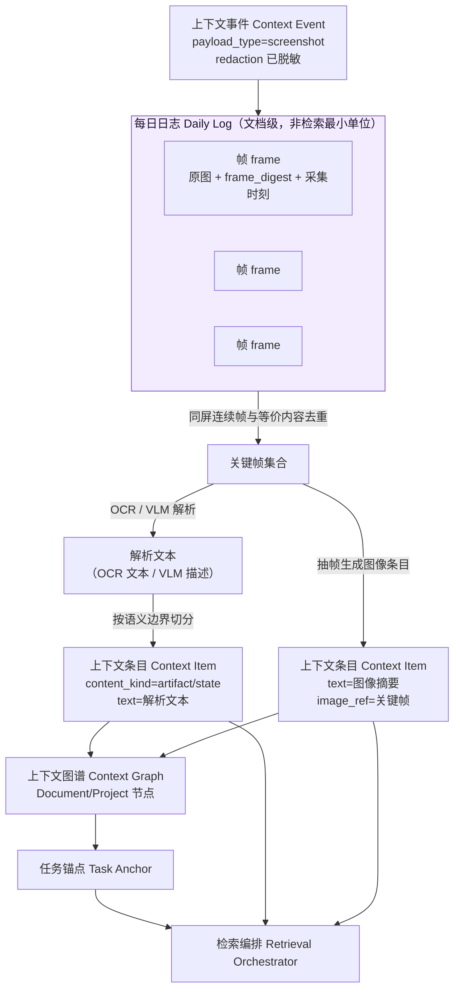
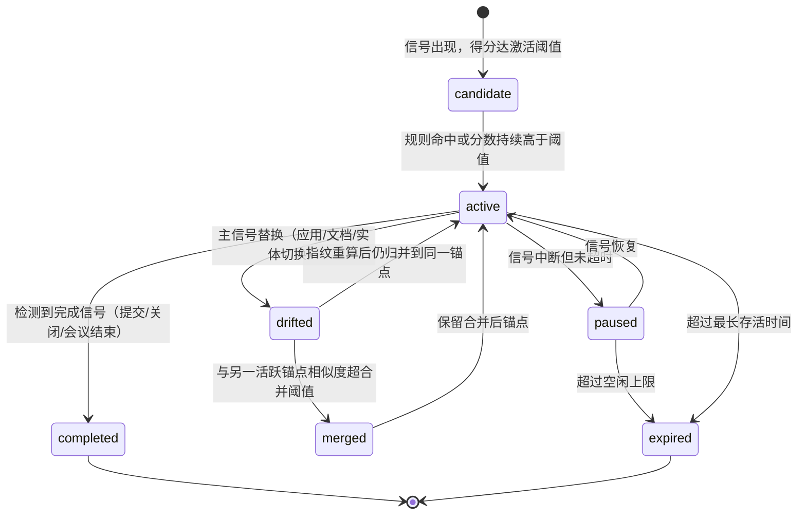
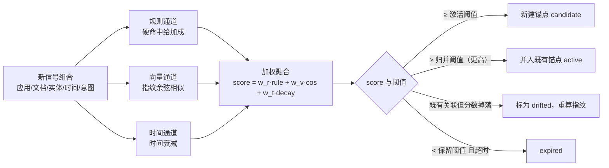

# 03 · 上下文数据模型

> 状态：设想稿 v0.1 · 最后更新：2026-11-03
> 一句话摘要：把采集到的原始活动记录逐层提炼成「任务锚点可驱动检索、无状态 Agent 拿到即可用」的上下文条目与上下文包，并冻结一套可版本化、可溯源、可裁剪的字段契约。

术语一律使用 [README.md](README.md) 术语表；本文不自定义同义新词。

## 为什么需要一个统一模型

[requirements.md](../requirements.md) 的核心诉求是「任意无状态 Agent 无需用户专门提示即可取到任务相关上下文」。这句话对数据模型提出了四个硬约束：

1. **可被机器判断相关性。** 同一条信息在不同任务下的相关性完全不同。模型必须让「任务」成为一等公民，而不是把相关性交给 Agent 每次现场推理。
2. **可溯源、可引用。** 无状态 Agent 无法凭记忆核对事实，任何结论都要能指回原始来源。
3. **可分层治理。** [06-privacy-security.md](06-privacy-security.md) 的隐私域、用途绑定与 L0–L3 敏感度必须**内建在字段里**，否则过滤只能靠事后补丁。
4. **可裁剪。** Agent 的上下文窗口有限，模型必须支持「按预算降级而不失真」。

**建议**：采用四层统一模型 —— 上下文事件（Context Event）→ 上下文条目（Context Item）→ 上下文图谱（Context Graph）→ 情境与任务锚点（Situation / Task Anchor），每层职责单一、单向提炼、可独立重建。文本与屏幕图像两类来源共享同一套层与字段，只在条目内部按多模态方式表达（见「多模态上下文条目：截图、屏幕图像与每日日志」）。

**备选**：直接面向「文档块 + 向量」建模（RAG 式）。实现快，但缺失时间语义、任务语义与来源溯源，无法支撑「无提示召回」。

**不采用**：让每个采集端自行定义 schema。会导致摄取管道（Ingest Pipeline）出现组合爆炸，且检索侧无法统一隐私过滤。

## 四层模型

每层只解决一个问题，上一层的产物是下一层的输入，**任何一层都可以从下一层+原始日志重建**（见 [04-storage-retrieval.md](04-storage-retrieval.md) 的回填策略）。



### 层间转换规则

| 转换 | 触发时机 | 规则要点 | 幂等性 |
|---|---|---|---|
| Event → Item | 摄取管道实时（端侧预清洗后）或批量重放 | ① 按会话/文档/页面切分；② 归一化为带时间范围与参与者的条目；③ 抽取实体并打分；④ 端侧或云端分级（隐私域、敏感度）；⑤ 生成 embedding 引用 | 同一 `event_id` 重复摄取只更新条目，不新增 |
| Event（截图）→ Daily Log → Item | 截图事件到达后先按天聚合，再走同一摄取管道 | ① 同屏连续帧与等价内容先去重；② 端侧脱敏后 OCR/VLM 解析为文本；③ 按语义边界切分为条目并回指 `daily_log_id`；④ 原图与解析文本分别存储与分级 | `daily_log_id + frame_digest` 去重；同日重跑只覆盖派生文本，不改原图 |
| Item → Graph | 条目落库后异步 | 实体链接（对齐已有节点）+ 关系抽取；只新增节点/边与证据，不覆盖既有结论 | 边按「主语-谓词-宾语-来源条目」去重 |
| Item + Graph → Situation | 滑动窗口（如 5–30 分钟）或会话边界 | 时间连续性 + 实体重叠 + 语义相似度三者同时达标才聚类 | 同一时间窗重复计算产出同一 `situation_id`（按窗口主键去重） |
| Situation → Anchor | 每有新 Situation 或新行为信号 | 规则 + 向量相似 + 时间衰减打分，超过阈值则激活新锚点或并入既有锚点 | 锚点状态机转换需带 `revision` 做乐观并发 |
| Anchor + Item + Graph → Bundle | Agent 请求或触发点命中 | 推荐多路召回 → RRF 融合 → 重排 → token 裁剪 → 组装 | 相同 `(anchor_id, budget, trigger)` 可缓存复用 |
| Agent → Event（写回） | 任务结束、用户确认后 | 写回内容以新的上下文事件落库，走同一摄取管道，禁止直写条目表 | 写回事件同样只追加 |

**建议**：转换规则必须可在测试中用固定输入重放，任何一次规则升级都要能对历史数据重放并对比产出差异（模型升级的回归门禁）。

## ① 上下文事件 Context Event

采集端产生的一次原始活动记录。**不可变、只追加**，是整套模型的证据底线。

| 字段 | 类型 | 必填 | 说明 |
|---|---|---|---|
| `event_id` | string (ULID) | 是 | 全局唯一，单调可排序 |
| `collector_id` | string | 是 | 采集器标识，如 `macos.foreground_window` |
| `device_id` | string | 是 | 设备标识，用于来源归属与撤销 |
| `source_app` | string | 否 | 产生活动的应用/服务 |
| `occurred_at` | string (ISO-8601) | 是 | 事件发生时间（设备时钟） |
| `ingested_at` | string (ISO-8601) | 是 | 云端接收时间，用于乱序检测 |
| `timezone` | string | 否 | IANA 时区，如 `Asia/Shanghai` |
| `privacy_domain` | enum | 是 | 隐私域，端侧预判、云端可纠正 |
| `sensitivity` | enum | 是 | `L0`–`L3`，见 [06-privacy-security.md](06-privacy-security.md) |
| `payload_type` | enum | 是 | `text` / `window` / `message` / `calendar` / `location` / `file` / `clipboard` / `screenshot` / `screenshot_ocr` |
| `payload_ref` | string | 是 | 原始负载在对象存储中的**不可变引用**（WORM）；截图事件指向**原图**，解析文本属于派生层 |
| `payload_digest` | string | 是 | 内容摘要，用于去重与防篡改校验；截图即 `frame_digest` |
| `capture_mode` | enum | 否 | 截图来源路径：`manual_pick`（移动端用户每日人工挑选）/ `silent_interval`（桌面端每 10–60 分钟静默截屏）/ `null`（非截图事件） |
| `redaction` | object | 否 | 端侧脱敏结果：`{applied: bool, regions: number, rules: [string]}`，脱敏后的图才允许离开设备 |
| `capture_level` | enum | 否 | 采集分级（端侧字段）：`metadata_only` / `metadata_plus_text` / `metadata_plus_parsed_image` / `full_artifact`；取值口径的权威定义见 [02-capture-clients.md](02-capture-clients.md) 采集分级表 |
| `preprocess` | object | 否 | 端侧预处理结果：`{redacted: bool, redact_rules: [string], truncated: bool}` |
| `schema_version` | string | 是 | 事件 schema 版本 |
| `idempotency_key` | string | 否 | 端侧重传去重键 |

**设备侧信封字段（不属于本 schema）**：[02-capture-clients.md](02-capture-clients.md) 的「设备侧上行样例」还带 `collector_version`、`platform`、`client_version`、`monotonic_seq`、`clock_skew_hint_ms`、`payload`、`derived`、`trigger`、`handling` 等字段。它们只在设备侧服务于传输、时钟校正与预处理留痕，**云端事件表只落本表字段**。三点取值规则：① `ingested_at` 由云端在接收时写入，设备侧样例不含；② `payload_ref` 在上行前是设备本地队列引用（`local://…`），上行后改写为对象存储的不可变（WORM）引用，**原始负载不随事件上行时取 `null`**（例如原图不出设备，只有 `payload_digest`/`frame_digest` 上行）；③ `handling` 的端侧处理结果映射为本表的可选字段 `redaction` / `preprocess`。

示例：

```json
{
  "event_id": "01JCF3K7Q2W9X8T5M4N3P2R1S0",
  "collector_id": "macos.foreground_window",
  "device_id": "dev-mbp-jia-01",
  "source_app": "com.microsoft.VSCode",
  "occurred_at": "2026-11-03T10:12:04+08:00",
  "ingested_at": "2026-11-03T10:12:06+08:00",
  "timezone": "Asia/Shanghai",
  "privacy_domain": "work",
  "sensitivity": "L1",
  "payload_type": "window",
  "payload_ref": "worm://raw/2026/11/03/dev-mbp-jia-01/01JCF3K7Q2.json.zst",
  "payload_digest": "sha256:9f2c...",
  "capture_level": "metadata_plus_text",
  "preprocess": { "redacted": true, "redact_rules": ["email", "internal_token"], "truncated": false },
  "schema_version": "1.0.0",
  "idempotency_key": "dev-mbp-jia-01:01JCF3K7Q2"
}
```

**约定**：事件级 `sensitivity` 是该事件**本次实际上行内容**中最高的一档（本示例为窗口标题类元数据，取 L1；若正文片段随之上行则为 L2——口径与 [02-capture-clients.md](02-capture-clients.md) 第 2 节的敏感度初判一致，见 [06-privacy-security.md](06-privacy-security.md) 第 2 节矩阵）。截图事件的制品按 L3 计，规则见下文「统一敏感度规则」。

**约定**：事件层**不参与语义检索**，只做溯源与重放。`screenshot_ocr` 之类的 L3 负载默认只在端侧保留，是否上传由用户显式授权决定，具体见 [06-privacy-security.md](06-privacy-security.md)。

### 截图类事件的两条来源路径

| 路径 | 采集时机 | 采集器示例 | 关键约束 |
|---|---|---|---|
| 移动端人工挑选 | 用户每日主动挑选重要截图（支付凭据、聊天关键页、行程、票据） | `ios.photo_pick` / `android.photo_pick` | 由用户显式选择，意图明确、量小；采集时必须记录「用户主动提供」这一事实，`confidence` 起点更高 |
| 桌面端静默截屏 | 每 10–60 分钟一次（可配、可暂停） | `macos.silent_screenshot` / `windows.silent_screenshot` | 无感知采集，量最大、隐私风险最高；必须先端侧脱敏再上传，且原图与解析文本分开授权 |

截屏事件示例（桌面静默截屏）：

```json
{
  "event_id": "01JCG1A2B3C4D5E6F7G8H9J0K1",
  "collector_id": "macos.silent_screenshot",
  "device_id": "dev-mbp-jia-01",
  "source_app": "com.apple.Safari",
  "occurred_at": "2026-11-03T14:30:00+08:00",
  "ingested_at": "2026-11-03T14:30:04+08:00",
  "timezone": "Asia/Shanghai",
  "privacy_domain": "work",
  "sensitivity": "L3",
  "payload_type": "screenshot",
  "payload_ref": "worm://frames/2026/11/03/dev-mbp-jia-01/01JCG1A2B3.png.enc",
  "payload_digest": "sha256:3ad1...",
  "capture_mode": "silent_interval",
  "redaction": { "applied": true, "regions": 3, "rules": ["email", "id_number", "chat_avatar"] },
  "capture_level": "full_artifact",
  "preprocess": { "redacted": true, "redact_rules": ["email", "id_number"], "truncated": false },
  "schema_version": "1.0.0",
  "idempotency_key": "dev-mbp-jia-01:01JCG1A2B3"
}
```

> 说明：本示例的 `capture_level` 为 `full_artifact`（事件引用了原始制品），故事件级 `sensitivity` 取 **L3**。若按 [06-privacy-security.md](06-privacy-security.md) 第 6.1 节的默认形态 A——**原图不出设备、只在端侧加密暂存**——则事件上行时不带原图，`capture_level` 应为 `metadata_plus_parsed_image`、`sensitivity` 随脱敏后的解析文本取 L2。云端的 `privacy_domain` 与 `sensitivity` 由端侧给出初始值；分级口径与上升/下降规则见下一条。

**统一敏感度规则（建议，与 [02-capture-clients.md](02-capture-clients.md) 第 9 节、[06-privacy-security.md](06-privacy-security.md) 第 2 节与第 6 节一致）**：

1. **原图制品本身始终按 L3 治理**——加密、留存上限、删除级联都以该制品为根，不因脱敏或解析成功而下调；
2. **解析文本按脱敏后的内容逐字段判定敏感度**，允许降到 L1–L2，但**屏幕派生文本的默认下限为 L2**（对应 06 第 2 节把「截图 OCR 文本」列在 L2）；
3. 任何仍含未完全脱敏个人内容的字段按 **L3**；无法可靠判定时**取更高一级**（与 06 第 2 节矩阵使用规则「冲突时取更高级别」一致）。

即：**制品是 L3，文本按内容分级、屏幕派生文本以 L2 为下限**——两者是两套分级口径，不再用「解析文本不得低于原图」的单一规则。

## ② 上下文条目 Context Item

记忆层的最小单位：一段可独立检索、可引用、带来源与时间的信息。字段分七组。屏幕图像来源的条目额外使用多模态字段，详见下文「多模态上下文条目：截图、屏幕图像与每日日志」。

### 通用字段

| 分组 | 字段 | 类型 | 必填 | 说明 |
|---|---|---|---|---|
| 标识 | `id` | string (ULID) | 是 | 条目 ID |
| 标识 | `schema_version` | string | 是 | 条目 schema 版本 |
| 标识 | `created_at` / `updated_at` | string (ISO-8601) | 是 | 记录创建与最后变更时间 |
| 来源 | `source` | object | 是 | `{collector_id, device_id, source_app, capture_level}` |
| 来源 | `source_event_ids` | string[] | 是 | 溯源：产生本条目的上下文事件 |
| 隐私 | `privacy_domain` | enum | 是 | 隐私域：`personal` / `work` / `family`（可扩展） |
| 隐私 | `sensitivity` | enum | 是 | `L0`–`L3` |
| 隐私 | `allowed_purposes` | string[] | 否 | 用途绑定标签，缺省继承隐私域默认值 |
| 时间 | `time_range` | object | 是 | `{start, end, precision}`；`precision` ∈ `instant`/`minute`/`day`/`range` |
| 时间 | `event_time` | string (ISO-8601) | 否 | 便于时间邻近召回的单点时间 |
| 参与者 | `participants` | object[] | 否 | `{person_id, role, display_name}` |
| 实体 | `entities` | object[] | 否 | `{entity_id, type, mention, salience}` |
| 内容 | `text` | string | 是 | 归一化后的可读文本（已脱敏） |
| 内容 | `text_lang` | string | 否 | 语言标签 |
| 内容 | `content_kind` | enum | 否 | `fact` / `preference` / `intent` / `artifact` / `state` |
| 内容 | `modality` | enum | 否 | `text`（默认）/ `image_derived` / `image_direct`，见「多模态上下文条目：截图、屏幕图像与每日日志」 |
| 内容 | `daily_log_id` | string | 否 | 来源的每日日志（文档级容器），仅屏幕来源条目出现 |
| 内容 | `image_ref` | object | 否 | 关键帧引用：`{frame_digest, payload_ref, key_frame, duplicate_of, redacted, width, height}` |
| 内容 | `parse` | object | 否 | 解析信息：`{method, model, ocr_confidence, vlm_summary}` |
| 向量 | `embedding_ref` | object | 是 | `{model, dim, index, vector_id, status}`，条目表**不内联向量** |
| 向量 | `image_embedding_ref` | object | 否 | 多模态条目的图像向量引用，结构同 `embedding_ref` |
| 质量 | `confidence` | number | 是 | 0–1，摄取管道对该条目正确性的自评 |
| 溯源 | `provenance` | object | 是 | 见下 |
| 生命周期 | `lifecycle` | enum | 是 | `active` / `superseded` / `expired` / `redacted` / `deleted` |
| 生命周期 | `valid_until` | string (ISO-8601) | 否 | 过期时间 |
| 生命周期 | `superseded_by` | string | 否 | 被哪条条目取代 |
| 检索辅助 | `tokens` | number | 否 | 正文 token 估算，供裁剪用 |

### 溯源 provenance

```json
{
  "derived_from": ["01JCF3K7Q2W9X8T5M4N3P2R1S0"],
  "ingest": { "pipeline_version": "0.4.0", "stage": "extract", "model": "extractor:v3" },
  "extraction": { "method": "llm+rule", "confidence": 0.82, "evidence_span": [12, 96] },
  "human_confirmed": false,
  "corrections": [
    { "at": "2026-11-03T11:00:00+08:00", "by": "user", "field": "entities", "note": "误识别为同事，实际是客户" }
  ]
}
```

**约定**：`provenance.derived_from` 必须能一路回指到一个或多个 `Context Event`；任何无法回指的条目不得进入检索索引（硬门禁）。

### 完整示例

```json
{
  "id": "01JCF4B2C3D4E5F6G7H8J9K0L1",
  "schema_version": "1.2.0",
  "created_at": "2026-11-03T10:13:10+08:00",
  "updated_at": "2026-11-03T10:13:11+08:00",
  "source": {
    "collector_id": "macos.foreground_window",
    "device_id": "dev-mbp-jia-01",
    "source_app": "com.microsoft.VSCode",
    "capture_level": "metadata_plus_text"
  },
  "source_event_ids": ["01JCF3K7Q2W9X8T5M4N3P2R1S0"],
  "privacy_domain": "work",
  "sensitivity": "L1",
  "allowed_purposes": ["task_execution", "summarization"],
  "time_range": { "start": "2026-11-03T10:12:04+08:00", "end": "2026-11-03T10:12:04+08:00", "precision": "instant" },
  "event_time": "2026-11-03T10:12:04+08:00",
  "participants": [],
  "entities": [
    { "entity_id": "proj:wecontext", "type": "Project", "mention": "wecontext", "salience": 0.91 },
    { "entity_id": "doc:03-context-model", "type": "Document", "mention": "03-context-model.md", "salience": 0.88 },
    { "entity_id": "org:internal", "type": "Org", "mention": "内部方案库", "salience": 0.35 }
  ],
  "text": "在 VSCode 中编辑 wecontext 的 03-context-model.md，正在补充任务锚点的匹配算法章节。",
  "text_lang": "zh",
  "content_kind": "state",
  "embedding_ref": { "model": "bge-m3", "dim": 1024, "index": "items_v3", "vector_id": "vec_01JCF4B2", "status": "ready" },
  "confidence": 0.86,
  "provenance": {
    "derived_from": ["01JCF3K7Q2W9X8T5M4N3P2R1S0"],
    "ingest": { "pipeline_version": "0.4.0", "stage": "extract", "model": "extractor:v3" },
    "extraction": { "method": "llm+rule", "confidence": 0.82, "evidence_span": [0, 48] },
    "human_confirmed": false,
    "corrections": []
  },
  "lifecycle": "active",
  "valid_until": null,
  "superseded_by": null,
  "tokens": 42
}
```

**建议**：`content_kind` 单独成字段而不是塞进 `text`，因为「偏好」类条目的冲突消解规则与「事实」类完全不同（见 [04-storage-retrieval.md](04-storage-retrieval.md) 的时效性与冲突消解）。

**备选**：把 embedding 直接内联在条目表。查询简单，但模型升级要全表重写，且隐私过滤与向量检索耦合，扩容困难。

## 多模态上下文条目：截图、屏幕图像与每日日志

屏幕图像与文本共享同一套四层模型，差异只在条目内部如何表达「图像—解析文本—来源文档」三者关系。

### 三者的关系



| 概念 | 是什么 | 是否可检索的最小单位 | 生命周期锚点 |
|---|---|---|---|
| 屏幕截图事件 | 一次截屏动作产生的上下文事件，引用原图 | 否，只做溯源与重放 | 跟随原始层保留策略 |
| 每日日志 Daily Log | 按天聚合的文档级容器，承载当天全部帧与原图引用 | 否（**建议**可作为文档级条目被引用，但不作为召回主单元） | 按天创建；当天结束即封存（immutable） |
| 帧 frame | 单张图像及其 `frame_digest`、采集时刻、`capture_mode` | 否 | 随原图保留策略过期 |
| 解析文本 | OCR / VLM 对帧的结构化解读 | 否，是条目的 `text` 来源 | 可重跑（模型升级时重生成） |
| 上下文条目 Context Item | 从关键帧或解析文本切分出的可检索单位 | **是** | 独立 `lifecycle`，可被 `superseded` |

**建议**：**只有上下文条目参与检索，每日日志与原图只作引用。** 若把整份日志当一个可检索单位，会同时污染召回精度与 token 预算。

**术语口径**：本文的「解析文本」指 [02-capture-clients.md](02-capture-clients.md) 第 9.3 节定义的**受限结构化字段**——应用/场景枚举、文档或页面类型、主题短句、实体名称、任务线索、时间感等（「只允许枚举 + 短文本，禁止自由长文转写，禁止输出完整对话记录」）。它不是屏幕自由转写，因此条目的 `text` 通常较短，`tokens` 预算也相应较小；VLM 若输出自由长文即属越界，需在摄取管道拦下。

### 原图与解析文本的关系

| 维度 | 原图 | 解析文本（OCR / VLM 输出） |
|---|---|---|
| 存储位置 | 加密对象存储（冷层） | 结构化条目表 + 全文/向量索引（热层） |
| 是否可检索 | 仅通过图像向量引用 | 直接参与 BM25 与文本向量召回 |
| 敏感度 | **始终 L3**（制品为治理之根，加密/留存/删除级联以它为准） | 按脱敏后内容逐字段判定，可降为 L1–L2；**屏幕派生文本默认下限 L2**；仍含未完全脱敏个人内容的字段按 L3，判不准时取更高一级 |
| 可信度 | 事实的最终依据 | 派生物，`provenance` 必须回指 `frame_digest` 与原图 `payload_ref` |
| 可否重建 | 不可重建 | 可从原图重建（模型升级时重跑） |
| 删除语义 | 删除后不可恢复 | 删除后需同时清索引与缓存 |

**建议**：条目 `text` 使用解析文本，同时保留 `image_ref` 指向关键帧；两者用同一条目表达，避免「图一条、文一条」造成重复召回与 token 浪费。

**备选**：原图与解析文本拆成两条独立条目。便于分别授权，但会产生重复召回、需要额外的图-文关联字段，**建议**只在「原图授权与文本授权必须分离」的强隐私要求下采用。

### 每日日志的组织、切分与去重

**按天组织（建议）**：

- `daily_log_id = log:{date}:{device_id}`，一天一台设备一份；多设备当天各自成日志。
- 日志只追加，当天结束后封存；补传的旧帧写入对应日期的日志并触发该日重算。
- 每个条目携带 `daily_log_id` 与 `frame_digest`，使「这条记忆来自哪一天哪一帧」可一步回溯。

**切分规则（建议，按优先级）**：

1. **应用/窗口切换边界**：`source_app` 或窗口标题变化即候选切分点。
2. **语义边界**：同一应用内按主题变化切分，避免把两份无关内容合成一条。
3. **时间间隔上限**：超过阈值（如 15–30 分钟无活动）强制切分，具体阈值**待核实**。
4. **长度上限**：单条目 token 不得超过上限，超出继续切分。
5. **最小长度下限**：过短且无实体的帧并入相邻条目，避免碎片化。

**去重规则（建议）**：

| 重复类型 | 判定 | 处理 |
|---|---|---|
| 同屏连续帧 | 相邻帧 `frame_digest` 相同，或图像相似度超过阈值 | 只保留最早一帧为关键帧，其余标记 `duplicate_of` |
| 内容等价但像素不同（光标闪烁、时钟跳动、通知条） | 解析文本相似度超过阈值 + 应用相同 | 归并到同一条目，`time_range.end` 取更晚时间 |
| 跨天重复（同一页面第二天又打开） | 解析文本高度相似 | **不合并**：时间不同、任务可能不同，交给检索的时间邻近通道区分 |
| 人工挑选与静默截屏撞车 | 同一时刻两条来源 | 保留人工挑选的那条（意图更强），静默帧标 `duplicate_of` |
| 同一张图重复挑选 | `frame_digest` 相同 | 幂等写入，只刷新 `updated_at` |

**不采用**：逐帧入库、不做去重。桌面静默截屏在 10–60 分钟粒度下一天可产生数十张图，逐帧入库会让条目数量与 token 成本失控，且召回结果高度冗余。

多模态条目示例：

```json
{
  "id": "01JCG2M3N4P5Q6R7S8T9V0W1X2",
  "schema_version": "1.3.0",
  "created_at": "2026-11-03T14:31:20+08:00",
  "updated_at": "2026-11-03T14:31:22+08:00",
  "source": {
    "collector_id": "macos.silent_screenshot",
    "device_id": "dev-mbp-jia-01",
    "source_app": "com.apple.Safari",
    "capture_level": "full_artifact",
    "capture_mode": "silent_interval"
  },
  "source_event_ids": ["01JCG1A2B3C4D5E6F7G8H9J0K1"],
  "daily_log_id": "log:2026-11-03:dev-mbp-jia-01",
  "privacy_domain": "work",
  "sensitivity": "L2",
  "allowed_purposes": ["task_execution"],
  "time_range": { "start": "2026-11-03T14:30:00+08:00", "end": "2026-11-03T14:41:00+08:00", "precision": "range" },
  "event_time": "2026-11-03T14:30:00+08:00",
  "participants": [],
  "entities": [
    { "entity_id": "proj:wecontext", "type": "Project", "mention": "wecontext", "salience": 0.74 }
  ],
  "text": "Safari 打开 weContext 仓库的 requirements.md 与 creativity/README.md，页面停留在「术语表」章节。",
  "text_lang": "zh",
  "content_kind": "artifact",
  "modality": "image_derived",
  "image_ref": {
    "frame_digest": "sha256:3ad1...",
    "payload_ref": "worm://frames/2026/11/03/dev-mbp-jia-01/01JCG1A2B3.png.enc",
    "key_frame": true,
    "duplicate_of": null,
    "redacted": true,
    "width": 2880,
    "height": 1800
  },
  "image_embedding_ref": { "model": "multimodal-embed-v1", "dim": 768, "index": "frames_v1", "vector_id": "vec_frame_01JCG1A2B3", "status": "ready" },
  "parse": { "method": "ocr+vlm", "model": "ocr:v2", "ocr_confidence": 0.88, "vlm_summary": true },
  "embedding_ref": { "model": "bge-m3", "dim": 1024, "index": "items_v3", "vector_id": "vec_01JCG2M3", "status": "ready" },
  "confidence": 0.81,
  "provenance": {
    "derived_from": ["01JCG1A2B3C4D5E6F7G8H9J0K1"],
    "ingest": { "pipeline_version": "0.6.0", "stage": "parse", "model": "ocr:v2" },
    "extraction": { "method": "ocr+vlm", "confidence": 0.88, "evidence_span": null },
    "human_confirmed": false,
    "corrections": []
  },
  "lifecycle": "active",
  "valid_until": null,
  "superseded_by": null,
  "tokens": 58
}
```

**约定**：`modality` 取值 `text` / `image_derived`（由图像解析得到）/ `image_direct`（图像本身即条目主体）；`image_ref` 与 `image_embedding_ref` 仅多模态条目出现，文本条目保持原样，不破坏既有 schema 的向前兼容。

**分级口径说明**：本示例条目 `sensitivity = "L2"` 描述的是**解析文本**的级别（脱敏后逐字段判定、以 L2 为屏幕派生文本下限）；它所引用的**原图制品始终按 L3 治理**，该 L3 不写入本字段，而体现在 `payload_ref` 指向的加密原图记录、其留存上限与删除级联上。`image_direct`（原图本身即条目主体、经用户逐张授权上传）时，条目 `sensitivity` 才按 **L3** 计。完整规则见上文「统一敏感度规则」，并见 [02-capture-clients.md](02-capture-clients.md) 第 9 节与 [06-privacy-security.md](06-privacy-security.md) 第 2、6 节。

## ④ 上下文图谱 Context Graph

人物、项目、文档、地点、事件之间的实体关系网络，为聚类与「图谱扩展召回」提供骨架。

### 节点

| 字段 | 类型 | 说明 |
|---|---|---|
| `node_id` | string | 规范化实体 ID，如 `person:alice`、`proj:wecontext` |
| `type` | enum | `Person` / `Project` / `Document` / `Place` / `Event` / `Topic` / `Artifact` / `Org` |
| `canonical_name` | string | 规范名 |
| `aliases` | string[] | 别名、不同端上的写法 |
| `privacy_domain` | enum | 归属域；跨域实体需显式声明 |
| `sensitivity` | enum | 节点级最高敏感度（取并入条目最大值） |
| `first_seen` / `last_seen` | string (ISO-8601) | 时间跨度 |
| `attributes` | object | 类型相关属性（如文档路径、地点经纬度粗化值） |
| `merge_state` | enum | `active` / `merged_into` / `tombstoned` |

### 边

| 字段 | 类型 | 说明 |
|---|---|---|
| `edge_id` | string | 边 ID |
| `from` / `to` | string | 节点 ID |
| `predicate` | enum | `mentions` / `authored_by` / `belongs_to` / `attended` / `located_at` / `references` / `derived_from` / `related_to` |
| `confidence` | number | 关系置信度 |
| `evidence_item_ids` | string[] | 证据：支撑该关系的上下文条目 |
| `time_range` | object | 关系有效期（人与项目的关系会结束） |
| `privacy_domain` | enum | 边的域；跨域边是**天然的过滤点** |

```json
{
  "nodes": [
    { "node_id": "proj:wecontext", "type": "Project", "canonical_name": "weContext", "aliases": ["wecontext", "上下文平台"], "privacy_domain": "work", "sensitivity": "L1", "first_seen": "2026-11-01T09:00:00+08:00", "last_seen": "2026-11-03T10:12:04+08:00", "attributes": { "repo": "SuperAgent/context-platform" }, "merge_state": "active" }
  ],
  "edges": [
    { "edge_id": "e_01JCF4C0", "from": "person:jia", "to": "proj:wecontext", "predicate": "belongs_to", "confidence": 0.95, "evidence_item_ids": ["01JCF4B2C3D4E5F6G7H8J9K0L1"], "time_range": { "start": "2026-11-01T09:00:00+08:00", "end": null }, "privacy_domain": "work" }
  ]
}
```

**建议**：图谱只存**实体与关系**，不存原文；原文永远在条目里，图谱通过 `evidence_item_ids` 引用。这样图谱可以被重建，也可以在隐私删除时精准级联。

**不采用**：把图谱当作独立的第二份事实库。会产生「图谱说 A、条目说 B」的双事实来源问题，违反 [AGENTS.md](../AGENTS.md) 的单一事实来源原则。

## ⑤ 情境 Situation 与任务锚点 Task Anchor

### 情境 Situation

| 字段 | 类型 | 说明 |
|---|---|---|
| `situation_id` | string | 情境 ID |
| `time_range` | object | 起止时间 |
| `privacy_domain` | enum | 主域（跨域情境需拆分） |
| `item_ids` | string[] | 组成该情境的上下文条目 |
| `entity_ids` | string[] | 涉及实体 |
| `summary` | string | 一句话概述（可由 LLM 生成，带 `provenance`） |
| `cohesion` | number | 聚类内聚度，低于阈值不成立 |
| `anchor_id` | string | 关联的任务锚点（可为空） |

### 任务锚点 Task Anchor

任务锚点是「用户此刻在做什么任务」的指纹，是检索的入口。它**由信号推导、可漂移、可纠错**，不是用户手填的任务名。

#### 信号来源

| 信号 | 来源字段/采集器 | 时效窗口 | 说明 |
|---|---|---|---|
| 前台应用与窗口 | `source_app`、窗口标题 | 秒级 | 强烈指示当前任务类型 |
| 正在读写的文档/页面 | 文档路径、URL | 分钟级 | 与 `Document` 实体对齐 |
| 日历事件 | `calendar` 事件 | 当前±30 分钟 | 提供任务名与参与者 |
| 最近消息/邮件 | `message` 事件 | 10 分钟内 | 推断协作对象与议题 |
| 剪贴板意图 | `clipboard` 事件 | 5 分钟内 | 「复制了地址 → 可能要出行/报销」 |
| 位置与设备状态 | `location` 事件 | 10 分钟内 | 区分通勤/在司/在家等工作模式 |
| 会话内 Agent 提问 | Agent 请求附带 | 会话级 | 显式但非必需的强信号 |
| 近期写回结论 | 记忆写回事件 | 小时级 | 任务延续性 |

#### 生命周期



锚点字段：

| 字段 | 类型 | 说明 |
|---|---|---|
| `anchor_id` | string | 锚点 ID |
| `state` | enum | 见上图状态机 |
| `fingerprint` | object | 指纹，见下 |
| `signal_weights` | object | 各信号贡献权重，用于解释与调试 |
| `time_range` | object | 起止时间与 `last_active_at` |
| `privacy_domain` | enum | 主域 |
| `situation_ids` | string[] | 关联情境 |
| `item_ids` | string[] | 高相关条目（缓存），避免每次全量召回 |
| `confidence` | number | 锚点是否可信 |
| `revision` | number | 乐观并发版本号 |
| `user_confirmed` | bool | 用户是否确认过锚点归属 |

#### 指纹表示

```json
{
  "anchor_id": "anchor_01JCF4D9",
  "state": "active",
  "revision": 7,
  "fingerprint": {
    "app_context": ["com.microsoft.VSCode"],
    "doc_refs": ["doc:03-context-model"],
    "url_hosts": [],
    "entity_ids": ["proj:wecontext", "doc:03-context-model"],
    "participants": [],
    "place": null,
    "intent_text": "撰写上下文平台设想文档：数据模型章节",
    "semantic_vector_ref": { "model": "bge-m3", "index": "anchors_v2", "vector_id": "vec_anchor_01JCF4D9" },
    "rule_tags": ["writing", "docs", "repo:context-platform"],
    "time_pattern": { "typical_hours": [9, 10, 11, 14, 15, 16], "weekday_bias": 0.8 }
  },
  "signal_weights": { "app": 0.30, "doc": 0.25, "entity": 0.20, "calendar": 0.10, "intent": 0.15 },
  "time_range": { "start": "2026-11-03T10:05:00+08:00", "end": null, "last_active_at": "2026-11-03T10:14:20+08:00" },
  "privacy_domain": "work",
  "situation_ids": ["sit_01JCF4D0"],
  "item_ids": ["01JCF4B2C3D4E5F6G7H8J9K0L1"],
  "confidence": 0.79,
  "user_confirmed": false
}
```

#### 候选匹配算法

对每个新到的信号组合，与现有活跃锚点逐一打分：



```
score(new, anchor) = w_rule · rule_score(new, anchor)
                   + w_vec  · cos(fingerprint_vec(new), anchor.fingerprint_vec)
                   + w_time · exp(-Δt / τ)
                   - w_conf · conflict_penalty(new, anchor)
```

- `rule_score`：隐私域不一致直接判 0；应用相同、文档/实体重叠、日历事件 ID 相同等给离散加成。
- `cos`：指纹语义向量相似度，解决「同一任务换了措辞」。
- `exp(-Δt/τ)`：时间衰减，`Δt` 为距 `last_active_at` 的间隔，`τ` 为衰减常数。
- `conflict_penalty`：跨隐私域或实体互斥（如同一时段两个不同项目）时扣分。

**待核实**：权重 `w_rule` / `w_vec` / `w_time` / `w_conf`、阈值与 `τ` 的**具体数值**必须在真实数据上调参得出，本文不给出拍脑袋的默认值；离线调参方法见 [04-storage-retrieval.md](04-storage-retrieval.md) 的评测方案。

**建议**：规则通道优先于向量通道——规则可解释、可审计、可硬约束（隐私域），向量只负责补召回。

#### 锚点漂移与纠错

| 现象 | 判定 | 处理 |
|---|---|---|
| 主信号替换（换应用/换文档） | 高权重信号连续 N 分钟不一致 | 进入 `drifted`，重算指纹；若仍与旧锚点相似度达标则留在原锚点（视为子任务） |
| 两个活跃锚点高度相似 | 指纹相似度与实体重叠同时超高 | 合并为同一锚点，`item_ids`/`situation_ids` 取并集，保留 `revision` 递增 |
| 一个锚点分裂成两条任务线 | 实体集合出现稳定不相交的两个簇 | 拆分为两个锚点，历史条目按实体归属分配 |
| 用户手动纠正 | 用户在客户端或 Agent 侧标注「不是这个任务」 | 写回纠正事件，调整 `signal_weights`，并作为负样本进入评测集 |
| 误合并被事后发现 | 用户拆回 | 支持按 `revision` 回滚到上一次锚点划分（**建议**保留锚点历史表） |

**不采用**：把锚点做成不可变的任务实体。锚点本质是猜测，必须允许漂移、合并、拆分与回滚，否则一次误判会长期污染召回。

## 上下文包 Context Bundle 契约

面向一次 Agent 任务的组装结果，是 Agent 实际消费的对象。

### 结构

```json
{
  "bundle_id": "bundle_01JCF5A1",
  "schema_version": "1.1.0",
  "created_at": "2026-11-03T10:15:00+08:00",
  "task": {
    "anchor_id": "anchor_01JCF4D9",
    "anchor_confidence": 0.79,
    "trigger": "session_warmup",
    "purpose": "task_execution",
    "privacy_domains": ["work"],
    "max_sensitivity": "L1"
  },
  "items": [
    {
      "item_id": "01JCF4B2C3D4E5F6G7H8J9K0L1",
      "rank": 1,
      "score": 0.91,
      "recall_paths": ["bm25", "vector", "time_proximity"],
      "text": "在 VSCode 中编辑 wecontext 的 03-context-model.md，正在补充任务锚点的匹配算法章节。",
      "content_kind": "state",
      "modality": "text",
      "time_range": { "start": "2026-11-03T10:12:04+08:00", "end": "2026-11-03T10:12:04+08:00", "precision": "instant" },
      "confidence": 0.86,
      "citations": [
        { "source_event_ids": ["01JCF3K7Q2W9X8T5M4N3P2R1S0"], "source": "macos.foreground_window", "device_id": "dev-mbp-jia-01", "payload_ref": "worm://raw/2026/11/03/dev-mbp-jia-01/01JCF3K7Q2.json.zst", "evidence_span": [0, 48] }
      ],
      "truncated": false
    },
    {
      "item_id": "01JCG2M3N4P5Q6R7S8T9V0W1X2",
      "rank": 2,
      "score": 0.74,
      "recall_paths": ["multimodal_vector", "time_proximity"],
      "text": "Safari 打开 weContext 仓库的 requirements.md 与 creativity/README.md，页面停留在「术语表」章节。",
      "content_kind": "artifact",
      "modality": "image_derived",
      "image_ref": { "frame_digest": "sha256:3ad1...", "key_frame": true, "width": 2880, "height": 1800, "redacted": true },
      "daily_log_id": "log:2026-11-03:dev-mbp-jia-01",
      "time_range": { "start": "2026-11-03T14:30:00+08:00", "end": "2026-11-03T14:41:00+08:00", "precision": "range" },
      "confidence": 0.81,
      "citations": [
        { "source_event_ids": ["01JCG1A2B3C4D5E6F7G8H9J0K1"], "source": "macos.silent_screenshot", "device_id": "dev-mbp-jia-01", "payload_ref": "worm://frames/2026/11/03/dev-mbp-jia-01/01JCG1A2B3.png.enc", "daily_log_id": "log:2026-11-03:dev-mbp-jia-01", "parse_method": "ocr+vlm", "evidence_span": null }
      ],
      "truncated": false
    }
  ],
  "timeline": [
    { "at": "2026-11-03T10:05:00+08:00", "label": "锚点激活：撰写设想文档", "item_id": null },
    { "at": "2026-11-03T10:12:04+08:00", "label": "编辑 03-context-model.md", "item_id": "01JCF4B2C3D4E5F6G7H8J9K0L1" }
  ],
  "entities": [
    { "entity_id": "proj:wecontext", "type": "Project", "canonical_name": "weContext", "salience": 0.91, "evidence_item_ids": ["01JCF4B2C3D4E5F6G7H8J9K0L1"] }
  ],
  "missing": [
    { "what": "该项目的技术选型结论", "why": "候选条目均低于重排阈值，且用户未在授权域内留存相关记录", "suggested_action": "ask_user" }
  ],
  "confidence": { "overall": 0.83, "anchor": 0.79, "coverage": "partial", "method": "加权平均 + 覆盖度惩罚" },
  "budget": { "limit_tokens": 4000, "used_tokens": 3120, "clipped": true, "strategy": "relevance_first" },
  "privacy": { "filtered_at": ["recall", "rerank", "assembly"], "redacted_items": 2, "max_sensitivity": "L1" }
}
```

### 引用与溯源格式

- 每条 `items[]` **必须**带至少一条 `citations[]`；无 citation 的条目不允许进入包（硬校验）。
- `citations[].source_event_ids` 指向上下文事件；`payload_ref` 指向 WORM 原始负载，供审计与二次核对。
- 图像派生条目额外带 `daily_log_id` 与 `parse_method`；`payload_ref` 指向**加密原图**，Agent 若被授权查看原图需走单独的受控取图通路，包内默认只给解析文本。
- `image_ref` 默认只给 `frame_digest` 与尺寸，**不内联图像数据**；需要原图时按 `payload_ref` 二次授权获取。
- `evidence_span` 用字符区间标注该条目文本对应原文的位置，避免 Agent 断章取义；图像派生条目的 `evidence_span` 为 `null`，改用 `frame_digest` 定位。
- 包级 `bundle_id` + `task.anchor_id` 组合作为审计键，检索编排（Retrieval Orchestrator）的每次产出都可回放。

### token 预算与裁剪策略

| 段落 | 建议预算占比 | 裁剪顺序 |
|---|---|---|
| 任务与锚点说明 | 5%–10% | 最后裁剪（Agent 需要知道自己在干什么） |
| 条目正文 | 55%–65% | 按优先级裁剪 |
| 时间线 | 10%–15% | 先合并相邻、再截断尾部 |
| 实体卡片 | 10%–15% | 低 salience 实体先移除 |
| 缺失说明与置信度 | 5% | 不裁剪 |

裁剪顺序（**建议**，优先级从高到低）：

1. `content_kind = preference` 且 `confidence` 高、时间近的条目 —— **必留**，偏好是「无提示」体验的核心。
2. 与锚点实体直接相关的条目。
3. 时间邻近条目（`|item.event_time - anchor.time|` 小）。
4. 图谱距离 2 跳内的扩展条目。
5. 其余按融合分数截断。

**建议**：单条目被裁剪时保留「首尾 + 关键事实句」，并在 `truncated: true` 标注，让 Agent 知道信息不完整，而不是把半句话当完整事实。

**备选**：一次性返回全量条目、由 Agent 自己裁剪。实现简单，但**不采用**为默认路径——token 成本不可控，且无状态 Agent 缺少跨条目比较的稳定依据。

### 置信度与「缺失说明」

- `confidence.overall` 由 条目置信度、召回路径数（多路命中加分）、锚点置信度、覆盖度共同决定，具体公式**待核实**后按评测固化。
- `missing[]` 是**一等公民**：明确告诉 Agent「这次没找到什么、为什么、建议怎么办（`ask_user` / `tool_query` / `fallback_offline`）」。这比给出低质量条目更有价值，也避免 Agent 编造。
- 当 `confidence.coverage = none` 时，**建议**包内 `items` 为空、只返回 `missing`，让 Agent 直接询问用户，而不是硬凑上下文。

## schema 版本与向前兼容

**建议**：所有层级字段都带 `schema_version`，采用 `MAJOR.MINOR.PATCH`。

| 变更类型 | 版本动作 | 兼容要求 |
|---|---|---|
| 新增可选字段 | MINOR +1 | 老读者必须忽略未知字段（forward compatible） |
| 新增枚举值 | MINOR +1 | 老读者遇到未知枚举需降级为 `unknown` 而非报错 |
| 字段语义变更 / 删除字段 / 收紧约束 | MAJOR +1 | 必须提供 upcast 适配器，把历史数据映射到新版本 |
| 文档/注释修正 | PATCH +1 | 不影响数据 |

- **不采用**：无版本号直接改字段。历史条目会被新代码错误解读，且无法判断某条数据是「旧格式」还是「脏数据」。
- **建议**：条目与包都遵循「宽进严出」——读取时容忍未知字段与未知枚举，写出时严格按当前版本校验。
- **备选**：为每个 MAJOR 保留一份 schema 快照与样例数据集，作为 upcast 的回归测试夹具（具体放在哪个模块由 [08-options-and-roadmap.md](08-options-and-roadmap.md) 决定）。

## 跨文档术语一致性

| 统一术语 | 英文 | 本文使用位置 | 相关文档 |
|---|---|---|---|
| 上下文事件 | Context Event | ① 层；截图事件见同名小节 | [02-capture-clients.md](02-capture-clients.md) |
| 上下文条目 | Context Item | ② 层 | [04-storage-retrieval.md](04-storage-retrieval.md) |
| 每日日志 | Daily Log | 多模态上下文条目小节（② 层的文档级容器） | [02-capture-clients.md](02-capture-clients.md)、[04-storage-retrieval.md](04-storage-retrieval.md) |
| 上下文图谱 | Context Graph | ④ 层 | [04-storage-retrieval.md](04-storage-retrieval.md) |
| 情境 | Situation | ⑤ 层 | [07-scenarios.md](07-scenarios.md) |
| 任务锚点 | Task Anchor | ⑤ 层、Bundle 入口 | [04-storage-retrieval.md](04-storage-retrieval.md)、[05-agent-access.md](05-agent-access.md) |
| 上下文包 | Context Bundle | 交付契约 | [05-agent-access.md](05-agent-access.md) |
| 摄取管道 | Ingest Pipeline | Event → Item（含截图→每日日志→条目） | [02-capture-clients.md](02-capture-clients.md)、[04-storage-retrieval.md](04-storage-retrieval.md) |
| 检索编排 | Retrieval Orchestrator | Anchor → Bundle | [04-storage-retrieval.md](04-storage-retrieval.md) |
| 隐私域 / 敏感度分级 / 用途绑定 | Privacy Domain / L0–L3 / Purpose Binding | 全层字段；截图口径见「统一敏感度规则」 | [06-privacy-security.md](06-privacy-security.md)、[02-capture-clients.md](02-capture-clients.md) 第 9 节 |

**约定**：其他文档若需引用本文字段名，必须原样引用（如 `privacy_domain`、`sensitivity`、`item_ids`、`anchor_id`、`source_event_ids`），不得另起别名。

## 待定问题

1. **锚点匹配算法的权重与阈值**：`w_rule` / `w_vec` / `w_time` / `w_conf`、激活/归并/过期阈值、时间衰减常数 `τ` 需要在真实数据上调参，本文不给默认值。
2. **指纹的 `intent_text` 由谁生成**：端侧小模型（隐私好、能力弱）还是云端模型（能力强、需上传）？涉及 L3 数据的处理位置，需与 [06-privacy-security.md](06-privacy-security.md) 一起定。
3. **情境的聚类窗口与内聚度阈值**：固定窗口（如 15 分钟）还是事件驱动边界？跨域情境是否允许存在？
4. **条目粒度**：一次窗口切换 = 一条条目，还是同一任务内合并为一条？粒度直接影响召回精度与 token 成本，需要实验对比。
5. **embedding 模型与升级策略**：模型更换时是双写过渡还是全量重建？`embedding_ref.status` 需要支持哪些中间态？
6. **图谱实体的归一化标准**：同名不同人（重名）与同一人不同名（花名/昵称）的判定规则，是否引入用户确认闭环？
7. **写回条目的置信度起点**：Agent 写回的内容默认 `confidence` 如何取值？是否需要「未确认写回不参与偏好冲突消解」。
8. **`missing[]` 的生成方式**：规则（分数低于阈值即报告）还是 LLM 生成？LLM 生成的幻觉风险如何约束。
9. **包内条目的排序稳定性**：同一 `(anchor_id, budget)` 多次请求是否必须返回相同顺序（缓存友好 vs 时效性）。
10. **schema 兼容性的验证手段**：是否需要一份跨版本的黄金样例集，作为 CI 门禁（当前仓库尚未进入实现阶段）。
11. **截图条目的原子单位**：一张关键帧 = 一条条目，还是一段连续屏幕内容 = 一条条目？粒度决定去重收益与召回精度，需要实验对比。
12. **解析文本与图像是合并还是拆分**：本文**建议**合并为一条（`image_ref` + `text`）；若隐私策略要求「原图授权与文本授权分离」，需评估拆分带来的重复召回成本。
13. **每日本地日志的封存与补传语义**：跨天补传的帧是写入原日期日志并触发重算，还是单独开补传日志？影响幂等键设计。
14. **人工挑选与静默截屏的敏感度起点**：两者的**制品**都按 L3 治理（已定，见「统一敏感度规则」）；仍待定的是**解析文本的下限**是否对人工挑选放宽——用户意图更强，是否允许其文本按 L1 起步，还是与静默截屏统一以 L2 为下限。
15. **OCR/VLM 解析模型的部署位置**：**当前表述为端侧为主、云端重解析为备选且需用户显式同意**（与 [02-capture-clients.md](02-capture-clients.md) 第 9.3 节「不采用把图片上传到云端解析作为默认路径；若要作为备选，必须用户显式同意并在解析后立即删除原图」及第 14 条、[06-privacy-security.md](06-privacy-security.md) 第 6.1 节形态 A 一致），本轮不拍板：端侧隐私好但能力弱、耗电，云端能力强但需上传脱敏后的图。该问题同时列在 [02-capture-clients.md](02-capture-clients.md) 第 14 条与 [04-storage-retrieval.md](04-storage-retrieval.md) 第 16 条，属跨文档交叉待定项。
16. **多模态 embedding 与文本 embedding 的关系**：是否共用同一向量空间（可用文本查图），还是两套索引分别检索后融合？影响召回通道设计。
17. **原图是否/如何上行云端**：[06-privacy-security.md](06-privacy-security.md) 第 6.1 节**建议**默认形态 A——原图不出设备、仅端侧加密暂存，云端只收脱敏文本，云端存原图列为需用户逐张显式授权的备选；本文的「原图加密冷存」按该备选形态描述，默认形态下原图不进入 ① 原始层。默认形态与是否提供单张上传通道**待发起人确认**，本轮不擅自改写。

## 相关文档

- [creativity/README.md](README.md) —— 术语表与文档约定（本文的用词来源）
- [02-capture-clients.md](02-capture-clients.md) —— 上下文事件的产生方与端侧预处理
- [04-storage-retrieval.md](04-storage-retrieval.md) —— 本文模型的存储、索引与检索实现设想
- [05-agent-access.md](05-agent-access.md) —— 上下文包如何经 MCP / Skill 交付给无状态 Agent
- [06-privacy-security.md](06-privacy-security.md) —— 隐私域、敏感度分级、用途绑定与删除级联
- [07-scenarios.md](07-scenarios.md) —— 端到端场景中模型的真实走查
- [08-options-and-roadmap.md](08-options-and-roadmap.md) —— 模型相关的分期与风险
- [requirements.md](../requirements.md) —— 原始需求
