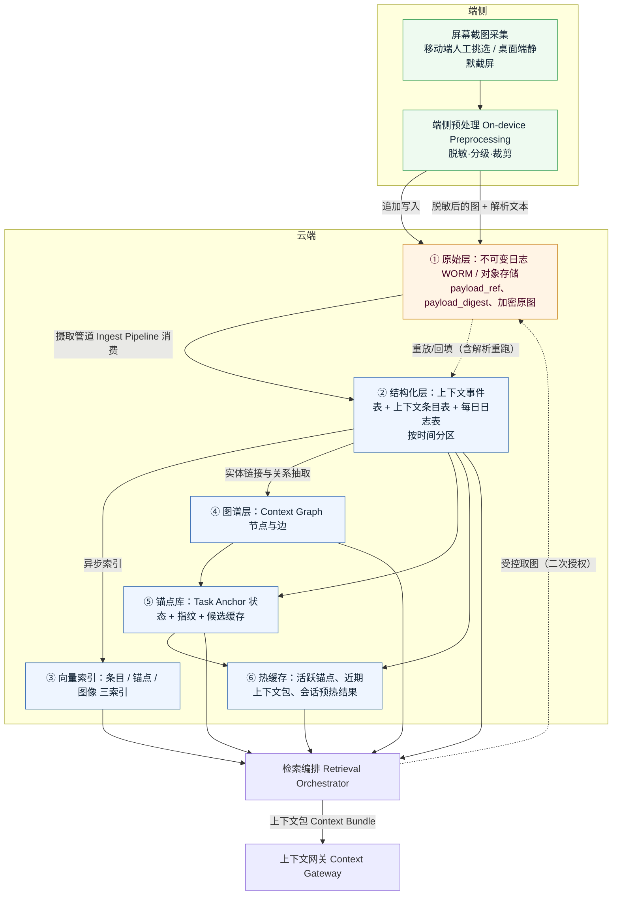
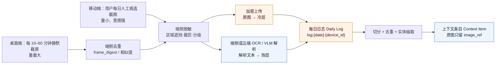
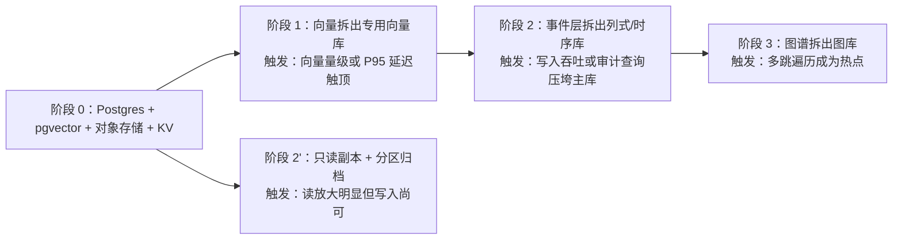
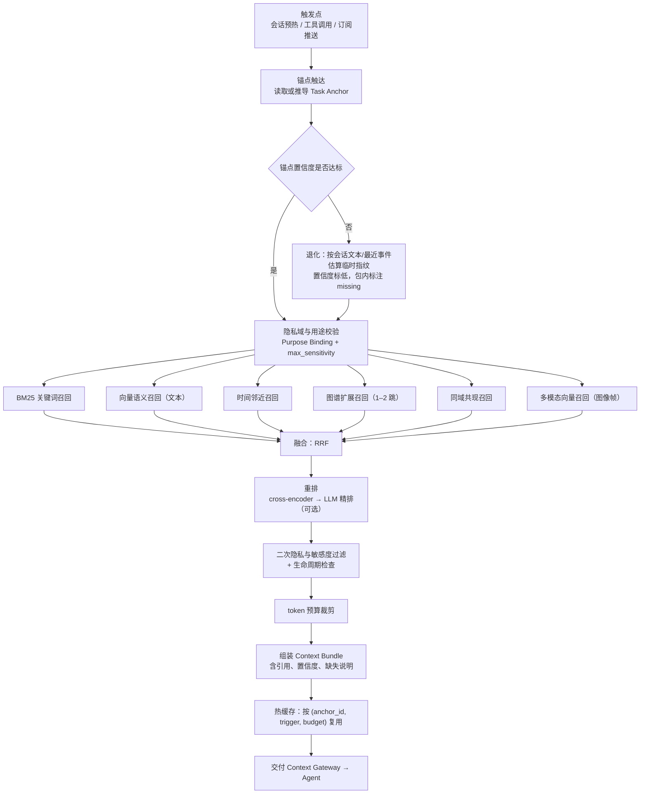
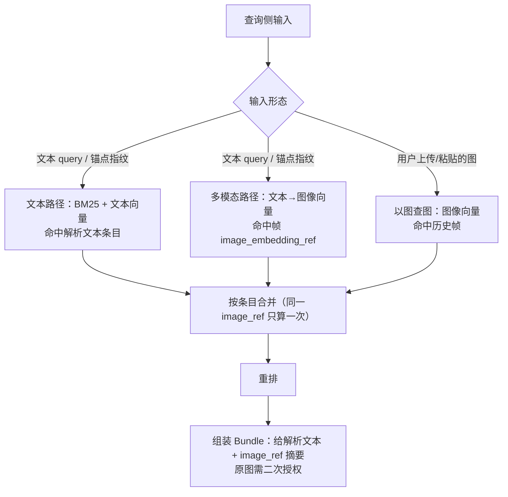
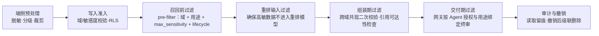

# 04 · 云端存储与检索

> 状态：设想稿 v0.1 · 最后更新：2026-11-03
> 一句话摘要：为上下文事件、上下文条目、上下文图谱与任务锚点设计一套分层存储（原始不可变日志 → 结构化表 → 向量索引 → 图谱 → 锚点库 → 热缓存），并给出「锚点触达 → 多路召回 → RRF 融合 → 重排 → token 裁剪 → 组装上下文包」的检索编排流程，支撑无提示召回。

字段名与 [03-context-model.md](03-context-model.md) 保持一致；术语一律引用 [README.md](README.md) 术语表。

## 目标与约束

| 约束 | 来源 | 对存储与检索的要求 |
|---|---|---|
| 无状态 Agent 无需专门提示 | [requirements.md](../requirements.md) | 检索入口必须是任务锚点，而不是用户 query |
| 端侧无感知采集、云端存储 | [requirements.md](../requirements.md) | 写入路径必须高吞吐、可乱序、可重放 |
| 任意 Agent 配 MCP/Skill 即可用 | [05-agent-access.md](05-agent-access.md) | 读路径稳定、低尾延迟、结果可引用 |
| 隐私域 + 用途绑定 | [06-privacy-security.md](06-privacy-security.md) | 过滤必须**下推到存储层**，不能只在上层做 |
| 原始信息不可篡改、可审计 | [03-context-model.md](03-context-model.md) 溯源要求 | 原始负载 WORM，派生层可重建 |
| 成本可控 | —— | 冷热分层，向量与图谱按访问频率决定索引精度 |

**核心主张**：**写入用日志、读取用索引、真相在原始层**。派生层（条目/图谱/锚点/索引）允许因隐私删除或模型升级而重建；原始层只追加、按保留策略整体过期。

## 分层存储



| 层 | 存什么 | 存储形态（建议） | 保留策略 | 冷热分层 |
|---|---|---|---|---|
| ① 原始层 | 上下文事件的原始负载、**加密屏幕原图**、OCR 中间产物、附件 | 对象存储，开启 WORM/对象锁定与版本化；原图端侧加密、密钥与服务端分离 | L0/L1 默认 30–90 天；L2/L3 默认更短或仅端侧；**原图单独设保留上限**（见「截图与每日日志的存储、成本与去重」）；具体天数**待核实**（取决于用户授权与合规要求） | 原图从写入起即冷层；超过 30 天转归档存储类 |
| ② 结构化层 | `context_event`、`context_item`、**`daily_log`** 表 | 关系库，按 `occurred_at` / `event_time` / 日志日期分区 | 条目 `lifecycle=expired` 后保留一段时间用于溯源，超期删除；日志封存后不可变 | 冷分区压缩/归档；热分区保留近 90 天 |
| ③ 向量索引 | 条目向量、锚点指纹向量、**图像（帧）向量** | HNSW（热）/ IVF-PQ 或磁盘索引（冷） | 跟随条目与原图生命周期；删除即删向量 | 近 90 天 HNSW 常驻内存，更早用低精度索引 |
| ④ 图谱层 | `Context Graph` 节点、边、别名表 | 关系库或图库（见选型） | 节点 `tombstoned` 后软删除；无边无证据的孤儿节点定期清理 | 全量常驻（图谱通常远小于原始数据） |
| ⑤ 锚点库 | 任务锚点状态、指纹、候选匹配缓存、锚点历史 | 关系库 + KV（热点锚点） | 锚点历史保留 30–90 天用于回滚与评测；过期锚点归档 | 活跃锚点常驻 KV |
| ⑥ 热缓存 | 活跃锚点快照、近期上下文包、会话预热结果、实体卡片、**近期解析文本** | 内存 KV（带 TTL） | TTL 分级：锚点秒级、包分钟级、实体卡片小时级 | 即热层本身 |

**建议**：保留策略以「字段级」而非「表级」声明——`sensitivity=L3` 的条目与 `L0` 的条目保留期不同，删除动作必须能级联到 ②–⑥ 所有派生层。

**建议**：截图的**原图走冷层、解析文本走热层**。原图是不可重建的证据、访问频率低、体积大；解析文本是可重建的派生物、需要参与检索、体积小。两者必须分开定存储类与保留上限。

**不采用**：把原始负载和结构化条目放同一个库。会导致（a）备份体积爆炸，（b）隐私删除无法做到「原件真正消失」，（c）无法单独对原始层做 WORM。

**备选**：端侧不保留任何原始数据，全部上传由云端托管。隐私风险高，且离线检索无法工作；仅作为「用户明确选择轻客户端」时的形态。

## 截图与每日日志的存储、成本与去重

新增采集路径（移动端人工挑选 + 桌面端每 10–60 分钟静默截屏 → 端侧脱敏 → 每日日志 → 抽取上下文）是整个平台**数据量最大、隐私最敏感、成本最不确定**的一条链路，必须单独设计存储与限额。



### 原图与解析文本的存储分离

| 维度 | 原图（加密原图） | 解析文本（OCR / VLM 输出） |
|---|---|---|
| 存储层 | ① 原始层，对象存储冷类（**默认形态下只在端侧加密暂存**，见下） | ② 结构化层 + ③ 向量索引 + ⑥ 热缓存 |
| 敏感度 | **始终 L3**：制品是治理之根，加密、留存上限、删除级联都以它为准，不因脱敏或解析成功而下调 | 按脱敏后内容**逐字段**判定，允许降为 L1–L2，但**屏幕派生文本默认下限 L2**；仍含未完全脱敏个人内容的字段按 L3，判不准时取更高一级 |
| 加密 | 端侧加密后上传（或仅端侧暂存），密钥与服务端存储分离 | 随结构化层加密；参与索引的那部分必须以可检索形式存在，**索引与缓存是明文泄露的高风险点** |
| 访问频率 | 极低（仅用户查看与审计） | 高（每次检索） |
| 可重建性 | 不可重建，是事实依据 | 可从原图重建（解析模型升级时可重跑） |
| 保留上限 | 单独设上限并按上限淘汰 | 跟随条目生命周期，可长期保留摘要 |
| 成本特征 | 容量与请求成本为主 | 计算与索引成本为主 |

**分级口径**：原图 L3 与解析文本 L1–L2 是**两套分级口径**，不适用「解析文本不得低于原图」。统一规则见 [03-context-model.md](03-context-model.md) 的「统一敏感度规则」，与 [02-capture-clients.md](02-capture-clients.md) 第 9 节、[06-privacy-security.md](06-privacy-security.md) 第 2 节与第 6 节一致。

**建议（默认形态）**：按 [06-privacy-security.md](06-privacy-security.md) 第 6.1 节的建议形态 A，**原图默认不出设备**——只在端侧加密暂存并按 TTL 删除，云端只接收脱敏解析文本；本节所述「原图进入 ① 原始层并加密冷存」对应云端存原图的备选形态 B，仅限用户对单张截图的显式授权动作。两种形态共用上表的分级与分离原则，差别只在原图落在端侧还是云端冷层。默认形态、原图端侧暂存天数与是否提供单张上传通道**待发起人确认**，本轮不拍板。

**建议**：无论原图落在端侧还是云端，原图都**永不进入**结构化层、向量索引与热缓存；条目只保存 `image_ref.frame_digest` 与 `payload_ref`。取图必须走单独的受控通路（二次授权 + 审计留痕）。

**备选**：原图解析后立即删除（06 的形态 A′，最严格档），仅保留解析文本（含低分辨率缩略图）。隐私最优、可重建性丧失，用户也无法复核 OCR 错误；适合「用户只要摘要」的形态。

**不采用**：把原图 base64 内联进条目表或塞进向量库 payload。备份、索引、缓存三处都会放大敏感数据，且与「原件加密冷存」的目标冲突。

### 保留上限与淘汰规则

| 数据 | 建议上限 | 淘汰方式 |
|---|---|---|
| 桌面静默截屏原图 | **L3 制品**：每用户保留最近 N 天 或 总量 M GB，两者先到为准；超出上限时**暂停采集**而非只淘汰旧数据 | 按天滚动淘汰最旧分区；保留期内的 L3 原图可提前淘汰 |
| 移动端人工挑选原图 | **L3 制品**：保留期更长（用户意图明确，通常是凭据/票据） | 到期提醒用户而非静默删除 |
| 每日日志的解析文本 | 长保留，但正文可降级为摘要；级别按内容逐字段判定、**下限 L2** | 正文超期后替换为摘要 + 实体，保留可检索性 |
| 帧向量索引 | 与原图同生命周期 | 原图淘汰时同步删向量 |
| 静默截屏的采集频率 | 10–60 分钟可配，支持暂停与「仅特定应用」白名单（与 [02-capture-clients.md](02-capture-clients.md) 第 9.1 节的频率档位口径一致） | 用户随时可调；夜间、全屏隐私应用与共享/录制状态默认跳过 |

删除级联以**原图制品**为根（L3）：删除原图必须同时清理解析文本条目、帧向量、热缓存与图谱中的引用，口径见 [06-privacy-security.md](06-privacy-security.md) 第 9.2 节。

**建议**：`N`、`M`、静默截屏频率、可保留的应用白名单都属于**用户可见可改**的设置，且默认偏保守；具体默认值**待核实**（[06-privacy-security.md](06-privacy-security.md) 第 6.1 节给出的端侧暂存示例为 7 天且标注需法律确认，本文不另编数字）。

### 数据量级估算方法（不填具体数字）

用下面的公式做容量规划，参数全部需要实测或用户调研后填入：

```
每日原图数量 ≈ 桌面静默采集时长 / 采集间隔 × 有效采集比例 + 移动端人工挑选数量
每日原图容量 ≈ 每日原图数量 × 单张原图平均字节数（含加密与元数据开销）
云端原图总量 ≈ 每日原图容量 × 保留天数 × 设备数 × 冗余系数
向量索引规模 ≈ 每日关键帧数量 × 保留天数 × 单向量字节数
每日解析文本 ≈ 每日关键帧数量 × 单帧平均 token × 单 token 字节数
存储成本 ≈ 原图容量 × 冷层单价 + 解析文本容量 × 结构化层单价 + 向量规模 × 内存单价
```

**待核实**：单张原图平均字节数（与分辨率、压缩率、是否加密有关）、OCR/VLM 单帧的算力与耗时、各存储类单价、去重后的实际有效率——这四项必须实测，任何拍脑袋的数字都会让成本模型失真。

**建议**：在 MVP 阶段就埋点统计「每日采集帧数、去重后关键帧数、上传字节数、解析耗时、检索命中率」，用真实数据反填上面的公式，再决定默认采集间隔与保留上限。

### 按天组织与去重（存储侧视角）

| 处理 | 位置 | 做法 | 收益 |
|---|---|---|---|
| 同屏连续帧去重 | **端侧**（上传前） | 相邻帧 `frame_digest` 相同或感知哈希相似度超阈值即丢弃 | 直接减少上传带宽与云端容量，是最大的一笔节省 |
| 静默帧与人工挑选撞车 | 端侧或摄取管道 | 保留人工挑选的那条，静默帧标 `duplicate_of` | 避免重复条目与重复召回 |
| 跨设备同一天 | 摄取管道 | 按 `daily_log_id = log:{date}:{device_id}` 分隔，不做跨设备合并 | 保持来源可追溯 |
| 解析文本级去重 | 摄取管道 | 文本相似度 + 同应用 + 同 `daily_log_id` 才归并 | 避免同一条目被反复写入 |
| 跨天重复 | **不合并** | 交给检索的时间邻近通道区分 | 时间不同、任务可能不同 |
| 幂等 | 摄取管道 | 唯一键 `(daily_log_id, frame_digest)` | 补传与重放安全 |

**不采用**：把去重完全交给云端。原始帧上传后再去重，带宽与冷存成本已经发生，且违反「敏感数据尽量不出设备」的原则。

## 存储选型对比

| 方案 | 适合承载 | 优势 | 代价/风险 | 结论 |
|---|---|---|---|---|
| **Postgres + pgvector** | ①事件表 ②条目表 ④图谱表 ⑤锚点表 + 向量（起步） | 单库事务一致、SQL 过滤与向量检索可在同一查询内下推、隐私域/敏感度过滤天然可控、运维简单 | 向量规模上到千万级后索引内存与召回性能承压；HNSW 参数调优与重建成本高 | **建议**作为起步统一底座 |
| **专用向量库**（Milvus / Qdrant / Weaviate 等） | ③向量索引（文本条目 / 锚点 / 图像帧） | 大规模向量召回、量化与多索引能力强、吞吐高 | 引入第二套一致性边界；需在应用层保证「条目已删、向量未删」的最终一致；过滤下推能力需逐个验证 | **备选**：向量规模与延迟成为瓶颈后拆分；图像向量通常是第一个把量级推上去的来源 |
| **时序/列式库**（TimescaleDB / ClickHouse 等） | ①原始事件表 ②行为类条目、统计与审计查询 | 高写入吞吐、时间分区与聚合极快、压缩比高 | 事务与更新语义弱；不适合承载需要频繁更新的锚点状态 | **备选**：写入量或分析需求上来后拆分事件层 |
| **图库**（Neo4j 等属性图 / 或关系库手写邻接表） | ④图谱层 | 多跳遍历表达自然、路径查询性能好 | 与主库双写一致性成本；多数场景 2–3 跳用 SQL 递归/邻接表已够 | **备选**：图谱查询成为热点后再拆；起步**建议**用关系库邻接表 |
| **对象存储**（开启对象锁定/WORM） | ①原始层（含加密屏幕原图）、附件、备份与离线导出 | 成本低、容量无上限、天然不可变与版本化 | 无查询能力、访问延迟高于本地盘、需自建索引与生命周期规则；原图取回延迟明显高于热层 | **建议**作为原始层必选项，原图从写入起即置于冷/归档存储类 |
| **内存 KV / Redis 类** | ⑥热缓存 | 亚毫秒读、天然 TTL | 非持久真相，重启即失效；不能作为唯一真相层 | **建议**作为加速层 |

**起步建议（MVP）**：对象存储（WORM） + 单个 Postgres（`pgvector` 扩展）承载 ②④⑤ 与向量索引 + 内存 KV 做热缓存。三件套即可跑通「锚点 → 多路召回 → 上下文包」全链路。

**规模化后拆分顺序（建议）**：



拆分原则：**先拆有明确触发指标的层，不提前拆**；每拆一层都要保留「跨层最终一致 + 隐私删除级联」的机制，否则隐私删除会变成不可能完成的任务。

**不采用**：一开始就上五套存储。运维与一致性成本会吃掉全部研发预算，且此时还没有数据能证明哪一层是瓶颈。

## 索引与分区策略

| 索引类型 | 承载层 | 选型要点 | 用途 |
|---|---|---|---|
| 全文索引 | ②条目表 | Postgres `tsvector`；中文需外部分词（如 zhparser 类方案，**待核实**具体扩展可用性）；检索用 `ts_rank`/BM25 类排序 | 关键词精确匹配、专有名词、代码符号 |
| 向量索引 | ③向量索引 | HNSW（热）/ IVF-PQ（冷）；参数 `m`、`ef_construction`、`ef_search` 需按评测调；**具体参数待核实** | 语义相似召回 |
| 图像向量索引 | ③向量索引（独立集合） | 与文本向量分集合/分维度；`model` + `dim` 写入 `image_embedding_ref`；模型升级需双写或重建 | 多模态召回、「用文本查图」「用图查图」 |
| 帧去重索引 | ②每日日志表 | `(daily_log_id, frame_digest)` 唯一索引 | 幂等写入与重复帧拦截 |
| 时间索引 | ①②⑤ | 分区键 + BRIN 或 B-tree；事件表按 `occurred_at`、条目表按 `event_time`、日志表按日志日期 | 时间邻近召回、保留策略批量过期、原图按天滚动淘汰 |
| 实体索引 | ②④ | 条目-实体倒排表（`item_id, entity_id, salience`）；图谱邻接表按 `from`/`to` 建索引 | 实体过滤、图谱扩展 |
| 隐私域索引 | ②③④⑤ | 作为所有查询的 **前置过滤条件**；考虑行级安全（RLS）兜底；原图与帧向量按域物理隔离 | 越权防护，避免「先召回后过滤」泄露 |
| 敏感度索引 | ②③④⑤ | 与隐私域构成复合索引；`max_sensitivity` 作为查询参数 | 降级输出、限制高敏数据进入重排 |
| 生命周期索引 | ②③ | `lifecycle` + `valid_until` 部分索引 | 排除过期/已取代条目 |

分区与分区键（**建议**）：

- `context_event` 按 `occurred_at` 月分区（写入量极大时可周分区）；分区淘汰即保留策略的实现方式。
- `context_item` 先按 `privacy_domain` 哈希或列表分区，再按 `event_time` 月分区 —— 让隐私删除与保留策略都能整分区操作。
- `daily_log` 按日志日期天/月分区；原图对象存储前缀同样按 `{year}/{month}/{day}/{device_id}/` 组织，使「按天淘汰」是一次前缀删除或生命周期规则，而不是逐对象扫描。
- 向量索引按 `privacy_domain` 分 collection/分片：**隐私过滤不能只靠向量库的 filter 参数**，物理隔离更安全（尤其 L3）。
- 图像向量集合与文本向量集合分开，且图像集合按保留窗口滚动重建（原图过期即删向量）。
- 锚点库按 `state` 划分活跃/归档表，活跃表保持小体量常驻内存。

**建议**：所有检索查询必须**先过滤后召回**（pre-filter）。跨域共现召回需要显式声明允许的域集合，且 L3 默认不参与跨域召回。

## 检索流程



### 多路召回

| 通道 | 输入 | 依赖索引 | 特点 | 建议权重来源 |
|---|---|---|---|---|
| BM25 关键词 | 实体名、应用名、文档名、锚点 `intent_text` | 全文索引 | 精确、可解释，专有名词强 | RRF 等权起步 |
| 向量语义 | 锚点指纹语义向量 + 会话文本 | 向量索引 | 覆盖换措辞、跨语言表达 | RRF 等权起步 |
| 时间邻近 | `anchor.time_range` 与 `item.event_time` 距离 | 时间索引 | 「刚发生过的事」优先级高 | RRF 等权起步 |
| 图谱扩展 | 锚点实体 → 邻域实体 → 关联条目 | 图谱 + 实体索引 | 补出「没被直接提到但相关」的上下文 | 按跳数衰减，如 1 跳 > 2 跳 |
| 同域共现 | 与锚点条目共现于同一情境/时间窗的条目 | 情境表 + 实体索引 | 捕捉隐含关联 | 落在 RRF 后段 |
| 多模态向量 | 锚点/会话文本的向量 → 图像帧向量；或用户上传的图 → 历史帧 | 图像向量索引 + `image_ref`/`daily_log_id` 回指 | 命中「屏幕上看到过但没被文本精确描述」的内容 | 起步**建议**等权；图像帧候选先按天去重再进融合 |

**融合（RRF）**：

```
RRF_score(item) = Σ_channels  w_channel / (k + rank_channel(item))
```

- RRF 只用**排名**不用分数，避免不同通道分数量纲不可比的问题。
- `k` 与 `w_channel` **待核实**：原始 RRF 论文给出过经验常数，但本系统通道数量与分布不同，需在离线评测集上调参后再固化。
- **备选**：加权分数归一化融合（如 min-max 后加权）。需要各通道分数校准，跨通道稳定性差，暂不作默认。

### 重排

| 阶段 | 方法 | 适用 | 代价 |
|---|---|---|---|
| 粗排 | RRF 融合后取 top-N（如 50–100） | 全量 | 低 |
| 精排 A | cross-encoder 对 (任务描述, 条目文本) 打分 | 需要高精度、延迟敏感 | 中：与候选数线性相关 |
| 精排 B | LLM 重排（可含「这条对当前任务是否有用」的判断） | 需要推断能力、条数少 | 高：token 与延迟显著 |

**建议**：默认只做「RRF + cross-encoder 精排」，LLM 精排在候选 ≤ 20 条或用户显式要求高质量时启用；所有重排模型的输入都必须已经过滤过隐私与敏感度。

**不采用**：直接让 LLM 读全量候选做重排。token 成本与延迟不可控，且会把 L3 数据过早暴露给重排模型。

### token 预算裁剪

裁剪规则与 [03-context-model.md](03-context-model.md) 的 Context Bundle 契约一致：偏好类高置信条目优先保留 → 锚点直接相关 → 时间邻近 → 图谱 1 跳 → 其余按融合分截断。存储侧提供的能力：

- 条目落库时预算 `tokens` 字段，避免组装时实时分词。
- 支持「按条目 ID 批量取正文」与「取正文摘要版」两种读取模式，摘要版用于预算紧张时。
- 裁剪结果写回热缓存，避免同一 `(anchor_id, trigger, budget)` 重复计算。
- 图像派生条目在预算紧张时**优先保留解析文本、丢弃 `image_ref` 的取图提示**，因为文本才是可直接消费的内容。

### 图像与解析文本的检索路径



| 路径 | 依赖 | 何时有效 | 何时不可用 |
|---|---|---|---|
| 解析文本关键词（BM25） | 全文索引 + OCR 文本质量 | 图中有明确文字（票据、页面、代码、聊天） | OCR 失败、纯图形内容、手写体 |
| 解析文本向量 | 文本向量索引 | 语义相近但措辞不同 | 解析文本为空或失真 |
| 多模态向量（文本→图） | 图像/多模态向量索引，且与文本向量同空间或可对齐 | 「屏幕上有过但没写下来」的内容 | 无多模态模型；向量空间不互通 |
| 以图查图 | 图像向量索引 | 用户手上已有相似截图 | 同上；相似但不同内容的误召回风险高 |
| 元数据路径 | `source.capture_mode`、`daily_log_id`、`time_range`、应用名 | 兜底：「昨天下午 Safari 上那页」 | 用户描述不含可匹配元数据 |

**建议**：

1. **解析文本是主检索路径，图像向量是补充路径**。OCR 在做文字类截图（票据、聊天、文档页）时召回质量通常更好、延迟与成本更低。
2. 同一 `image_ref` 的多条命中在融合前**先按条目合并**，避免文本与图像两条路径重复计数把某条推到不合理的高位。
3. 图像向量检索必须带 `privacy_domain` 与 `max_sensitivity` 的前置过滤，且**默认不跨域**。

**降级路径（图像链路不可用时，按顺序退）**：

| 降级级别 | 触发条件 | 退化为 | 影响 |
|---|---|---|---|
| D0 完整 | 文本 + 图像向量均可用 | 全通道召回 | —— |
| D1 无图像向量 | 多模态模型不可用或索引未就绪 | 只走解析文本的 BM25 + 文本向量 | 丢失「只可看图、未能解析」的内容 |
| D2 无解析文本 | OCR/VLM 失败或未授权云端解析 | 只按元数据（应用、时间、`daily_log_id`）召回，条目 `text` 为空摘要 | 命中率显著下降，须在 `missing[]` 标注 |
| D3 无文本索引 | 中文分词或全文索引不可用 | 实体索引 + 时间邻近 + 元数据 | 关键词召回失效 |
| D4 仅端侧 | 离线或云端不可用 | 端侧本地文本索引（见「离线与端侧检索降级」） | 图像基本不参与检索 |

**建议**：任何一级降级都要在 Bundle 的 `missing[]` 与 `confidence.coverage` 中如实反映，**禁止**在降级状态下让 Agent 误以为拿到了完整上下文。

## 「无提示召回」的三个触发点

真正的「用户没提也能拿到」主要靠第一个触发点；后两个是补充。

| 触发点 | 触发时机 | 召回策略 | 代价 | 说明 |
|---|---|---|---|---|
| **① 会话预热** | Agent 会话开始、任务上下文尚未建立 | 读当前活跃锚点（或由会话首句 + 最近事件估算临时指纹）→ 全通道召回 → 小预算包（如 1k–2k token） | 每会话一次检索 + 重排；活跃锚点命中时可在毫秒级 | **建议**为默认必开；这是「无需专门提示」的主要实现 |
| **② 工具调用** | Agent 主动调用 MCP 工具（如 `context.search` / `context.bundle`） | 以工具入参 + 当前锚点为联合指纹 → 定向召回（可跳过图谱扩展以省延迟）→ 中预算包 | 每次调用一次编排；可带 `budget` 与 `channels` 显式控制 | 工具契约以 [05-agent-access.md](05-agent-access.md) 第 3.2 节工具清单为准 |
| **③ 订阅推送** | 上下文发生显著变化（锚点漂移、新关键条目、优先级变化） | 变化检测（锚点状态机 + 条目显著性打分）→ 增量召回 → 推送「变化摘要」而非全包 | 后台持续计算 + 推送通道；需限流与去重，否则变成骚扰 | 只推「与已订阅锚点相关」的变化；**建议**默认关闭、按锚点订阅 |

**建议**：三个触发点共用同一套检索编排，只在 `trigger`、预算、通道开关与是否推送上有差异；避免为每个触发点写一套独立检索逻辑导致行为漂移。

**代价控制**：

- 会话预热结果按 `(anchor_id, trigger, budget)` 缓存复用；锚点未变化时不重复重排。
- 会话预热默认**关闭多模态通道**（图像向量召回延迟与成本更高），仅在文本路径召回不足时补充一次；具体是否开启由 `channels` 控制。
- 工具调用允许 Agent 指定 `channels` 与 `max_sensitivity`，把控制权交给调用方。
- 订阅推送必须做**显著性阈值 + 速率限制 + 用户可见的开关**。

## 时效性与冲突消解

记忆里同时存在「旧偏好」和「新偏好」是常态，必须有确定的消解规则。

| 冲突类型 | 判定 | 消解规则（建议） |
|---|---|---|
| 偏好更新（如「咖啡不加糖」→「加糖」） | 同 `content_kind=preference`、同实体/话题、`time_range` 不同 | 新条目优先；旧条目置 `lifecycle=superseded`、`superseded_by` 指向新条目 |
| 事实修正（如「会议在 3 楼」→「改到 5 楼」） | 同实体 + 同谓词 + 时间更晚 | 新的覆盖旧的，但**保留旧条目为历史**（`superseded`），Bundle 中只给最新 |
| 时间上冲突但都有效 | 两条目 `time_range` 不重叠 | **不做消解**，都保留，靠时间邻近召回区分 |
| 来源冲突（设备 A 与设备 B 记录不一致） | 同实体同时段不同值 | 按 `confidence` × 来源可信度排序；差异显著时把两个值都放进 Bundle 并标注 `conflict`，由 Agent 或用户裁决 |
| 敏感度冲突（跨域引用同实体） | 实体归属域与条目域不同 | 以条目域为准；跨域引用需显式授权，否则过滤 |
| 用户显式纠正 | 用户在客户端标注 | 优先级最高，覆盖模型推导；并作为评测负样本 |

**建议**：消解规则全部落在条目写入与组装两个阶段，**不放在检索打分里**——否则同一批数据在不同查询下会得到互相矛盾的结论。

**备选**：只用时间衰减让新条目自然胜出（`exp(-Δt/τ)` 影响分数）。简单，但对「旧偏好仍有效」的场景会误杀，只能作为辅助信号。

## 隐私过滤必须发生的阶段

隐私过滤是**多阶段纵深防御**，任一阶段单独做都不够：



| 阶段 | 必须做什么 | 漏做的后果 |
|---|---|---|
| 端侧预处理 | 按 [02-capture-clients.md](02-capture-clients.md) 的采集分级脱敏；L3 默认不离开设备；**截图必须在端侧遮挡敏感区域后才允许上传** | 敏感原文与原始屏幕进入云端，后续任何过滤都只是补救 |
| 写入准入 | 校验 `privacy_domain` / `sensitivity` / `allowed_purposes`；行级安全兜底；原图单独标记并进入加密冷层 | 脏数据污染索引，删除范围不可控 |
| 召回前 | 把域、用途、`max_sensitivity`、`lifecycle` 下推到查询（含图像向量查询） | 「先召回后过滤」会让高敏数据进入应用内存与日志 |
| 重排输入 | 再确认一次候选集合已过滤 | 高敏内容被第三方/云端重排模型看到 |
| 组装期 | 跨域共现二次校验；citation 可达性检查；**条目只带 `image_ref.frame_digest`，不内联图像** | Bundle 里出现越权条目、引用或原图 |
| 交付期 | 上下文网关按 Agent 授权 + 用途绑定终审；**原图取回走独立通路，需二次授权 + 审计留痕** | 授权模型被绕过；原图被任意 Agent 拉走 |
| 审计与撤销 | 记录谁在何时以何用途读了哪些条目、取过哪些原图；撤销后级联删除派生层与原图 | 无法回答「我的数据被谁看过」，也无法真正删除 |

**不采用**：只在上层应用做过滤。无法防御索引、缓存、日志、重排模型侧的侧信道泄露。

具体授权模型、加密与密钥管理见 [06-privacy-security.md](06-privacy-security.md)。

## 离线与端侧检索降级

移动端与断网场景下，云端检索不可用，需要明确的降级路径：

| 场景 | 能力 | 降级策略 | 数据新鲜度 |
|---|---|---|---|
| 桌面在线、移动离线 | 移动端仅本地 | 端侧保留近期条目（如 7 天）与摘要向量，本地小模型做召回 | 落后云端 |
| 完全离线 | 端侧检索 | ①本地热缓存（最近 Bundle + 活跃锚点快照）②端侧 SQLite + 向量索引（小模型 embedding）③纯关键词/实体匹配 | 明确标注 `stale` |
| 网络恢复 | 补偿 | 队列化的写回与锚点状态同步；冲突按上一节的规则消解；**离线期间产生的截图按采集时刻回填对应 `daily_log_id`** | 追平 |
| 云端故障 | 只读降级 | 读走最近一次有效缓存；写路径排队重试，不丢事件 | 只读 |
| **截图链路降级** | 端侧可解析但云端索引不可用 | 端侧保留解析文本与关键帧缩略图，云端恢复后回填；原图排队上传，不重复上传（`frame_digest` 幂等） | 解析文本可用、图像向量暂缺 |
| **图像向量不可用** | 云端检索正常但多模态模型/索引不可用 | 退到解析文本路径（D1），或按元数据兜底（D2） | 完整但丢失部分图像内容 |

**建议**：Bundle 中始终携带 `missing[]` 与 `stale` 标记，让 Agent 知道「当前上下文可能不完整」，从设计上避免离线时装作一切正常。

**备选**：端侧不保留任何数据，离线即不可用。隐私最优、体验最差，仅在用户显式选择「纯云」模式时采用。

**不采用**：离线时让 Agent 自行回忆历史会话。违背无状态 Agent 的前提，且会产生无法溯源的幻觉。

## 评测方案

不评测就无法知道「无提示召回」是否真的有效。

### 离线评测集构造

| 组成部分 | 构造方式 | 数量级 |
|---|---|---|
| 任务场景 | 按 [07-scenarios.md](07-scenarios.md) 的端到端场景，人为构造「任务 + 时间点 + 设备状态」 | 数十个起步 |
| 黄金条目 | 每个任务标注「哪些上下文条目是相关的」，由构造者人工判定 | 每任务 3–20 条 |
| 正样本来源 | 真实使用中用户对 Bundle 的采纳/纠正行为；写回结论 | 持续积累 |
| 负样本来源 | 与锚点相邻但不同任务的时间窗条目；跨隐私域条目（用于验证过滤） | 与正样本同量级 |
| 锚点评测 | 标注「此刻正确的锚点是什么」，用于锚点匹配算法的准确率/漂移检测 | 与任务场景配对 |
| 隐私用例 | 故意放入 L3 截图、跨域截图与未授权原图，验证「绝不出现在结果中」且取图被拒 | 每阶段至少一组 |
| 合成扰动 | 同义改写、跨语言、错别字、时间偏移 | 扩充鲁棒性覆盖 |

**建议**：评测集与代码同仓库管理，带 schema 校验；每次检索策略或模型变更都跑全量，作为合并门禁。

### 指标

| 指标 | 定义 | 关注点 |
|---|---|---|
| Recall@k | 黄金条目出现在 top-k 的比例 | **首要指标**，直接对应「该给的有没有给」 |
| Precision@k | top-k 中相关条目占比 | 防止噪音淹没 Agent 窗口 |
| MRR / nDCG | 相关条目的排序质量 | 排序是否把最相关的放前面 |
| 锚点命中率 | 检索所用锚点与标注锚点一致的比例 | 入口错了后面全错 |
| 锚点漂移误报率 | 无任务切换却被判为漂移的比例 | 影响体验稳定 |
| P50 / P95 / P99 延迟 | 三个触发点分别统计（会话预热/工具调用/订阅推送） | 预热必须在会话首响前完成 |
| token 成本 | 每次 Bundle 的输入 token + 重排消耗 | 直接映射到使用成本 |
| 隐私违规数 | 越权条目数、跨域条数、L3 泄露数、**未授权取图数** | **必须为 0**，不做权衡 |
| 空包正确率 | 确实无相关上下文时返回空包 + `missing` 的比例 | 验证不硬凑 |
| 图像链路指标 | 关键帧去重率、OCR 文本可用率、图像向量召回占比、降级级别分布（D0–D4） | 衡量截图链路是否真的贡献召回，而不只是消耗存储 |
| 采集成本指标 | 每日上传原图字节数、解析耗时、冷层容量增长 | 与「数据量级估算」公式互相校验 |

**建议**：先固定 Recall@k 与隐私违规数为硬门禁，再优化其他指标；**不得编造具体基准数值**，所有目标值在有了真实评测集之后再填（当前全部标记为**待核实**）。

**图像链路的评测补充**：评测集需显式包含「只有截图、没有文本记录」的任务场景（如「上周那张发票截图上的金额」），否则无法验证多模态召回是否真的有用；同时需包含「截图里有 L3 内容」的用例，验证原图与解析文本都不会越权进入结果。

**备选**：只做人工体感评测（让使用者主观打分）。成本低、信号弱，只适合早期探索阶段。

## 待定问题

1. **起步选型最终确认**：Postgres + pgvector 能支撑到多大规模？在什么量级必须拆出专用向量库？需要压测数据，本文只给触发条件不给数字。
2. **中文全文检索的具体实现**：`tsvector` 配合哪个分词方案，是否需要引入外部检索服务；BM25 在关系库中的可用实现**待核实**。
3. **RRF 的 `k` 与各通道权重 `w_channel`**：需要在离线评测集上调参后固化；是否按触发点分别调参？
4. **重排模型的选择**：cross-encoder 与 LLM 精排的切换阈值；是否允许第三方模型处理 L2 数据。
5. **保留策略的具体天数**：L0–L3 各档、各层的保留期需要结合合规要求与用户预期确定，本文只给区间。
6. **向量与图谱的最终一致窗口**：接受多长的「条目已删、索引未删」窗口？隐私删除是否需要强一致。
7. **订阅推送的显著性阈值与限流参数**：如何避免变成通知骚扰；用户可配置到什么粒度。
8. **离线端侧索引的体积上限**：移动端能保留多少条目与向量，模型用哪个量级。
9. **冷热分层的切换代价**：向量索引精度切换、分区归档是否影响在线查询延迟。
10. **评测集的隐私与合规**：真实采纳行为数据本身也是个人数据，如何在脱敏后用于评测。
11. **多设备锚点同步**：同一任务在手机与电脑切换时，锚点是共享还是各自维护（影响锚点库的分区键）。
12. **成本模型**：每用户每月的存储、向量检索、重排 token 成本量级未知，**待核实**后再决定默认预算。
13. **原图保留上限的默认值**：保留天数 `N` 与总量 `M` 的默认值、L3 原图是否提前淘汰、到期是静默删除还是提醒用户，需要用户调研。
14. **静默截屏的默认频率与跳过策略**：默认间隔（10 还是 30 分钟）、夜间/全屏隐私应用/敏感应用白名单的默认规则，需要一个明确的默认集。
15. **图像向量量与文本向量的关系**：共用向量空间（可直接文本查图）还是两套索引分别召回后融合？决定是否必须引入多模态模型。
16. **OCR/VLM 解析在端侧还是云端**：**当前表述为端侧为主、云端重解析为备选且需用户显式同意**（与 [02-capture-clients.md](02-capture-clients.md) 第 9.3 节「不采用把图片上传到云端解析作为默认路径；若要作为备选，必须用户显式同意并在解析后立即删除原图」及第 14 条、[06-privacy-security.md](06-privacy-security.md) 第 6.1 节形态 A 一致），本轮不拍板：端侧省隐私但耗电与能力受限；云端能力强但需要上传脱敏图。该问题同时列在 [02-capture-clients.md](02-capture-clients.md) 第 14 条与 [03-context-model.md](03-context-model.md) 第 15 条，属跨文档交叉待定项。
17. **解析文本的敏感度规则已定，剩余待定项是下限是否分档**：统一规则为「原图制品始终 L3；解析文本按脱敏后内容逐字段判定、可降为 L1–L2，屏幕派生文本默认下限 L2；仍含未完全脱敏个人内容的字段按 L3，判不准时取更高一级」（见 [03-context-model.md](03-context-model.md) 的「统一敏感度规则」）。仍待定的是**人工挑选截图的解析文本是否允许按 L1 起步**，还是与静默截屏统一以 L2 为下限。
18. **原图是否/如何上行云端**：[06-privacy-security.md](06-privacy-security.md) 第 6.1 节**建议**默认形态 A——原图不出设备、仅端侧加密暂存，云端只收脱敏文本，云端存原图是需用户逐张显式授权的备选；本文的 ① 原始层与「原图加密冷存」按该备选形态描述。默认形态、端侧暂存天数与是否提供单张上传通道**待发起人确认**，本轮不擅自改写。
19. **原图的加密密钥托管**：端侧加密后云端如何托管密钥才既能跨设备解密又不等于明文托管，见 [06-privacy-security.md](06-privacy-security.md)。
20. **每日日志的封存与重算成本**：跨天补传触发整天重算的算力开销是否可接受，是否需要增量重算。
21. **关键帧的判定阈值**：感知哈希/相似度阈值定多少，才能既不漏关键变化又不把每帧都当关键帧；需要真实数据验证。

## 相关文档

- [creativity/README.md](README.md) —— 术语表与文档约定（本文的用词来源）
- [01-architecture.md](01-architecture.md) —— 整体分层架构与数据流
- [02-capture-clients.md](02-capture-clients.md) —— 写入侧的端侧预处理与采集分级
- [03-context-model.md](03-context-model.md) —— 本文所存储的上下文事件/条目/图谱/锚点/包的定义
- [05-agent-access.md](05-agent-access.md) —— 检索结果如何经 MCP / Skill 交付（工具调用触发点）
- [06-privacy-security.md](06-privacy-security.md) —— 隐私域、用途绑定、加密与撤销的完整设计
- [07-scenarios.md](07-scenarios.md) —— 端到端场景（评测集的场景来源）
- [08-options-and-roadmap.md](08-options-and-roadmap.md) —— 存储拆分的分期与风险
- [requirements.md](../requirements.md) —— 原始需求
