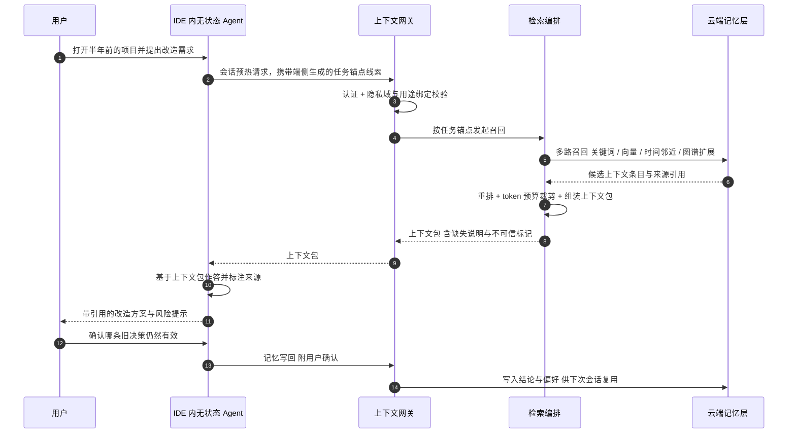
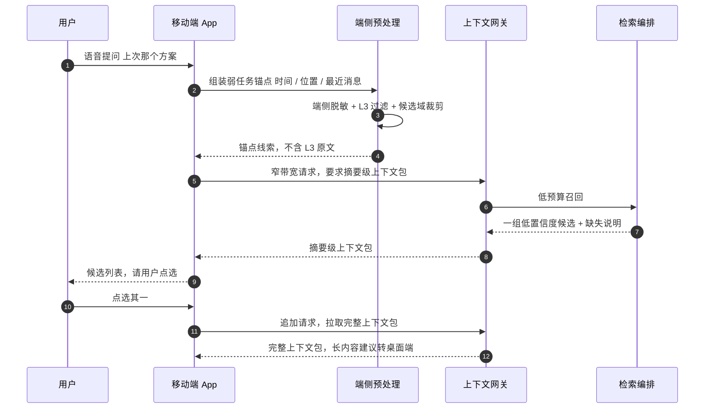
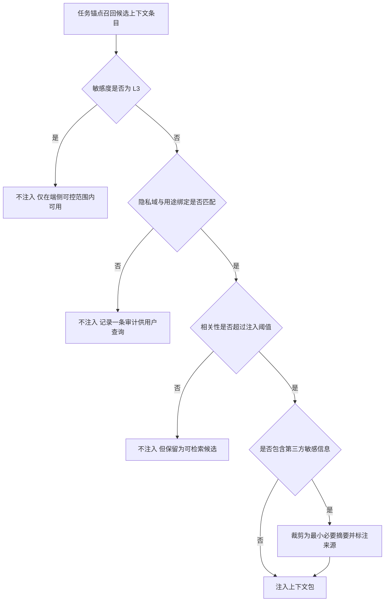

# 07 · 端到端场景走查

> 状态：设想稿 v0.1 · 最后更新：2026-11-03
> 一句话摘要：用 6 个端到端场景把采集、建模、检索、注入、治理五块机制拼成「用户能感觉到的体验」，并给出「不应该注入什么」的反例清单与体验指标。

## 这一篇回答什么

[00-vision.md](00-vision.md) 到 [06-privacy-security.md](06-privacy-security.md) 分别在讲问题、架构、采集、模型、存储检索、Agent 接入与隐私治理。这一篇只做一件事：**把机制拼回成体验**，顺带暴露拼不上的地方。

判断标准不是「系统记了多少」，而是「用户在任务里少解释了多少」。如果一个场景里用户仍然要手动复制粘贴背景，那这个场景就是失败的，无论后台存了多少数据。

阅读提示：术语一律以 [README.md](README.md) 的术语表为准（任务锚点 Task Anchor、上下文包 Context Bundle、隐私域、敏感度 L0–L3 等），本文件不重新定义，只在需要时注明用到了哪一条核心主张。

## 场景总览

| # | 场景 | 主端 | 主要任务锚点信号 | 主要注入形态 | 敏感度分布 | 验证的主张 |
|---|---|---|---|---|---|---|
| A | 开发者在 IDE 接手半年前的项目 | 桌面 | 仓库、当前文件、前台窗口、本地 git 活动 | ①会话预热 + ②按需检索 | L1–L2 | 主张 3、4 |
| B | 顾问/销售见客户前 | 桌面 + 日历 | 日历事件、邮件往来、上次会议纪要 | ①会话预热 + ③订阅提醒 | L2 | 主张 2、3 |
| C | 个人生活事务（改签/家人/账单） | 移动 App | 邮件与通知摘要、账单、家人日历 | ②按需检索 + ①预热 | L1–L2 | 主张 4、6 |
| D | 就医记录（敏感场景） | 移动 App | 端侧健康数据、就诊提醒 | 不注入（仅端侧可用） | L3 | 主张 5、6 |
| E | 跨设备「上次那个方案」 | 移动端 | 位置、最近消息、时间（弱锚点） | ②按需检索 + 降级 | L1–L2 | 主张 1、6 |
| F | 回顾某天「为什么做了那个决定」 | 桌面 + 移动 | 每日日志 Daily Log、桌面定时截屏的端侧 OCR 文本、移动端人工挑选的截图 | ①会话预热 + ②按需检索 | 派生文本默认下限 L2；截屏原图按 L3 治理且默认不出端 | 主张 1、4 |

所有场景的采集动作都由 [02-capture-clients.md](02-capture-clients.md) 定义的**采集器 Collector** 完成；采集到的原始活动是**上下文事件 Context Event**，经端侧预处理后成为**上下文条目 Context Item**。场景 F 额外引入**每日日志 Daily Log**——一天的屏幕活动文档，模型位置见 [03-context-model.md](03-context-model.md)。

**三个注入触发点**（来自 [README.md](README.md) 主张 2）在下面统一记作：

- **触发点 ①—会话预热**：会话开始时按任务锚点自动装填上下文包。
- **触发点 ②—按需检索**：Agent 主动调用工具检索。
- **触发点 ③—订阅推送**：后台在上下文变化时提醒。

只有触发点 ① 才真正满足需求里的「无需用户专门提示」。②③ 是补充，不是替代。

## 本文件的取舍标注

按 [README.md](README.md) 的文档约定，本文件涉及的设计取舍统一标注如下（详细论证在对应文档，此处只收敛结论）：

| 取舍 | 标注 | 理由 |
|---|---|---|
| 低置信度的弱锚点只出候选，不自动注入 | **建议** | 猜错的代价远大于少给一次（场景 E） |
| L3 数据上行后在云端加密、再参与注入 | **不采用** | L3 默认不出设备；加密不改变「数据已离开用户控制」的事实（场景 D） |
| 端侧生成摘要，用户逐次确认后按 L2 注入 | **备选** | 保留可用性，但需要用户在场，不是「无提示」（场景 D） |
| 访问被拒绝也写入用户可见的审计 | **建议** | 拒绝本身必须可见，否则用户无法判断系统是否越界（场景 D） |
| 跨隐私域条目默认合并展示 | **不采用** | 需用户显式授权后才合并（场景 C） |
| 会话预热（触发点 ①）作为默认注入形态 | **建议** | 只有它满足「用户没提也能拿到」（场景总览） |
| 桌面端连续录屏或分钟级以下采样 | **不采用** | 采集口径以 [02-capture-clients.md](02-capture-clients.md) 第 9 节为准：周期采样、建议但**默认关**、逐项显式开启并单独解释（场景 F） |
| 截屏原图长期留存并上行 | **不采用** | 原图默认不出设备，仅本地加密暂存并按到期删除，上行脱敏文本（口径见 02 第 9 节；场景 F） |
| 移动端用户主动挑选截图 + 分享扩展 | **建议** | 选择权在用户，隐私风险显著低于自动截屏，建议先于自动截屏落地（场景 F） |

---

## 场景 A · 开发者在 IDE 接手半年前的项目

> 涉及注入触发点：① + ②；核心验证：任务锚点能不能替代「用户先解释一遍」。

### 用户目标

开发者接手一个半年前自己写、之后没碰过的项目，需要在不重新通读全部代码的前提下，快速判断「当时为什么这么设计」「哪些事还没做完」，然后动手改一个模块。

### Agent 任务

IDE 内的无状态 Agent 被要求：「帮我把支付重试这块改成幂等，并说明需要注意什么」。Agent 本次会话不携带任何历史。

### 系统如何获得任务锚点

不需要用户输入任何背景，任务锚点由以下信号共同构成（采集来源见 [02-capture-clients.md](02-capture-clients.md)）：

| 信号 | 作用 |
|---|---|
| 当前前台应用与窗口标题（IDE + 仓库名） | 定位项目实体 |
| 打开的文件路径与光标所在模块 | 定位子模块，收窄到「支付重试」 |
| 本地 git 活动（分支、最近 commit、未提交改动） | 判断当前进行中的工作线 |
| 剪贴板中刚复制的一段报错或 issue 编号 | 补充意图，弱信号 |
| 时间衰减 | 半年前的决策权重下调，但仍可被「项目实体」拉回 |

这些信号在端侧被归并成一个任务锚点指纹（上下文图谱中的「项目—文件—进行中工作」三元关系），再由检索编排发起召回。

### 召回了什么

- 该项目当时的**决策记录**：架构说明文档片段、提交说明、代码注释里「为什么不选 X」。
- **未完成事项**：TODO/FIXME 片段、上次会话遗留的临时方案、被跳过的测试。
- **相关人物**：与此项目相关的协作者与其提出的评审意见。
- **冲突信号**：两条时间不同、结论相反的决策（新偏好应当覆盖旧偏好，见 [04-storage-retrieval.md](04-storage-retrieval.md) 的冲突消解）。

### 注入了什么

组装为一个上下文包 Context Bundle（契约见 [03-context-model.md](03-context-model.md)）：

- 时间线：项目关键决策的先后顺序，而不是一堆无序片段；
- 实体：项目、模块、协作者；
- 来源引用：每条结论都能点回原始文件或提交；
- 置信度：从提交说明推断的决策置信度低于从架构文档直接读到的；
- 缺失说明：明确写出「未找到测试策略说明」；
- 不可信内容标记：从网页/邮件抓来的文本只作为数据，不作为指令（防提示注入，见 [06-privacy-security.md](06-privacy-security.md)）。

### 用户实际看到什么

Agent 的第一轮回答就已经知道「这是半年没动的项目、当时为了兼容旧网关才没做幂等」，并给出改动方案、风险点、以及「这些结论来自哪几处」。用户不需要先粘贴一段项目背景。

### 失败模式与降级

| 失败模式 | 表现 | 降级 |
|---|---|---|
| 锚点漂移 | 用户其实要改的是另一个仓库 | 上下文包里带「当前锚点」提示，用户一句话即可纠正，纠正结果写回锚点库 |
| 旧偏好已过期 | 注入了三个月前作废的决策 | 显式标注时间，并优先展示时间较新的结论；低置信度条目不直接注入，只作为可检索候选 |
| 仓库无采集权限 | 端侧读不到 git 活动 | 退化为「仅前台窗口 + 文件路径」的弱锚点，注入量减少并在缺失说明中标注 |
| 召回为空 | 新克隆的仓库没有任何历史 | 明确说「无可用历史」，而不是让 Agent 编造项目背景 |

配一个完整时序：

---

## 场景 B · 顾问/销售见客户前

> 涉及注入触发点：③ + ①；核心验证：后台订阅能不能做到「用户没提也给」。

### 用户目标

顾问在见客户前需要一份简短备忘：这个客户上次谈到哪、承诺过什么、有哪些悬而未决的问题；会后要能快速记录结论。

### Agent 任务

桌面助手 Agent 收到一个定时任务：「距客户会议还有一段时间，准备会前简报」。用户没有主动提问。

### 系统如何获得任务锚点

- 日历事件的参与人、标题、时间与地点（最强的锚点信号）；
- 该参与人的邮件往来与会议纪要实体；
- 相关的文档与提案版本；
- 时间邻近：临近会议时，锚点权重上升，触发点 ③ 被激活。

### 召回了什么

- 邮件往来中的承诺与时间点；
- 上次会议要点与待办；
- 客户实体关联的文档版本变化；
- 与客户所在隐私域绑定的条目（工作域，L2）。

### 注入了什么

一份**摘要级**上下文包：只含结论、待办、悬而未决问题与来源链接，不注入原始邮件全文。原因是会前简报场景对 token 成本敏感、且原文里可能夹带与任务无关的第三方信息。

### 用户实际看到什么

会议开始前，桌面端出现一张卡片：「与 A 客户的 3 件未决事项 + 上次承诺的交付时间」，每条可展开看来源。用户点一下就能把某条转成会议议程。

### 失败模式与降级

| 失败模式 | 表现 | 降级 |
|---|---|---|
| 提醒打扰 | 用户已经知道的事被反复推送 | 订阅推送设频率上限与「已读即静音」；连续被忽略则自动降频 |
| 隐私域错配 | 把私人邮件当成客户往来 | 用途绑定校验失败即不注入，只记录一条审计（用户可查） |
| 会议时间被改 | 简报在错误时间触发 | 日历变更事件使锚点失效，取消待发简报 |
| 实体消歧错误 | 两个同名联系人被合并 | 简报中显示实体候选，允许用户一键纠正 |

---

## 场景 C · 个人生活事务：机票改签、家人安排与账单

> 涉及注入触发点：② + ①；核心验证：生活数据能不能在不打扰的前提下被 Agent 用起来。

### 用户目标

用户想「把这周的行程理顺」：机票需要改签、家人周末安排有冲突、两笔账单到期。用户只说了一句模糊的话。

### Agent 任务

移动端或桌面端上的通用 Agent 收到：「帮我把这周要处理的事理一下」。

### 系统如何获得任务锚点

- 时间窗口：本周（自然语言中的相对时间本身就是锚点）；
- 邮件与通知摘要中的订单号、航班号、账单实体；
- 家人日历中的共享事件；
- 移动端位置与行程的弱信号。

### 召回了什么

三类以上、分属不同隐私域的信息：行程（个人域）、家人安排（家庭域）、账单（个人域）。这里的关键不是召回能力，而是**跨隐私域的授权边界**：家庭域条目能否在同一张卡片里出现，取决于用户是否授权「家庭域用于生活事务类任务」。

### 注入了什么

按隐私域分组注入，并标注每条所属域；涉及他人信息的条目只给「谁、什么时候、需要你做什么」，不展开他人细节。

### 用户实际看到什么

一个待办清单：改签提醒（附航班与订单来源）、家庭冲突时间点、两笔账单到期日。用户可以直接让 Agent 去执行改签流程，Agent 使用同一份上下文包里的订单信息，不需要用户再报一次订单号。

### 失败模式与降级

| 失败模式 | 表现 | 降级 |
|---|---|---|
| 采集不全 | 航班邮件在未接入的邮箱里 | 缺失说明明确列出「未覆盖的采集源」，并给出一次性手动补充入口 |
| 域授权缺失 | 家庭域未授权，清单静默变少 | 不静默：显示「有 1 个域未授权，无法纳入」，由用户决定 |
| 时间解析错误 | 把下周的事算进本周 | 注入条目一律带原始时间戳，用户可纠正，纠正写回 |
| 移动端后台受限 | 通知抓不到 | 退化为用户主动触发的「同步一次」，并如实告知能力边界 |

---

## 场景 D · 敏感场景：就医记录（L3 边界演示）

> 涉及注入触发点：无；这是**反例场景**——用来定义「系统什么时候必须什么都不做」。

### 用户目标

用户希望 Agent 帮忙整理「最近的就医与用药记录」，用于自己看病时参考。

### Agent 任务

Agent 被要求：「帮我列一下我最近在吃什么药、上次复查是什么时候」。

### 系统如何获得任务锚点

任务锚点仍然可以被识别（用户当前就在健康类 App / 就医提醒里，时间与实体都明确）。**可以识别 ≠ 可以取用**，这是本场景与前面四个场景的本质区别。

### 召回了什么

- 在端侧：可以召回到本地加密存储的就医与用药条目，用于生成**只在本机显示**的整理结果。
- 在云端：召回阶段就被敏感度过滤器拦截，L3 条目**不进入候选集**，因此不可能出现在任何上下文包里。

### 注入了什么

**什么都不注入云端 Agent。** 边界如下：

| 数据 | 端侧可读 | 可进上下文包 | 说明 |
|---|---|---|---|
| L3 就医/用药原始记录 | 是（本地密钥） | 否 | 不参与云端向量检索 |
| L3 的**存在性** | 是 | 否（默认） | 连「有无就医记录」也不默认告诉 Agent |
| L3 的**用户手工摘要** | 是 | 仅在用户逐次显式确认后 | 用户主动降级为 L2 并指定用途 |
| L3 的匿名统计 | 是 | 否（需单独授权，建议不做） | 反推到个人风险过高 |

### 用户实际看到什么

- 只有用户主动在端上发起时，才看到整理结果，且页面明确标注「此内容未离开设备」。
- 如果云端 Agent 试图查询该域，用户会在审计记录里看到一条**被拒绝**的访问：「某 Agent 某时刻请求了健康域，已拦截」——禁止本身也是可见的。

### 失败模式与降级

| 失败模式 | 表现 | 降级 |
|---|---|---|
| 用户想让 Agent 帮忙但数据取不到 | 体验割裂 | 提供「端侧生成摘要 → 用户确认后降级为 L2 → 再注入」的单向人工通道 |
| 分级被误判为 L2 | L3 数据被上行 | 端侧分级为**保守默认**：无法判定时按更高敏感度处理；上行前二次校验 |
| Agent 以「医疗建议」名义诱导取数 | 越权 | 用途绑定不匹配即拒绝；拒绝事件写审计 |
| 共享设备 | 他人看到端侧结果 | 端侧结果需要设备解锁 + 应用内二次确认 |

> 结论：这个场景不是为了展示能力，而是为了给产品设一条**不可谈判的底线**——某些数据从设计上就不进入无提示注入链路，哪怕这会牺牲一部分体验。

---

## 场景 E · 跨设备：手机上问「上次那个方案」

> 涉及注入触发点：②；核心验证：移动端能力弱时能不能优雅降级，而不是装作能用。

### 用户目标

用户在通勤路上想起来一件事：「上次那个方案后来怎么定的？」——不记得是哪个项目、哪次会议。

### Agent 任务

移动端 Agent 需要在**弱锚点、窄带宽、小屏幕**条件下给出候选，而不是假装能直接给出唯一答案。

### 系统如何获得任务锚点

移动端拿不到 IDE 窗口、本地文件、完整剪贴板，只能靠：

- 相对时间（「上次」）；
- 最近通知与消息摘要中的关键词；
- 位置（刚离开办公室 / 正在路上）；
- 当前会话的语音或文本内容本身。

这是**弱任务锚点**：歧义高，必须靠交互补齐，不能靠猜测硬答。

### 召回了什么

召回结果天然是**一组候选**而不是一条：多个项目、多个「方案」相关条目，置信度都不高。此时正确的做法是把歧义暴露给用户，而不是挑一个最像的注入。

### 注入了什么

摘要级、低 token 预算的上下文包：每条候选只给标题、时间、来源类型，不给全文。核心内容留在云端，等用户点选后再拉取。

### 用户实际看到什么

手机上先出现一个短的候选列表（「上周三的项目评审方案」「上月的采购方案」），用户点一下，才展开该方案的要点；如果内容较长，提示「建议在电脑上继续」。

### 失败模式与降级

| 失败模式 | 表现 | 降级 |
|---|---|---|
| 弱锚点猜错 | 注入了错误项目的方案 | 强制候选制：低置信度不自动注入，只出候选 |
| 网络差 | 摘要也拉不到 | 端侧热缓存兜底（本地最近条目），并标注「可能不是最新」 |
| 跨设备数据未同步 | 刚在电脑上产生的内容手机上没有 | 显示最后同步时间，不用旧数据假装最新 |
| 用户在路上无法细看 | 给了长文 | 转「稍后在桌面端提醒」的订阅推送（触发点 ③） |

---

## 场景 F · 回顾某天「为什么做了那个决定」

> 涉及注入触发点：① + ②；核心验证：**截图 / 每日日志这条采集路径**能不能回答别的采集源回答不了的问题——「当时我看到了什么，才这么决定」。采集路径假设：移动端每日人工挑选重要截图 + 健康/步数/位置；桌面端每隔一段时间静默截屏 → 端侧脱敏 → 每日日志解析 → 抽取上下文。

### 用户目标

用户要复盘上周三的一次技术决策：「我为什么把支付重试从消息队列改成了同步调用？当时是不是看到过什么数据？」用户只记得那天很忙、改了很多东西，具体理由已经想不起来，聊天记录也翻不到。

### Agent 任务

无状态 Agent 收到：「帮我复盘上周三支付重试那次改动，我当时的依据是什么。」Agent 本身没有那天的任何记忆。

### 系统如何获得任务锚点

这个场景的锚点与场景 A 不同：**不是「此刻在做什么」，而是「某个已过去的时间窗 + 实体」**。

| 信号 | 作用 |
|---|---|
| 用户给出的时间窗（上周三） | 把检索限制在一天，是主锚点 |
| 项目 / 模块实体（支付重试） | 在当天的日志里切出相关段落 |
| 每日日志 Daily Log 作为文档级来源 | 提供当天屏幕活动的连续叙事 |
| 桌面端静默截屏经端侧 OCR/VLM 解析出的文本 | 提供「当时看到了什么」 |
| 移动端人工挑选的截图 + 位置 / 步数 | 还原当时的情境 Situation（例如下午在外出差，不在电脑前） |
| 当日日历与 git 活动 | 交叉验证时间线 |

关键点：**截屏原图默认不出设备**。端侧完成脱敏与 OCR 后，原图只进入本地加密暂存区并按到期删除，上行的是脱敏文本、摘要与来源引用；采集口径（周期采样档位、默认关、跳过规则、原图配额与留存）一律以 [02-capture-clients.md](02-capture-clients.md) 第 9 节为准，形态与代价见 [08-options-and-roadmap.md](08-options-and-roadmap.md) 第 4 节。

### 召回了什么

- 每日日志中与「支付重试」「压测」「旧网关」相关的段落；
- 当天的上下文事件与上下文条目：什么时候改了代码、改之前在看哪份文档；
- 截图 OCR 文本里的关键句（例如压测结论、同事在群里提到旧网关不支持队列）；
- 当日的日历与位置信号，用于解释「为什么下午没有继续跟进」。

### 注入了什么

- 一份**当日复盘时间线**：按时间排列「看到什么 → 做了什么」，而不是一堆无序片段；
- 每条结论都附**文档级来源引用**（指向当日日志段落与原始上下文条目）；
- OCR/VLM 文本一律标记为**不可信内容**（只作数据、不作指令，见 [06-privacy-security.md](06-privacy-security.md)）；
- **不注入**原始截图、不含 L3 的健康原始样本与含验证码的通知文本；
- 缺失说明写清「当日日志有若干小时未覆盖」。

### 用户实际看到什么

一条可展开的复盘：「14:20 看到压测结论 → 15:05 改了重试策略 → 16:30 同事提到旧网关不支持队列」。用户点开每条能看到当时的原文片段并核对。如果某条是 OCR 误读，用户可以直接标记「这条不对」，该反馈用于下调该来源的置信度。

### 失败模式与降级

| 失败模式 | 表现 | 降级 |
|---|---|---|
| OCR/VLM 解析错误 | 摘要与原文不符，用户被误导 | 低置信度不注入；注入时保留原文片段供核对；用户可下调整体置信度 |
| 权限被拒或系统更新导致截屏失效 | 日志大面积缺失 | 缺失说明如实告知；退化为「前台窗口标题 + 日历 + git」的骨架时间线 |
| 屏幕内容误捕（密码、私密聊天、他人信息） | 严重隐私事故 | 端侧排除名单与全屏黑名单；命中即丢弃；原图不出端；采集指示灯常驻可见 |
| 一天里混了多个任务 | 复盘把不相关的事串到一起 | 按项目实体切分；切不开时给候选而不是强行给结论 |
| 定时截屏被用户视为监视 | 用户关闭采集或卸载 | 默认关闭，逐项显式开启并单独解释风险；随时暂停；提供「只在我标记的时段采集」 |
| 端侧解析耗电/卡顿 | 常驻体验变差 | 解析排到充电与空闲时段；移动端仅在 Wi-Fi 下上传文本 |
| 多设备时间不一致 | 时间线错序 | 上行时统一服务端时间并标注设备时钟偏移 |
| 每日日志变成「另一种录屏」的法律风险 | 合规争议 | 原图不长期留存、明示采集范围；具体合规判断**待核实** |

---

## 「不应该注入什么」反例清单

> 这一节比前面六个场景更重要。无提示注入的价值上限由「它敢不注入什么」决定。

### 噪音类：不相关的都算噪音

| 反例 | 为什么会发生 | 期望行为 | 兜底机制 |
|---|---|---|---|
| 把同一事件的多个副本全部注入 | 多端重复采集 | 同源去重，只留最新且信息量最大的一条 | 摄取管道去重 + 时间邻近合并 |
| 注入两年前的偏好 | 向量相似度高但时效已过 | 时间衰减后不进入 top 结果 | 时效性与冲突消解 |
| 注入「用户已经知道」的内容 | 无差别堆上下文 | 只保留与当前任务锚点有差异的信息 | 重排 + token 预算裁剪 |
| 每次会话都重放同一批背景 | 锚点粒度太粗 | 按会话差异动态裁剪 | 锚点指纹 + 缺失说明 |
| 把整整一天的每日日志原文塞进去 | 「日志很全」的错觉 | 只注入与锚点相关的段落，其余留作可展开来源 | 切分 + 重排 + token 预算裁剪 |

### 越权类：能不能读 ≠ 这次该不该读

| 反例 | 为什么会发生 | 期望行为 | 兜底机制 |
|---|---|---|---|
| 工作 Agent 读到私人域内容 | 只做了 ACL，没有做用途绑定 | 用途不匹配即拒绝，并写审计 | 隐私域 + 用途绑定 |
| Agent 请求 L3 数据 | 只按「是否授权过」判断 | L3 默认不进入候选集，端侧也不上行 | 敏感度分级 L0–L3 |
| 某个 Skill 偷偷扩大了检索范围 | 工具参数越界 | 每次调用的域与用途都可审计、可撤销 | 上下文网关统一鉴权 |
| 把他人数据当成本人上下文 | 实体消歧错误 | 实体候选显式化，不静默合并 | 上下文图谱 + 用户纠正 |
| 直接注入原始截图 | 截图信息量最大 | 只注入 OCR 文本与摘要，原图仅端侧可用 | 端侧预处理 + 敏感度分级 |

### 社交尴尬类：技术上正确，但人不想被这么「懂」

| 反例 | 为什么会发生 | 期望行为 | 兜底机制 |
|---|---|---|---|
| 在客户面前弹出「上次你答应他的事没做」 | 订阅推送缺乏场景判断 | 涉及承诺/欠账的提醒只在私有场景出现 | 场景上下文 + 推送策略 |
| 把家庭纠纷条目注入工作会话 | 按关键词召回 | 按隐私域隔离，跨域需显式授权 | 隐私域边界 |
| 在共享屏幕时展开私人内容 | 端侧可见性未做场景判断 | 检测到投屏/共享时自动收起敏感卡片 | 端侧预处理 |
| 指出用户前后说法矛盾 | 「有帮助」但没有边界 | 默认不主动点破，除非与当前任务直接冲突 | 注入策略白名单 |

判断门可以画成这样（发生在组装上下文包之前）：

## 体验指标

| 指标 | 定义 | 目标方向 | 测量方式 |
|---|---|---|---|
| 首次有用上下文延迟 | 从会话开始到第一段有用背景出现的时间 | 越小越好 | 端到端埋点 |
| 任务相关上下文命中率 | 注入条目中被用户或 Agent 实际使用的比例 | 越大越好 | 引用点击 + 用户采纳 / 忽略 |
| 注入噪音率 | 被用户主动忽略或移除的注入条目占比 | 越小越好 | 主动移除行为 + 反馈按钮 |
| 澄清轮次减少 | 同一任务在接入前后的用户补充背景轮次变化 | 显著减少 | A/B 对照（见 [08-options-and-roadmap.md](08-options-and-roadmap.md) 的 H1 实验） |
| 用户纠错率 | 用户纠正锚点/实体/时间的频次 | 前期可接受，应逐步下降 | 纠正事件埋点 |
| 引用可追溯率 | 注入结论能点回原始来源的比例 | 接近全部 | 数据校验 |
| 静默失败率 | 无数据/未授权时未如实告知的比例 | 必须为 0 | 缺失说明完整性检查 |
| 每日日志覆盖率 | 一天中被日志有效覆盖的时段占比 | 越大越好，但缺口必须如实暴露 | 端侧采集统计上报 |
| 隐私惊吓事件 | 用户感到「它怎么知道」或不该出现的注入 | **必须为 0** | 用户举报 + 审计复核 |
| 端侧资源占用 | 桌面/移动常驻的 CPU、内存、耗电 | 低且可感知 | 客户端性能埋点 |

> 指标口径本身是产品决策，见下方待定问题；此处只给方向，不给目标数值。

## 待定问题

1. **场景优先级**：A（开发者）与 B（顾问/销售）先做哪一个？两者对采集源的要求不同（A 偏本地文件与 git，B 偏日历与邮件）。
2. **「首次有用上下文延迟」是否应该作为北极星指标**？还是用「澄清轮次减少」更贴近真实价值？
3. **触发点 ③ 订阅推送的默认开关**：默认关闭（更安全但价值弱）还是默认开启（价值强但打扰风险高）？
4. **跨隐私域的卡片能否合并展示**：技术上可行，但产品上是否始终需要用户逐次确认？
5. **移动端弱锚点是否应该允许自动注入**：本文件假设「不允许，只出候选」，需要确认。
6. **L3 的用户手工降级通道**是否值得做，还是应该彻底不提供（更安全，但用户会把数据抄到别处）？
7. **噪音率与命中率的取舍阈值**：宁可少注入还是宁可不漏？这个取舍应由用户暴露程度还是全局默认决定？
8. **场景 D 的「被拒绝也要可见」**是否会造成隐私泄露的二次风险（审计页面本身也是信息）。
9. **截屏 / 每日日志路径的口径：已对齐，不再构成冲突。** 采集方案一律以 [02-capture-clients.md](02-capture-clients.md) 第 9 节为准——桌面端「周期采样（10/20/30/60 分钟，默认 20，另有仅手动）而非连续录屏、建议但默认关、首次单独开启、原图默认不出设备」，移动端「每日提醒 + 用户挑选」为可行·默认开，只有**键盘输入**保留在不做；[01-architecture.md](01-architecture.md) 亦已确认口径对齐。本文件不再给出替代口径。
10. **原图默认留存天数**与**是否开放单张上传原图通道**：端侧加密暂存已确定（原图默认不出设备），但默认留存多久、以及要不要为个别场景提供用户显式触发的单张上传通道仍待发起人拍板（[06-privacy-security.md](06-privacy-security.md) 已给出建议口径，见 02 待定问题 13）；以及如何向用户证明原图确实没有上行。
11. **场景 F 的「事后合理化」风险**：复盘时把当时并未出现的理由说成当时的理由，是否需要强制区分「日志里有证据」与「模型推测」两类结论？

## 相关文档

- [README.md](README.md) — 术语表与文档约定（本文术语来源）
- [00-vision.md](00-vision.md) — 问题定义、成功指标
- [01-architecture.md](01-architecture.md) — 分层架构与端到端数据流
- [02-capture-clients.md](02-capture-clients.md) — 采集源与端侧预处理
- [03-context-model.md](03-context-model.md) — 任务锚点与上下文包契约
- [04-storage-retrieval.md](04-storage-retrieval.md) — 召回、重排与冲突消解
- [05-agent-access.md](05-agent-access.md) — MCP 工具与无状态会话协议
- [06-privacy-security.md](06-privacy-security.md) — 敏感度分级、隐私域与用途绑定
- [08-options-and-roadmap.md](08-options-and-roadmap.md) — 选型、MVP 与路线
