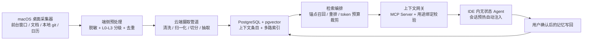

# 08 · 选型、MVP 与路线

> 状态：设想稿 v0.1 · 最后更新：2026-11-03
> 一句话摘要：给出形态与人群的收敛建议、技术选型倾向、采集路径优先级、MVP 最小闭环、M0–M4 里程碑、优先验证的高风险假设与量级成本模型，并列出需要用户拍板的决策点。

## 这一篇回答什么

前七篇回答「怎么做」，这一篇回答「**先做什么、赌什么、怎么知道赌错了**」。所有选型都标了倾向，但都保留了备选；本文件不产出任何代码或目录，技术选型也随时可被实验推翻。

全文的推荐都建立在 [README.md](README.md) 的七条核心主张之上，尤其是主张 6（混合部署）与主张 2（三种注入形态）。凡涉及具体数字，一律给估算公式与假设并标「量级估算」，不写精确值。

---

## 1. 形态选择

| 形态 | 定义 | 优势 | 代价 | 结论 |
|---|---|---|---|---|
| 云优先 | 采集后尽量上行，云侧建模与检索 | 跨设备、跨 Agent 能力最强；端侧实现简单 | 隐私风险最高；上行带宽与合规成本高；L3 数据基本无法处理 | **不采用**（作为唯一形态） |
| 本地优先 | 数据与索引都在端上，云只做同步/中继 | 隐私感受最好；离线可用；推理可下沉 | 跨设备与跨 Agent 弱；移动端算力/电量受限；多端索引一致性难 | **不采用**（作为唯一形态） |
| 混合 | 端侧脱敏 + 本地热缓存 + 云端加密冷存与索引 | 兼顾隐私、跨设备与可检索性；可按敏感度分流 | 架构复杂度最高；两端都要维护；需要清晰的一致性策略 | **建议采用** |

**建议：混合形态。** 具体分工建议：

- **端侧**：采集、脱敏、敏感度分级（L0–L3）、L3 本地加密存储、情境（Situation）聚类与热缓存、弱网兜底；
- **云侧**：加密冷存、跨设备索引、上下文图谱、检索编排与重排、面向 Agent 的上下文网关；
- **边界**：L3 不出端，L2 加密后上行且默认不进入无提示注入，L0–L1 可正常参与检索。矩阵细节见 [06-privacy-security.md](06-privacy-security.md)。

**代价要说清楚**：混合形态会让「同一条数据在端上和云上状态不一致」成为常态，必须在 [04-storage-retrieval.md](04-storage-retrieval.md) 里定义清楚版本与冲突规则，否则后期会出现「手机上删了、电脑上又冒出来」这类信任崩塌问题。

**备选**：MVP 阶段先做「云优先 + 强制端侧预处理」的简化混合，把本地热缓存推迟到第二阶段（与 [01-architecture.md](01-architecture.md) 的备选一致）；代价是早期注入延迟可能不达标。
**不采用**：纯云优先、纯本地优先作为首发形态。

---

## 2. 切入人群

| 人群 | 为什么值得优先 | 风险 | 结论 |
|---|---|---|---|
| 开发者 | 任务锚点信号最结构化（仓库、文件、git、IDE 前台窗口）；无提示召回的价值最容易验证；对隐私换效率的接受度高；容易自建与反馈 | 市场偏小；对「帮我记住」需求强度不如对工具链的需求 | **建议优先** |
| 知识工作者（顾问、销售、PM） | 日历 + 邮件 + 会议的锚点清晰；会前简报价值直观；付费意愿相对明确 | 数据源多为第三方 SaaS，采集受 API 与权限限制；企业合规敏感 | **备选（第二梯队）** |
| 大众用户（生活事务） | 市场最大；机票/账单/家人安排场景普遍 | 冷启动最难（无历史数据时价值为零）；隐私敏感度最高；噪音容忍度最低 | **建议后置** |

**建议：开发者优先。** 核心理由不是「开发者市场大」，而是**开发者场景能在最短路径上验证整个产品最不确定的假设**——即「不用用户提示，自动带出背景，到底有没有价值」。这个假设在生活场景里验证成本高得多（需要先采集几周数据），在开发场景里可以用一个仓库的历史数据在几天内验证完。

**不采用「大众优先」** 作为起点：它把最难的问题（冷启动 + 隐私信任 + 噪音容忍）同时放在第一步。

---

## 3. 技术选型

> 以下是**方向性倾向**，不是最终结论。标注「待核实」的条目表示具体能力需要以官方文档与实测为准，本文件不做断言。

| 维度 | 候选 | 倾向 | 理由 | 风险 |
|---|---|---|---|---|
| 桌面端框架 | Electron / Tauri / 完全原生（Swift + WinUI） / Flutter desktop | **Tauri 外壳 + 平台原生采集模块** | 采集强依赖系统 API（前台窗口、辅助功能、文件监听），UI 框架只负责壳与展示；Tauri 常驻资源占用低，适合「无感知」定位 | 原生模块意味着 macOS/Windows 两套采集代码；Tauri 在部分系统集成场景生态较薄（待核实） |
| 移动端框架 | 原生双端（Swift / Kotlin） / Flutter / React Native | **原生双端做采集与后台，跨端框架只做展示层（备选）** | iOS 后台执行、通知读取、健康与相册权限差异大，跨端框架难以覆盖（待核实各自最新限制） | 双端开发成本最高；需要严格控制 MVP 只做一端 |
| 后端语言 | Go / Rust / TypeScript（Node） / Python / JVM | **Go** | 摄取管道与网关是高并发 I/O 型服务，部署简单、并发模型清晰 | 模型侧生态弱于 Python，需要拆分出独立推理服务 |
| 主数据库 | PostgreSQL + pgvector / MySQL / 文档库 / NewSQL | **PostgreSQL + pgvector** | 起步阶段单库覆盖结构化、全文与向量三种检索，运维成本最低；隐私域、敏感度、时间分区都能用普通列表达 | 千万级条目后向量召回性能与索引内存压力明显，需要预留拆分路径 |
| 向量检索 | pgvector / Qdrant / Milvus / 托管向量服务 | **起步 pgvector，规模化后 Qdrant** | 避免 MVP 阶段引入独立向量库；拆分阈值由离线评测决定 | 迁移成本；两套索引口径不一致会导致召回结果漂移 |
| 对象存储 | S3 兼容对象存储 / MinIO 自建 / 云厂商专有 | **S3 兼容接口为契约，公网用云对象存储，自托管用 MinIO** | 原始日志是不可变冷数据，最需要标准化与低成本 | 生命周期策略与加密密钥归属需要提前设计（[06-privacy-security.md](06-privacy-security.md)） |
| 消息队列 | Redis Streams / NATS JetStream / Kafka / 云托管队列 | **起步 Redis Streams 或 NATS JetStream，规模后 Kafka** | MVP 阶段事件量级不大，优先减少运维组件；保留可替换的发布订阅抽象 | 早期选型若被业务逻辑深度耦合，后期替换代价高 |
| 模型与推理位置 | 纯云 API / 纯端侧小模型 / 混合 | **混合：端侧做脱敏/分级/轻抽取，云侧做大模型重排与摘要** | 端侧算力用于「不让敏感数据出端」，云侧算力用于「效果」；与混合形态一致 | 端侧模型质量决定脱敏效果，效果不足则隐私承诺失效；云侧推理是主要可变成本 |
| MCP/SDK 生态 | MCP Server 主线 / Skill 包 / REST + SDK | **MCP Server 为唯一必需入口，Skill 包作为引导层，REST 供自研宿主** | MCP 是「任意无状态 Agent 低适配接入」的最短路径；Skill 解决「Agent 不会用工具」的问题 | MCP 生态仍在演进，宿主实现差异大（待核实）；需要设计降级到 REST 的路径 |

---

## 4. MVP 最小闭环

**建议的 MVP 定义：一个端 + 一类数据 + 一个 Agent + 一条完整注入链路。**

| 要素 | MVP 范围 | 说明 |
|---|---|---|
| 一个端 | macOS 桌面客户端 | 只做桌面，先不做移动端 |
| 一类数据 | 工作项目相关上下文 | 前台窗口与文档活动、本地 git 活动、日历事件；全部 L0–L2 |
| 一个 Agent | IDE 内的无状态 Agent | 通过 MCP 接入，验证「零适配」是否成立 |
| 一条链路 | 触发点 ① 会话预热自动注入 | 必须打通「锚点 → 召回 → 重排 → 裁剪 → 组装上下文包 → 注入」全链路，并带来源引用与缺失说明 |

闭环示意：

> 图中**不含**桌面定时截屏与每日日志通道：它属于 M1 的第一优先增强通道（默认关），评估见 4.1。

### MVP 明确不做

| 不做项 | 为什么现在不做 |
|---|---|
| 移动端 App | 后台限制与权限差异会拖慢闭环验证；跨设备场景见 [07-scenarios.md](07-scenarios.md) 场景 E |
| 浏览器扩展采集 | 数据源噪音高，会干扰对召回质量的判断 |
| 触发点 ② 按需检索工具的完整实现 | MVP 只需要最小 `context.bundle`；工具清单完整版见 [05-agent-access.md](05-agent-access.md) |
| 触发点 ③ 订阅推送 | 打扰风险高，在核心价值被验证前不引入 |
| 记忆写回自动化 | 先做「用户确认后写回」，不做 Agent 自动写入 |
| 多租户、计费、团队协作 | 与「个人上下文」定位冲突，且不是验证假设所必需 |
| 端侧大模型推理 | 先用小模型 + 规则做脱敏与分级，避免算力与功耗问题 |
| L2 数据的无提示注入 | 默认不注入，先积累用户对系统的信任 |
| 桌面定时截屏与每日日志抽取 | 不在 MVP 主闭环内，列为 M1 第一优先增强通道，理由与代价见 4.1 |

### 4.1 采集路径评估：桌面定时截屏 + 每日日志抽取

按发起人补充的采集路径假设评估：**移动端每日人工挑选重要截图 + 健康/步数/位置；桌面端每隔一段时间静默截屏 → 端侧脱敏 → 每日日志解析 → 抽取上下文。** 这条路径的模型落点是 [03-context-model.md](03-context-model.md) 的**每日日志 Daily Log**（一天的屏幕活动文档）。

**可行性判断：技术上可行，但它不是「更全的采集」，而是「更贵、更敏感的采集」。** 三个硬约束：

| 约束 | 具体表现 | 影响 |
|---|---|---|
| 权限 | 静默截屏需要屏幕录制类系统权限，属高风险权限 | 只能默认关、逐项显式开启；用户拒绝即整条路径失效 |
| 隐私 | 屏幕内容不受控，可能包含密码、私密聊天、他人信息 | 必须端侧排除名单 + 原图不出端；事故代价最高 |
| 算力/电量 | 端侧 OCR/VLM 是持续负载 | 影响常驻体验与留存，需节流到充电/空闲时段 |

**与其他采集源的优先级对比**：

| 采集源 | 回答什么问题 | 信息密度 | 隐私/权限风险 | 实现成本 | 建议优先级 |
|---|---|---|---|---|---|
| 前台窗口与文档活动 | 在做什么、什么时候 | 高 | 低 | 低 | **P0（MVP）** |
| 本地 git / 文件活动 | 改了什么 | 高 | 中（需完全磁盘访问类权限） | 中 | **P0（MVP）** |
| 日历 | 与谁、何时、在哪 | 中 | 低 | 低 | **P0（MVP）** |
| 移动端人工挑选截图 + 分享扩展 | 用户主动强调的重要信息 | 高（用户已筛选） | 低（用户主动行为） | 低 | **P1（建议先于自动截屏落地）** |
| 桌面定时截屏 + 每日日志抽取 | 当时看到了什么 → 解释「为什么」 | 中高 | **高** | **高** | **P1（M1 增强通道，默认关）** |
| 健康 / 步数 / 位置 | 当时的情境 Situation（出差、生病、作息） | 低–中 | 高 | 中 | **P2（默认关，仅在明确场景使用）** |

**建议结论**：

1. **不采用**把「桌面定时截屏 + 每日日志」作为 MVP 的唯一采集闭环。它对权限、隐私与端侧算力的要求都最高，而 MVP 要验证的是「无提示召回有没有价值」，用低敏感的结构化源（窗口/文档/git/日历）就能验证，不必先承担最重的风险。
2. **建议**把它作为 M1 的第一优先增强通道，因为它能回答其他采集源回答不了的问题——「当时我看到了什么，才做了这个决定」（场景 F，见 [07-scenarios.md](07-scenarios.md)）。
3. **建议**的形态是「**原图默认不出设备、只上行脱敏文本与摘要**」：截图解析后，原图只进本地加密暂存区并按到期删除（配额与到期口径见 [02-capture-clients.md](02-capture-clients.md) 第 9 节），上行的是脱敏文本、摘要与来源引用。这样既拿到信息，又把最敏感的载体留在设备内；**默认留存天数仍待拍板**（见第 10 节决策点 12）。
4. **建议**移动端「人工挑选截图 + 分享扩展」先于桌面自动截屏落地：选择权在用户，隐私风险低得多，实现成本也低，可作为每日日志的第一块拼图。
5. **口径已对齐（以 02 第 9 节为准）**：[02-capture-clients.md](02-capture-clients.md) 已新增第 9 节，把采集口径收敛为「周期采样（10/20/30/60 分钟，默认 20，另有仅手动）而非连续录屏；桌面端建议但默认关、首次单独开启；移动端每日提醒 + 用户挑选默认开；原图默认不出设备」；只有「键盘输入」保留在不做。[01-architecture.md](01-architecture.md) 已确认不再构成冲突，**本文件不再提供替代口径**。仍需发起人拍板的只剩：原图**默认留存天数**、**是否开放单张上传原图通道**（[06-privacy-security.md](06-privacy-security.md) 已给建议，见 02 待定问题 13）。
6. **备选**：只做移动端人工挑选截图 + 分享扩展，完全不做桌面自动截屏——隐私与权限风险最低，但拿不到「当时屏幕上看到了什么」的连续叙事。
7. **不采用**：把原始截图上行到云端再由云端解析。这会让敏感载体离开设备，前面的脱敏设计全部作废。

**成本估算（量级估算，只给方法与假设，不写精确值）**：

| 符号 | 含义 | 假设值（量级假设，需实测替换） |
|---|---|---|
| f | 桌面截屏频率 | 按 02 第 9 节的档位（10/20/30/60 分钟，默认 20）→ 10¹–10² 张/日 |
| s_shot | 单张降采样 + 有损压缩后的截图大小 | 10² KB 量级（02 第 9 节目标单帧 ≤ 300 KB） |
| k | 加密与副本开销系数 | 1–3（量级假设） |
| t_ocr | 单张截图解析出的文本量 | 10²–10³ token |
| D_local | 端侧原图留存期 | 10⁰ 天量级（**默认值待拍板**，02 第 9 节配额示例为 ≤ 2 GB 或 ≤ 7 天先到为准） |

| 成本项 | 估算公式 | 结果（量级估算） | 敏感度 | 说明 |
|---|---|---|---|---|
| 截图原始存储（端侧原图暂存） | `f × s_shot × D_local × k` | 日增 10¹ MB 量级；按天滚动删除，端侧占用由配额封顶（02 第 9 节示例：≤ 2 GB 或 ≤ 7 天先到为准） | **最高**（默认留存天数直接决定量级与暴露面） | 调小默认留存天数、按天滚动删除；原图不上行 |
| 上行文本存储（建议形态） | `f × t_ocr × k` 折算为字节 | 日增 10¹–10² KB 量级，年增 10¹ MB 量级 | 低 | 相比留存原图低约 10²–10³ 倍（量级估算） |
| 端侧解析算力 | 无法用外部单价粗算，只能实测 | 需在 M1 实测 | 高 | 表现为电量、发热、常驻占用；必须节流 |
| 云侧每日汇总推理 | `每日一次汇总 × 当日文本 token` | 单用户每日 10⁴–10⁵ token 量级 | 中 | **按天调用一次**，不按张调用，否则线性放大 |
| 下行带宽 | 复盘时按需展开 | 远小于场景 A/B 的常规注入 | 低 | 摘要级注入 + 按需展开原文 |

**最敏感的两个假设**：①**原图默认留存天数**——「原图不出设备」已定，但留存多久直接决定端侧存储量级与隐私暴露窗口；②**解析调用粒度**——按天汇总与按张解析之间差一到两个数量级。这两点在 M1 必须实测后再定，不能沿用本文的量级假设做决策。

---

## 5. 里程碑 M0–M4

| 里程碑 | 目标 | 交付物 | 验证方式 | 退出条件 |
|---|---|---|---|---|
| **M0 价值验证（人工版）** | 验证「无提示召回是否真的有用」，不写正式系统 | 手工组装的上下文包 + Wizard-of-Oz 注入脚本 + 实验报告 | 见第 6 节 H1 实验设计 | H1 出现明确正向信号，或明确否决；无论哪种都算成功退出 |
| **M1 单端闭环** | 打通 MVP 全链路，单用户可用 | macOS 客户端、摄取管道、检索编排、MCP Server、每日日志通道（可选，默认关） | 自用 2 周；对照「有注入 / 无注入」的澄清轮次；实测端侧解析的电量与占用 | 日常可连续使用；注入噪音率低于自定阈值；隐私惊吓事件为 0；端侧开销可接受 |
| **M2 采集扩展 + 治理可见** | 让用户看得见、管得住，扩采集源 | 采集开关与预览、审计页、逐源同意、L3 端侧存储 | 用户能否自主解释「系统知道什么」；撤回是否真的级联删除 | 审计与删除链路端到端可验证；权限被拒时如实降级 |
| **M3 移动端与跨设备** | 弱锚点与跨设备体验 | 移动端 App（弱锚点、候选制）、端侧热缓存、跨设备一致性 | 场景 E 的走查复现；同步延迟与冲突表现 | 弱网可用；筛掉的候选有明显减少；不出现「旧数据假装最新」 |
| **M4 写回复利 + 开放生态** | 让记忆随任务变好；开放接入 | 受控记忆写回、Skill 包、多宿主适配 | 同一任务第二次执行的澄清轮次是否继续下降 | 写回带来可测量的收益；接入第三个不同宿主无需改服务端 |

> M0 是**可被砍掉整个项目**的一期，这是有意设计：先花最小成本证伪。

---

## 6. 优先验证的高风险假设

按「错了代价最大 × 验证成本最低」排序：

| 编号 | 假设 | 如果错的后果 | 验证成本 |
|---|---|---|---|
| H1 | 无提示召回真的有价值 | 整个产品前提不成立 | 低（M0 人工版即可） |
| H2 | 端侧脱敏后仍保留足够信息量 | 隐私与效果二选一 | 中 |
| H3 | 用户能接受常驻采集 | 采集拿不到数据，一切归零 | 中（需要真实留存观察） |
| H4 | 弱锚点足以支撑移动端体验 | 跨设备价值大打折扣 | 中 |
| H5 | 云端推理成本可控 | 单位经济模型不成立 | 低（量级估算 + 实测） |
| H6 | Agent 宿主愿意接入 MCP | 分发路径被卡 | 低（找几个宿主实测） |

### H1 实验设计（最关键）

**目标**：回答「用户没提示时自动带出的上下文，是否让任务完成得更好」。

**设计**：Wizard-of-Oz 对照实验——先不建自动化系统，由后台人工按规则组装上下文包并注入，模拟触发点 ①。

- **对象**：招募开发者做真实任务（接手陌生/半年前项目，完成一个小改造）。首轮样本量按预算定，量级假设为 8–12 人（**假设值，需按预算调整**）。
- **分组**：
  - A 组：无注入（基线）；
  - B 组：用户自己手动粘贴背景（当前现实）；
  - C 组：无提示自动注入；
  - 同一批受试者交叉做多个任务，避免个体差异。
- **测量**：任务完成时间、用户澄清轮次、注入条目采纳率、主动移除率、主观「省了多少事」评分、隐私不适评分。
- **预注册判定规则**（先写死，避免事后解释）：
  - C 相对 A 的澄清轮次下降且任务时间不显著变差 → 支持 H1；
  - C 相对 B 有明显优势 → 说明价值在「不用手动粘贴」而非「有背景」；
  - C 的主动移除率高于预设阈值 → H1 部分成立，但必须先解决相关性阈值再扩大投入；
  - C 引发隐私不适评分明显上升 → 优先修边界，而不是加功能。
- **成本控制**：M0 全部人工，不引入向量库与索引，用一个本地脚本模拟上下文包格式即可（格式定义见 [03-context-model.md](03-context-model.md)）。

**H2 的最小验证**：取一批真实（脱敏后）样本，人工按脱敏规则处理后，再让评审判断「是否还能完成原来的任务」。这能以极低成本提前暴露「脱敏过度导致不可用」。

**H3 的最小验证**：桌面采集器只开最少的源，观察「主动关闭采集」的比例与关闭原因；先验证「采集指示灯 + 一键暂停」是否能显著降低不适感。

---

## 7. 成本模型（量级估算）

> 本节只给**估算方法与假设**，所有数字都是量级估算，不是实测，也不应作为报价依据。真实成本必须用 M0/M1 的实测数据替换。

### 假设参数

| 符号 | 含义 | 假设值（量级估算，待实测替换） |
|---|---|---|
| E | 单用户每日活跃上下文事件数 | 10³–10⁴ 条 |
| s | 单条上下文事件压缩后大小 | 10⁰–10¹ KB |
| D_hot | 热存保留期 | 10² 天量级 |
| N | 单用户累计上下文条目数（满量级） | 10⁵–10⁶ 条 |
| d | 向量维度 | 10³ 量级 |
| m | 向量索引膨胀系数 | 1–3（量级假设） |
| Q | 单用户每日注入会话数 | 10¹ 次量级 |
| T_in | 单次上下文包注入 token | 10³–10⁴ token |
| T_out | 单次 Agent 输出 token | 10³ 量级 |
| k | 加密与副本开销系数 | 1–3（量级假设） |
| r | 上行重传与幂等冗余系数 | 1–2（量级假设） |

### 估算公式与结果

| 成本项 | 估算公式 | 结果（量级估算） | 敏感度 | 降本手段 |
|---|---|---|---|---|
| 冷存（原始日志） | `E × s × 365 × k` | 单用户每年 10¹–10² GB 量级 | 中（取决于 s） | 端侧压缩、按敏感度分级留存、冷存生命周期策略 |
| 热存（结构化事件） | `E × s × D_hot × k` | 单用户 10¹ GB 量级以内 | 低 | 缩短热存窗口，超期转冷 |
| 向量索引 | `N × d × 4 B × m` | 单用户 10⁰–10¹ GB 量级 | 高（取决于 N 与 d） | 降维、量化、只对高价值条目建索引 |
| 全文索引 | `N × 平均文本长度 × 膨胀系数` | 与向量索引同量级 | 中 | 只索引摘要与标题，正文按需回源 |
| 推理（重排 + 摘要） | `Q × (T_in + T_out) × 单价` | 单用户每日 10⁴–10⁵ token 量级 | **最高**（Q 与 T_in 直接线性放大） | 端侧轻量重排、缓存复用、token 预算裁剪、按用途分档模型 |
| 上行带宽 | `E × s × r` | 单用户每日 10¹–10² MB 量级 | 中 | 端侧聚合批量上行、差量同步 |
| 下行带宽 | `Q × 上下文包大小` | 远小于上行 | 低 | 摘要级包 + 按需展开 |
| 端侧算力/耗电 | 无法用公式粗算，只能实测 | 需在 M1 实测 | 高（影响留存） | 采样频率节流、按电源状态调整 |

**结论性观察（仍需实测）**：

1. 成本结构里**推理是唯一随使用量线性放大且单价最高的项**，存储与索引更像固定成本。因此产品设计上应主动控制「注入次数与包大小」，而不是只优化存储。
2. 混合形态下的一部分重排可以下沉到端侧，这既降成本也降隐私风险，但会消耗端侧算力——这是需要实测的权衡点。
3. 一切单位成本的收益都取决于 H1：如果无提示召回价值不成立，再低的成本也没有意义。

---

## 8. 主要风险与缓解

| 风险 | 类型 | 影响 | 缓解 |
|---|---|---|---|
| 无提示召回价值不成立 | 产品 | 致命 | M0 优先证伪（H1）；保留「工具调用按需检索」作为退路形态 |
| 采集被用户拒绝或卸载 | 增长 | 致命 | 采集可见、可暂停、逐源开关；先做「指示灯 + 一键暂停」再谈扩源 |
| 隐私事故 | 信任/合规 | 致命 | L3 不出端；用途绑定；审计与级联删除；隐私惊吓事件指标定为 0 |
| 注入噪音过高导致用户关闭 | 产品 | 高 | 注入阈值 + 用户在环反馈；噪音率作为一等信息 |
| 端侧脱敏过度 | 效果 | 高 | H2 专项验证；保留可回退的分级策略 |
| 截屏采集引发隐私事故或被视为监视 | 信任/合规 | 致命 | 默认关 + 逐项解释；原图默认不出设备、本地加密暂存到期删除；排除名单与全屏黑名单；采集指示灯常驻；随时暂停 |
| 每日日志解析耗电/卡顿 | 体验 | 中 | 节流到充电与空闲时段；按天汇总而非按张解析 |
| 原图默认留存天数与单张上传通道未拍板 | 决策 | 中 | 口径已对齐到 02 第 9 节（原图默认不出设备）；这两项先按最保守值实现，待发起人拍板后再调默认 |
| 多端数据不一致 | 工程 | 高 | 明确单一事实来源与冲突消解规则（[04-storage-retrieval.md](04-storage-retrieval.md)） |
| 关键采集源封闭（第三方 App/API 限制） | 依赖 | 中 | 每个采集源设计降级路径，不假设任何单一来源必然可得（待核实） |
| MCP 生态碎片化 | 依赖 | 中 | 网关同时暴露 REST；把宿主差异集中在适配层 |
| 云端被攻破 | 安全 | 高 | 字段级加密、最小权限、审计防篡改；E2EE 与可检索性的折中见 [06-privacy-security.md](06-privacy-security.md) |
| 成本随规模失控 | 经济 | 中 | 推理降本路径 + 用量配额；用 M1 实测替换量级估算 |
| 方案范围蔓延成「另一个笔记应用」 | 方向 | 高 | 以「任务相关召回率」而非「记录完整度」作为唯一验收口径 |
| 法律与合规判断错误 | 合规 | 高 | 单独同意、最小必要；具体条款以法律意见为准（**待核实**） |

---

## 9. 模块划分建议草案

> **这是建议，不是目录结构，也不要在本目录执行。** 按 [AGENTS.md](../AGENTS.md)，实际模块初始化必须在方案确认后另行走「初始化项目结构」流程，并由用户确认划分。此处只作为讨论输入。

划分原则沿用 AGENTS.md：按能力分包（界面 + 逻辑 + 数据 + 测试放一起），总被同一需求一起改的代码归同一模块，跨模块只调用 README 列出的公开接口。

| 建议模块 | 负责 | 不负责 | 切分理由 |
|---|---|---|---|
| `capture-desktop` | macOS/Windows 采集器、权限申请、采样节流、离线缓冲 | 脱敏与分级（交给边缘层） | 采集团队与平台强绑定，变化节奏独立 |
| `capture-mobile` | iOS/Android 采集、后台策略、系统扩展 | 同上 | 与桌面采集的平台约束完全不同，放一起会互相污染 |
| `edge-processing` | 端侧脱敏、L0–L3 分级、排除名单、端侧热缓存 | 云端检索 | 隐私承诺的落点，必须能被独立审计与测试 |
| `ingest` | 摄取管道：清洗、归一化、切分、抽取、幂等 | 检索与注入 | 「原始事件 → 上下文条目」的转换是独立且高频变更的能力 |
| `context-model` | 上下文条目/事件/图谱/任务锚点/上下文包的 schema 与版本 | 存储与检索实现 | 全系统共享的契约，单独成模块才能做版本兼容 |
| `storage-retrieval` | 分层存储、索引、多路召回、重排、裁剪组装 | 对外鉴权 | 召回质量的核心，评测集与调优都集中在此 |
| `context-gateway` | 认证、授权、用途绑定校验、审计、MCP/Skill/REST 暴露 | 召回算法 | 对外边界与对内算法变化节奏不同；鉴权集中才能一致 |
| `privacy-governance` | 隐私域模型、策略规则、同意与撤回、审计查询 | 具体存储实现 | 治理规则会被多个模块调用，且需要独立评审 |
| `shared` | 仅当某项内容被 ≥2 个模块共用时创建 | 任何能力实现 | 按 AGENTS.md，避免「什么都往 shared 扔」 |

潜在的划分问题（需要用户拍板）：`context-model` 是否应并入 `storage-retrieval`？如果 schema 变更与检索调优总是一起发生，合并更符合 AGENTS.md 的「一起改的放一起」。

---

## 10. 需要用户拍板的决策点

| # | 决策点 | 选项 | 建议 |
|---|---|---|---|
| 1 | 部署形态 | 云优先 / 本地优先 / 混合 | **混合** |
| 2 | 首发人群 | 开发者 / 知识工作者 / 大众 | **开发者** |
| 3 | MVP 端 | 桌面 / 移动 / 双端 | **macOS 桌面单端** |
| 4 | 首个 Agent 宿主 | IDE 类 / 桌面助手类 / 自研 | **IDE 类** |
| 5 | 是否先做 M0 人工验证 | 做 / 跳过直接开发 | **做**（成本最低、信息量最大） |
| 6 | L2 是否允许无提示注入 | 允许 / 默认不允许 | **默认不允许**，用户逐域开启 |
| 7 | 是否提供 L3 手工降级通道 | 提供 / 不提供 | 倾向**不提供**，改为止损设计 |
| 8 | 移动端是否自研原生双端 | 原生 / 跨端 | 采集必须原生；展示层可跨端 |
| 9 | 技术栈确认（第 3 节 9 项） | — | 按倾向执行，但允许 M1 后调整 |
| 10 | 模块划分是否按第 9 节执行 | 确认 / 调整 | 需确认后另行走初始化流程 |
| 11 | 是否采纳「桌面定时截屏 + 每日日志」采集路径 | 采纳为 M1 增强通道 / 只做移动端人工挑图 / 都不做 | **M1 增强通道**（口径按 02 第 9 节：桌面默认关、移动端挑选默认开、原图默认不出设备）；移动端人工挑图先行（见 4.1） |
| 12 | 原图默认留存天数 | 短留存（02 示例 ≤ 7 天）/ 更长 / 解析后即弃 | 先按**最保守的短留存**实现，默认值待发起人拍板（见 02 第 9 节与 02 待定问题 13） |
| 13 | 是否开放单张上传原图通道 | 不开放 / 仅用户显式触发的单张上传 | **默认不开放**；若开放须逐张显式确认、解析后即删并单独审计（06 倾向提供但默认关闭） |

---

## 待定问题

1. **H1 实验的样本量、周期与判定阈值**由谁定、按什么预算定？本文件只给了方法。
2. **混合形态下的一致性策略**：端侧与云端谁是真源？离线删除如何在多端级联？
3. **向量库拆分阈值**如何确定——按条目数、按 P95 召回延迟，还是按索引内存占用？
4. **推理成本的上限**由谁承担（用户付费 / 免费额度 / 端侧替代）？这直接决定 Q 与 T_in 的设计上限。
5. **是否允许第三方 Agent 写入记忆**（M4 的写回范围）：写回是否需要逐条确认，还是按域批量确认？
6. **MCP 与 Skill 的长期关系**：Skill 是否只是过渡形态，还是长期保留的引导层？
7. **`context-model` 与 `storage-retrieval` 是否合并**（见第 9 节）。
8. **桌面端首发平台**：只做 macOS 还是同时做 Windows？Windows 采集能力差异需要单独评估（**待核实**）。
9. **合规路径**：数据出境、单独同意的具体落地方式需法律确认（**待核实**）。
10. **开源策略**：采集端是否开源以换取隐私信任？这会显著影响用户接受度，也影响商业路径。
11. **截屏路径口径已对齐**：以 [02-capture-clients.md](02-capture-clients.md) 第 9 节为准（周期采样 10/20/30/60 分钟默认 20、桌面默认关、移动端挑选默认开、原图默认不出设备），[01-architecture.md](01-architecture.md) 已确认不再构成冲突；本文件无替代口径。
12. **原图的默认留存天数**与**是否开放单张上传原图通道**：端侧加密暂存已定，但默认值（02 示例 ≤ 7 天，需法律确认）与是否允许用户显式上传单张原图仍待发起人拍板；以及如何向用户证明原图没有上行。
13. **每日日志的权限成本**：屏幕录制类权限会导致多少比例的用户直接放弃安装？这需要在 M0/M1 用真实数据回答（**待核实**）。
14. **端侧解析算力的实测口径**：用什么指标衡量（日均耗电百分比、CPU 占用时长、发热还是留存率）？

## 相关文档

- [README.md](README.md) — 术语表、七条核心主张与文档约定
- [00-vision.md](00-vision.md) — 目标、非目标与成功指标
- [01-architecture.md](01-architecture.md) — 分层架构与三种部署形态对比
- [02-capture-clients.md](02-capture-clients.md) — 采集能力边界（决定 MVP 采集范围）
- [03-context-model.md](03-context-model.md) — 上下文包契约（M0 手工格式依据）
- [04-storage-retrieval.md](04-storage-retrieval.md) — 分层存储、召回与评测方案
- [05-agent-access.md](05-agent-access.md) — MCP 工具清单与无状态会话协议
- [06-privacy-security.md](06-privacy-security.md) — 分级矩阵、用途绑定与加密折中
- [07-scenarios.md](07-scenarios.md) — 端到端场景走查与体验指标
- [AGENTS.md](../AGENTS.md) — 模块划分与协作规范（第 9 节建议的依据）
